# Estados, autoridad y compensación

Estos diagramas describen estados del código, no protocolos clínicos aprobados. Los comandos conservan `X-Correlation-ID`, institución/actor, motivo cuando corresponde y evento local transaccional. API y núcleo web modular ejecutan las mismas funciones. No hay DELETE genérico de historias.

Una nueva versión de resultado, autorización, consentimiento o destino conserva autor, institución, fecha, fuente/referencia y sustitución. La versión optimista evita sobrescritura; bloquear una unidad exige su fila SQL. Errores 409/412 no modifican el estado. Las rutas v1 históricas mantienen 409; los nuevos comandos de versión usan 412.

## Donante

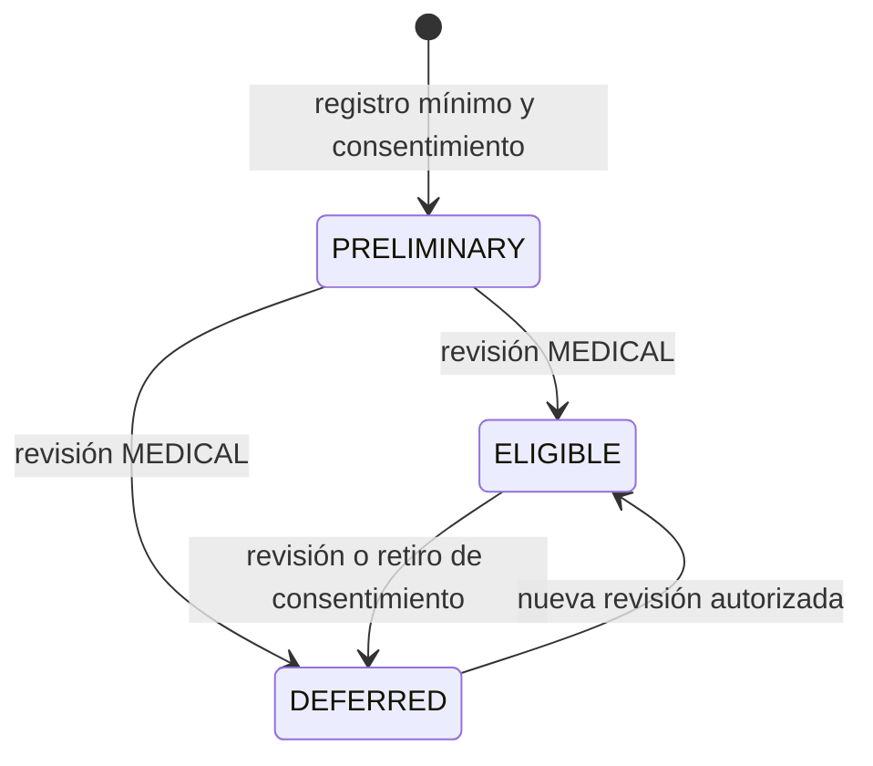

La baja es un indicador separado y conserva historia. Retirar consentimiento no elimina donaciones anteriores ni revoca hechos físicos. Cita y consentimiento nuevo no significan elegibilidad.

## Muestra

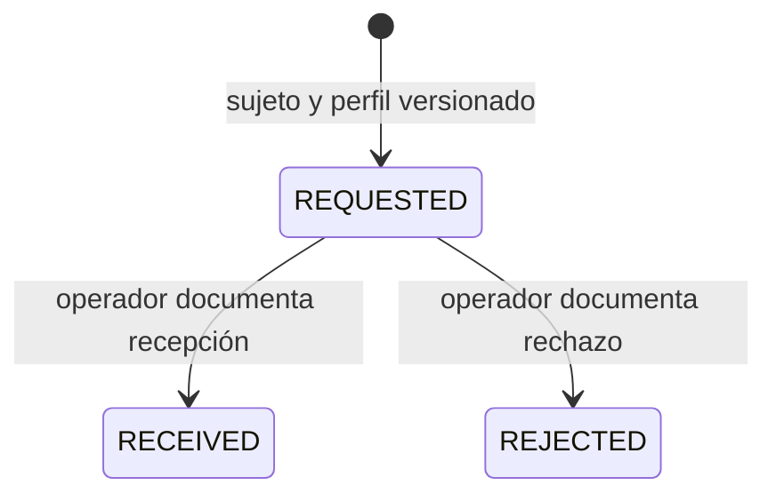

Identificador único, sujeto exclusivo (unidad/receptor/donación), fecha de colecta y perfil de la institución. Rechazo requiere motivo; no se capturan resultados sobre muestra no recibida.

## Resultado

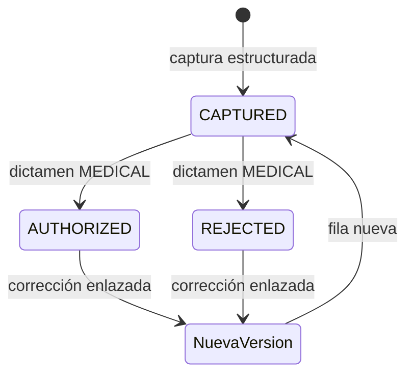

`NuevaVersion` representa una fila nueva; no es un valor de estado almacenado. Corrección exige `supersedes` del último resultado y versión creciente. La última versión no autorizada invalida completitud del perfil; la autorización anterior permanece visible. Un resultado autorizado es dato registrado, no autorización de reserva.

## Donación

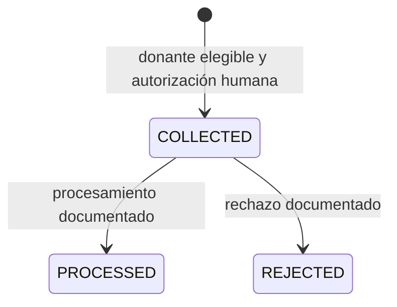

Colecta por MEDICAL; procesamiento/rechazo por personal permitido. Registrar bolsa, muestra y referencias no interpreta pruebas. El fraccionamiento posterior exige procedencia válida.

## Componente o recurso

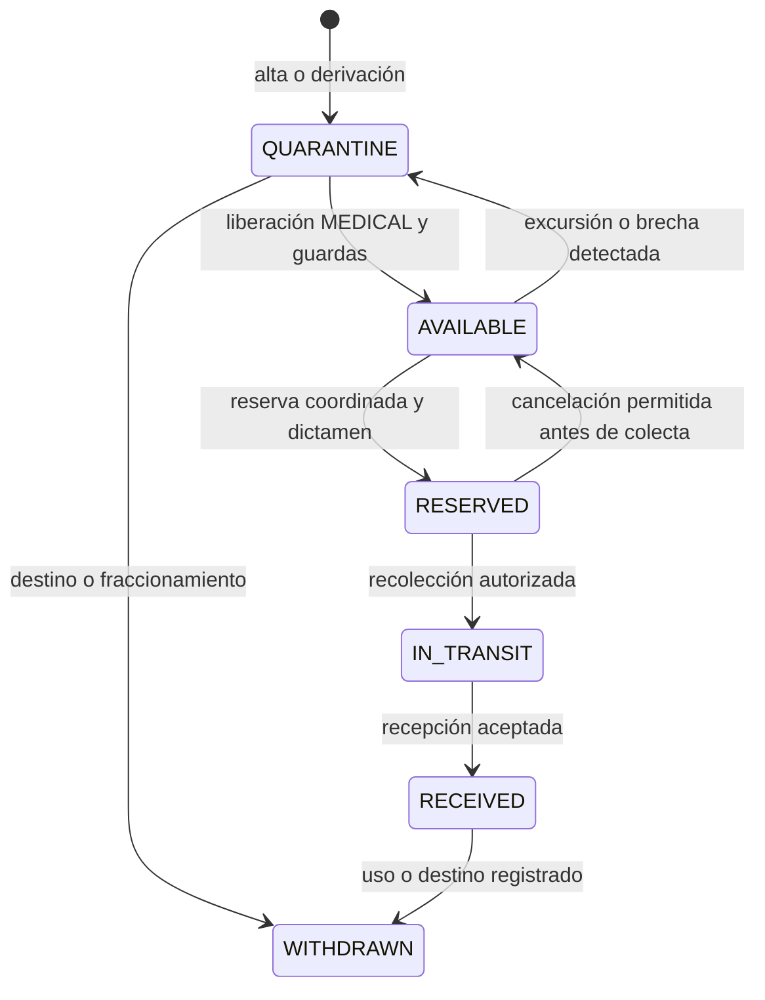

Fraccionar retira el padre y crea hijos en cuarentena, enlazados a la misma donación. Un bloqueo durante tránsito se conserva en `resource_controls`; no reescribe un hecho físico como si la unidad estuviera en almacén. Guardas de calidad consultan resultados actuales y vigencia térmica antes de liberar/reservar/aceptar/usar. Fuera del modo académico, perfil faltante bloquea.

## Solicitud

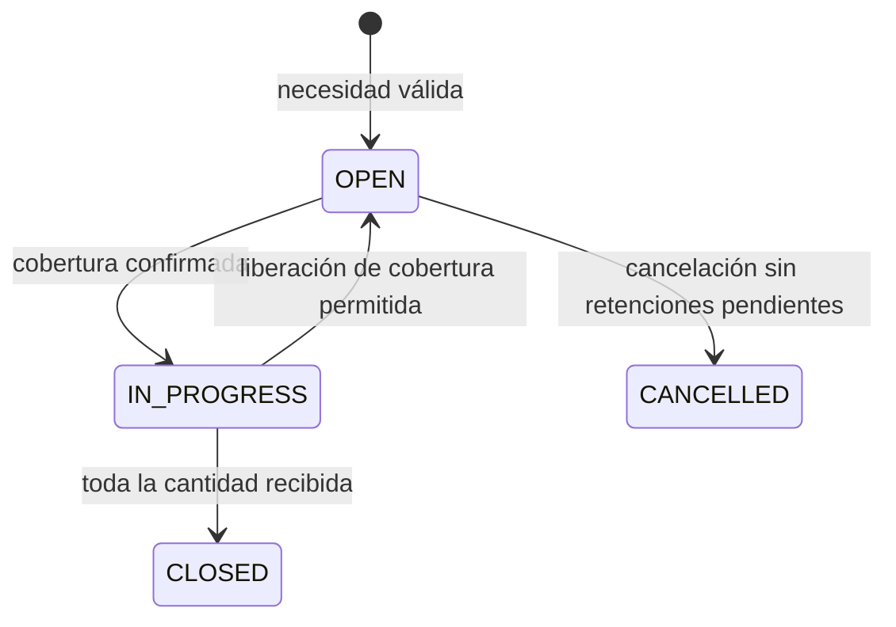

La aprobación de una propuesta pertenece al dictamen de compatibilidad y a la reserva humana. `CLOSED` confirma cobertura logística; no afirma transfusión/trasplante. Órganos exigen constancia externa vigente según política operativa, nunca asignación oficial automática.

## Retención y reserva

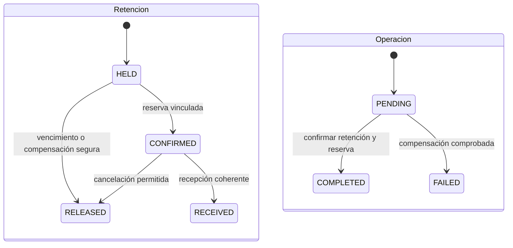

El timeout HTTP no demuestra fracaso: consultar la operación/idempotencia, recuperar con el worker y liberar solo cuando se determina el resultado. Índice único y bloqueo de recurso evitan doble reserva; bloqueo de solicitud evita exceder cantidad. El vencimiento conserva las filas e historia.

## Traslado

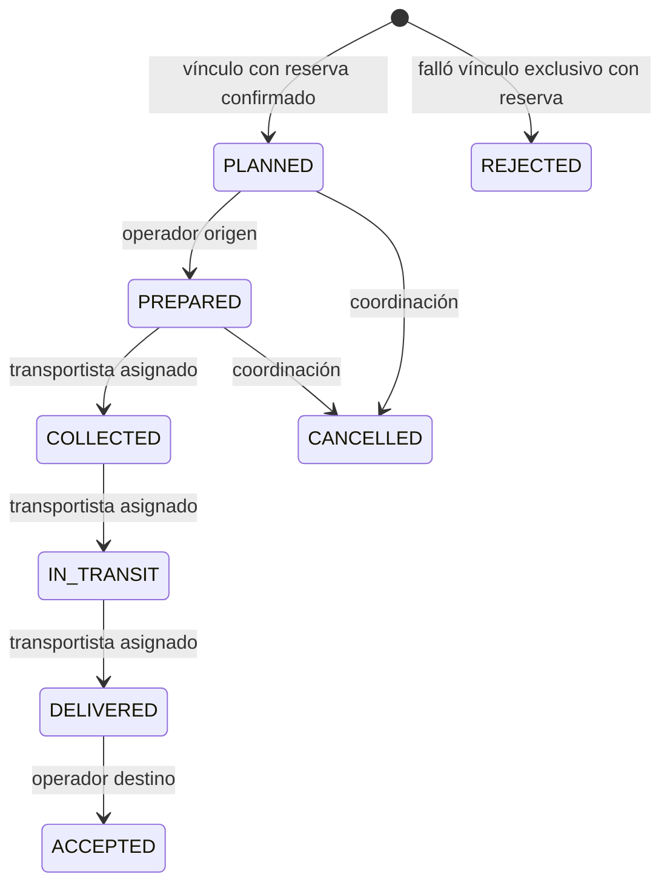

`INCIDENT` es un evento que conserva el estado actual. No existe compensación que deshaga una recolección real. `inventory_pending` bloquea avance hasta recuperar el vínculo. Cada paso produce evento a Inventario/Custodia/Auditoría/Alertas y proyección Mongo. El rastreo únicamente observa, nunca ejecuta estos pasos.

## Recepción

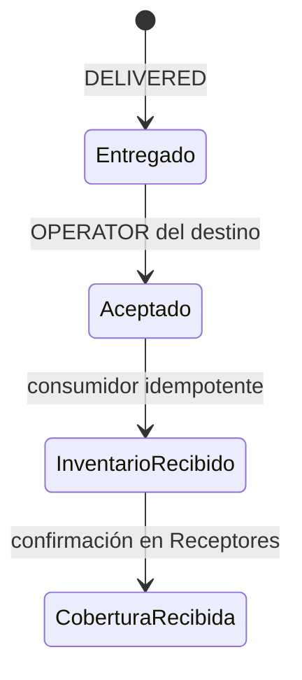

Los nombres describen etapas del protocolo, no una tabla nueva. La autorización de aceptación exige vencimiento y calidad válidos. Si un consumidor cae, outbox y secuencia reintentan; no se ejecuta doble movimiento. El cierre de solicitud espera confirmación coherente. Escaneo debe coincidir con recurso reservado; sello, fechas y contraparte quedan en el evento.

## Uso o destino

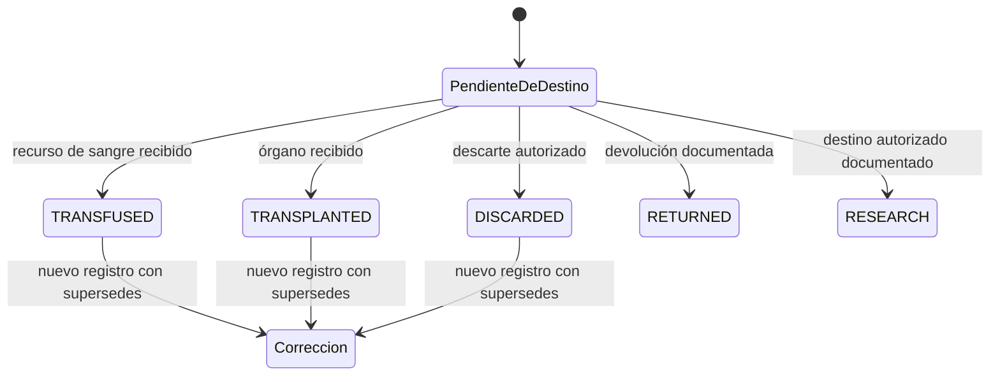

Pendiente y corrección son conceptos de vista; los cinco destinos son registros inmutables. MEDICAL aporta fecha real, referencia y motivo. La unidad queda WITHDRAWN; no se reutiliza por corregir destino. Sangre y órganos tienen validación separada. No se emite una orden clínica.

## Documento y exportación

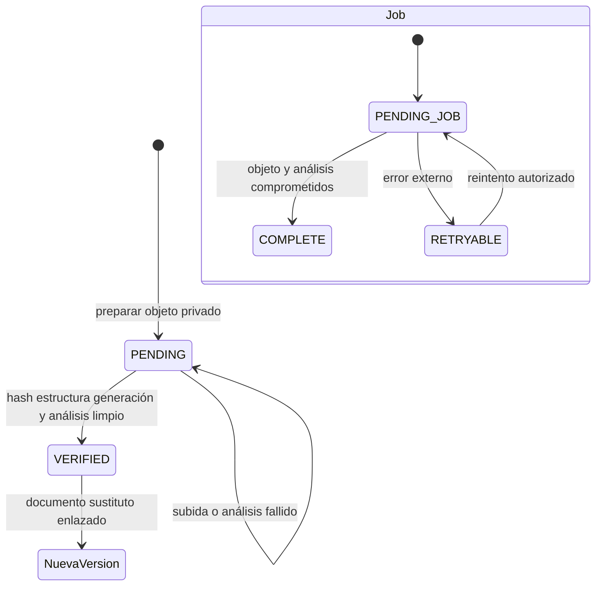

`PENDING_JOB` representa `export_jobs.status=PENDING`. Análisis se registra aparte como CLEAN/INFECTED/ERROR. Descargar exige CLEAN de la generación y hash actuales, además de autorización vigente del sujeto/job. Una URL no certifica contenido. La ruta determinista del job permite recuperar una subida cuya respuesta se perdió.

## Alerta

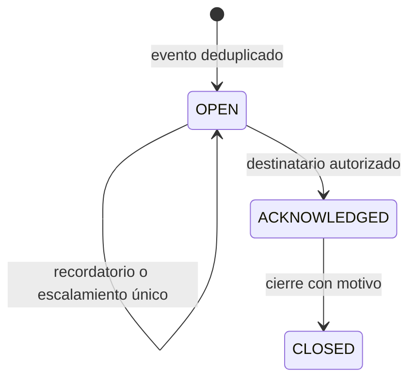

El evento de origen permanece. Un acuse no reabre CLOSED. La política define severidad e intervalos; la entrega externa tiene estado independiente y backoff. Revocar suscripción o perder rol impide nuevas entregas. El destino del escalamiento sigue dentro de la institución configurada.

## Obligaciones por transición

| Familia | Actor / datos y versión | Condición y evento | Compensación / rechazo |
| --- | --- | --- | --- |
| Donante/consentimiento | Donante propio o MEDICAL; versión del donante, referencia/política/fecha/motivo | Activo, institución y consentimiento vigente; DONOR_REVIEWED/CONSENT_* | Rechazo no cambia fila. Retiro añade versión e impide nueva colecta. |
| Muestra/resultado | OPERATOR captura/recibe; MEDICAL autoriza; perfil, sujeto, prueba/método/unidad/fecha/documento y versión | Muestra recibida, última corrección y fechas válidas; LAB_* | Nueva fila corrige; nunca reescribir valor anterior. |
| Donación/derivación | MEDICAL colecta, OPERATOR procesa/fracciona; versiones, motivo, folios y vencimiento capturado | Elegibilidad y estado/procedencia; DONATION_*, RESOURCE_* | Hijos y retiro padre en una transacción. Un fallo revierte todo. |
| Liberación/calidad/destino | MEDICAL; versión/confirmación, perfil, referencia/motivo; lectura OPERATOR | Sin bloqueo, laboratorio completo, frío vigente, tipo/estado correcto; RESOURCE_* | Excursión conserva evidencia; revisión humana habilita nueva evaluación, no liberación automática. |
| Solicitud/retención/reserva | MEDICAL; evaluación, dictamen, versiones y clave idempotente | Cantidad sin cubrir, recurso disponible, autorización de órgano vigente; REQUEST_*/RESOURCE_RESERVED | Protocolo existente consulta/compensa; nunca liberar por timeout a ciegas. |
| Traslado/recepción | Coordinación planea; operador de origen/destino y transportista asignado; versión/motivo, escaneo/sello/aceptación cuando se documentan | Secuencia y vínculo exclusivo; SHIPMENT_* | Reintentar misma operación tras respuesta perdida. Incidencia conserva hecho físico; cancelación antes de colecta. |
| Uso/destino | MEDICAL actual; versión, referencia, fecha, motivo y supersedes si corrige | RECEIVED para TRANSFUSED/TRANSPLANTED; sin reserva activa; RESOURCE_DESTINATION_* | Inmutable; corrección nueva, no retorno automático a disponible. |
| Documento/job | Propietario autorizado; sujeto/hash/tamaño/tipo o filtro/orden/formato | Subida privada y análisis generación exacta; DOCUMENT_*/EXPORT_* | Estado pendiente/reintentable; ninguna descarga sin CLEAN. |
| Alerta | Destinatario actual/ADMIN política; motivo de cierre y versión configurada | Inbox deduplicado; ALERT_* y acciones únicas | Retry de adaptador no duplica alerta; acuse cancela pendientes y cierre no reabre. |
| Sincronización/GPS | Responsable/dispositivo vigente; UUID, captura, versión/sequence y cursor servidor | Periodo y asignación; observación o TRACKING_POSITION_PERSISTED | UUID idéntico devuelve recibo, distinto cuerpo 409, versión vieja 412; conservar cola cifrada hasta ACK. |

Los controles de formato y elegibilidad no se trasladan a clientes como una segunda autoridad. El listado exhaustivo de campos/enumeraciones por comando está en OpenAPI/XSD; los diagramas resumen el ciclo, no sustituyen esos contratos.
