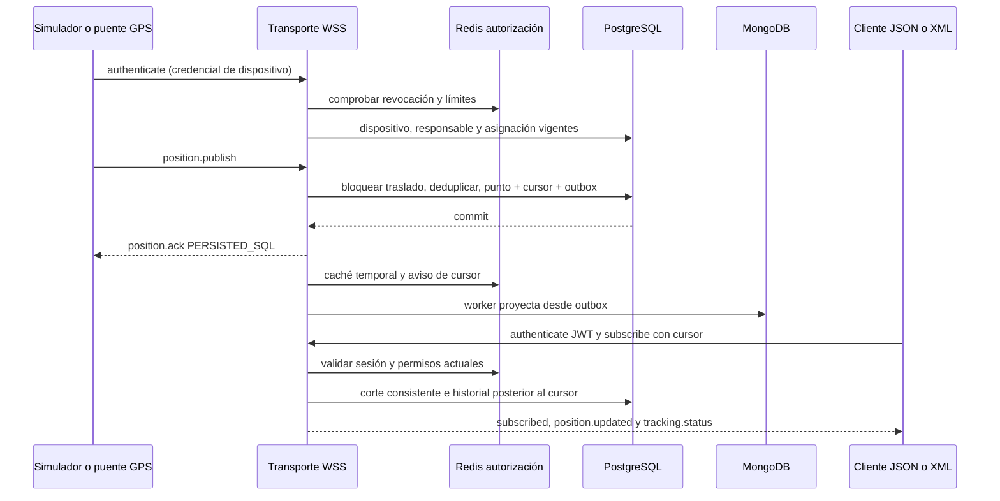

# Rastreo GPS: receptor, WSS y recuperación

Estado: software backend ejecutable con simulador y pruebas WSS reales. GPS físico pendiente. Los mapas de web/Android/escritorio pertenecen a las etapas consumidoras; esta etapa no presenta un mapa implementado ni una captura de pantalla como evidencia de hardware.

## Propiedad y recorrido



Transporte es la autoridad del punto. PostgreSQL conserva el historial y asignación porque el ACK necesita compromiso atómico con evento/cursor. MongoDB recibe la proyección documental por outbox; su indisponibilidad no pierde puntos confirmados. Redis contiene última posición durante 300 segundos y avisos efímeros; borrar/expirar esa caché no borra historial.

La misma fila de traslado serializa publicación y corte de suscripción. El cursor por traslado representa orden de compromiso SQL, no secuencia del GPS. La última ubicación se elige por fecha de captura y cursor como desempate; un paquete tardío se conserva sin hacer retroceder el marcador. UUID de evento y `(assignment_id, sequence)` son únicos; cuerpo diferente con misma identidad produce `event_conflict`.

## Contrato HTTP y de eventos

HTTP conserva OpenAPI. Los contratos WebSocket son independientes y están en [contracts/websocket](../../../apps/services/ms_transporte/contracts/websocket/): cuatro JSON Schema, cuatro XSD y trece ejemplos de mensajes en ambos formatos. En ejecución se publican `/schemas/tracking/message.xsd` y `/schemas/tracking/event.xsd`.

| Canal | Ruta interna / subprotocolo | Uso |
| --- | --- | --- |
| JSON | `/ws/v1/tracking/json`, `redhouse.tracking.v1.json` | Android, puente y consumidor web autorizado |
| XML | `/ws/v1/tracking/xml`, `redhouse.tracking.v1.xml` | Escritorio PySide6; XSD y DTO obligatorios |

El gateway público conserva el prefijo `/transporte/`; la URL configurada del puente termina en `/transporte/ws/v1/tracking`, y la CLI añade `/json` o `/xml`. Un despliegue directo usa `/ws/v1/tracking`. No pasar credenciales en query string: el servidor rechaza cualquier query del handshake.

| Dirección | Mensaje | Campos / efecto |
| --- | --- | --- |
| Cliente → servidor | `authenticate` | Primero, en 5 s. `credential_kind=user` con JWT o `device` con secreto revocable. No se entrega dato protegido antes de validar. |
| Cliente → servidor | `subscribe` | `shipment_id`, `cursor` opcional. Solo usuarios; el donante y el dispositivo no leen mapa. |
| Cliente → servidor | `unsubscribe` | Cancela un traslado, conserva otras suscripciones. |
| Fuente → servidor | `position.publish` | Posición normalizada v1. Revalida credencial, dispositivo, responsable, periodo, estado y fuente. |
| Servidor → fuente | `position.ack` | Mismo `event_id`, cursor y `state=PERSISTED_SQL`. Solo después de commit; no significa proyectado a MongoDB o mostrado en mapa. |
| Servidor → cliente | `subscribed` | Última posición autorizada, cursor y estado de la instantánea. Con replay, procesar eventos individualmente antes de guardar el cursor como consumido. |
| Servidor → cliente | `position.updated` | Posición completa, cursor, captura y recepción. Deduplicar por cursor/evento. |
| Servidor → cliente | `tracking.status` | LIVE, NO_DATA, NO_FIX, STALE o FINALIZED según estado y antigüedad. La desconexión la detecta además el cliente. |
| Servidor → cliente | `resync.required` | Cursor fuera de ventana; nueva instantánea autorizada, sin inventar puntos perdidos. |
| Ambos | `heartbeat` | Mantiene actividad de aplicación; además ping/pong de protocolo. |
| Servidor → cliente | `error` | Código/mensaje seguro; rechazos de ámbito, revocación, dependencia o contrato cierran la conexión cuando corresponde. |

Posición: `schema_version=1`, UUID `event_id/shipment_id/device_id`, `source=SIMULATOR|GPS_BRIDGE|ANDROID`, `sequence` entero seguro, `captured_at` con zona, `fix_valid`, latitud/longitud WGS84. `received_at` y cursor los genera el servidor. Rangos: latitud −90..90, longitud −180..180; `0,0` es válido. Coordenadas ausentes requieren ausencia de fijación; no se inventa precisión. Opcionales: `accuracy_m`, `speed_m_s`, `heading_deg`, `altitude_m`, `battery_percent`. El orden del contrato es latitud/longitud; cualquier futuro GeoJSON deberá convertirlo explícitamente a longitud/latitud.

Ejemplo ficticio de posición:

```json
{"type":"position.publish","position":{"schema_version":1,"event_id":"00000000-0000-4000-8000-000000000001","shipment_id":"00000000-0000-4000-8000-000000000002","device_id":"00000000-0000-4000-8000-000000000003","source":"SIMULATOR","sequence":1,"captured_at":"2026-10-28T12:00:00+00:00","fix_valid":true,"latitude":25.6866,"longitude":-100.3161,"accuracy_m":8.0}}
```

El ejemplo XML equivalente está generado en `client-position-publish.xml`, con raíz `request` y elementos tipados por XSD; no se envía JSON dentro de XML. Validar estructura y DTO, rechazar DTD/entidades externas, duplicados, valores no finitos y campos desconocidos. Estos UUID son ejemplos y deben sustituirse por asignaciones reales de prueba.

## Autorización, vigencia y límites

Identidad registra dispositivos para un usuario TRANSPORT activo y su institución; credencial máxima 30 días, hash en SQL y Redis, rotación/revocación explícita. Coordinación asigna dispositivo/responsable/traslado con inicio/fin máximo siete días, dentro de la vigencia del dispositivo. No confiar en institución/región declarada por GPS. La fuente registrada debe coincidir; no alternar silenciosamente Android/GPS/simulador.

Cada iteración y cada publicación/entrega protegida comprueba permiso actual. Redis inaccesible suspende el canal; no se omite autenticación para mantener movimiento. La consulta SQL verifica usuario/institución activos y rol TRANSPORT del dispositivo. Logout/expiración JWT cierra su conexión de usuario; revocar dispositivo o asignación cierra publicación y seguimiento activo correspondiente. El historial requiere la autorización actual del traslado. Un logout del teléfono no apaga físicamente un GPS externo: revocar su asignación o credencial para finalizar su autorización.

Estados de captura admitidos: PREPARED, COLLECTED, IN_TRANSIT, INCIDENT y DELIVERED, siempre con asignación vigente. ACCEPTED/CANCELLED/REJECTED no admiten publicación ni suscripción en vivo. Coordenadas no prueban recolección/entrega; esos hechos siguen siendo transiciones REST autenticadas. `tracking_snapshot` conserva consulta histórica autorizada después del cierre.

| Límite | Valor predeterminado / propósito |
| --- | --- |
| Conexiones | 64 globales; 4 por identidad, lease Redis 45 s renovado y purga de entradas antiguas |
| Suscripciones | 8 por socket |
| Frecuencia | 1200 mensajes/minuto por identidad |
| Tamaño | 16 KiB por mensaje; binarios rechazados |
| Entrada | Máximo 32 frames pendientes; exceso cierra con 1008 |
| Autenticación / inactividad | 5 s / 60 s; ping cada 15 s |
| Escritura lenta | Timeout socket 5 s; cierre y recuperación por cursor |
| Replay | Lotes de 100; ventana de 10000 puntos; cursor inválido requiere resincronización |
| Captura | Hasta siete días atrás y diez segundos de adelanto por desfase tolerado, además del periodo asignado |
| Antigüedad | STALE después de 30 s; parámetro operativo, no criterio de conservación clínica |

Configuración privada: `TRACKING_ALLOWED_ORIGINS`, `TRACKING_MAX_CONNECTIONS`, `TRACKING_CONNECTIONS_PER_ACTOR`, `TRACKING_MESSAGES_PER_MINUTE`, `TRACKING_REPLAY_WINDOW`, `TRACKING_STALE_SECONDS`. Origin ausente admite clientes nativos; Origin presente debe estar en lista. Origin no reemplaza credenciales. TLS directo opcional mediante `TRACKING_TLS_CERT/KEY`. Con nginx, `TRACKING_TRUST_PROXY=true` solo en red privada que impida acceso directo a Transporte; confiar exclusivamente en el proxy que establece `X-Forwarded-Proto`. `TRACKING_ALLOW_INSECURE_LOCAL` queda desactivado fuera de pruebas.

## Puente y simulador

[gps_bridge.py](../../../apps/services/scripts/gps_bridge.py) es un cliente WSS ejecutable, sin credenciales de bases. Acepta JSON normalizado por líneas o NMEA RMC con checksum; convierte grados/minutos a WGS84, nudos a m/s y fecha/hora a UTC. RMC con fijación inválida produce `fix_valid=false`. No se afirma lectura serial/TCP de un equipo todavía desconocido: el lector de transporte futuro debe entregar las líneas al mismo normalizador.

Crear en una ruta privada un JSON con `url`, `credential`, `shipment_id`, `device_id` y opcionalmente `ca_file` para una CA de pruebas. `credential` es la respuesta de emisión de Identidad, nunca JWT administrador. Dar permiso 0600 al archivo y mantenerlo fuera de Git. Preparar el traslado, registrar dispositivo con fuente SIMULATOR, emitir credencial y asignarlo mediante las API; los ejemplos REST están en sus contratos.

```sh
apps/services/.venv/bin/python apps/services/scripts/gps_bridge.py --config /ruta/privada/gps.json --spool /ruta/privada/gps-pending.sqlite --simulate metro --interval 2 --count 60 --seed 42 --format json
apps/services/.venv/bin/python apps/services/scripts/gps_bridge.py --config /ruta/privada/gps.json --spool /ruta/privada/gps-pending.sqlite --simulate regional --scenario offline --count 20 --format xml
apps/services/.venv/bin/python apps/services/scripts/gps_bridge.py --config /ruta/privada/gps.json --spool /ruta/privada/gps-pending.sqlite --simulate regional --scenario reconnect --count 20 --format xml
```

`metro` cubre puntos sintéticos de Monterrey y su área metropolitana; `regional` se extiende hacia Linares. Son trayectorias interpoladas de prueba, no navegación carretera. Escenarios: normal, no-fix, delay, duplicate, disorder, reconnect, offline. Intervalo mínimo 0.1 s; 1–1000 puntos; secuencia explícita opcional, por defecto microsegundos Unix. Ctrl-C detiene captura y conserva pendientes. La siguiente ejecución intenta vaciar primero la cola; ante autorización rechazada la conserva y exige revisión, sin rebautizar fuente ni traslado.

Para datos externos, registrar fuente GPS_BRIDGE y usar `--input archivo --adapter nmea-rmc` o `--adapter json`. Sin `--input`, lee stdin. El archivo normalizado aporta captura/fijación/coordenadas/opcionales; el puente aporta IDs y fuente desde configuración confiada. `--input` no verifica transporte físico, energía ni precisión real.

La cola SQLite cifra cada cuerpo con Fernet y archivo de clave local 0600. Máximo 1000 registros, ACK solo borra el elemento confirmado. Reintentos de transporte con espera exponencial y variación, máximo seis intentos antes de conservar backlog y terminar con error. Proteger también disco, directorio y credencial; el cifrado con clave local no sustituye control del sistema operativo ni una política de retención aprobada.

## Réplicas, degradación y observabilidad

`run.py transporte` usa gevent y `simple-websocket`. No requiere afinidad: una conexión existente pertenece a un proceso y, al caer, el cliente reconecta a otra réplica con cursor. Entre procesos, cada suscripción consulta SQL cada 0.5 s y entrega frames WSS; los clientes no hacen polling. Pub/Sub Redis es solo aviso efímero y no se considera cola durable. Esta consulta periódica tiene coste medible; una mayor carga puede justificar un distribuidor especializado futuro.

nginx configura Upgrade/Connection, sin buffering, lectura 75 s y escritura 10 s. En actualización drenar conexiones o dejar que reconecten; no prometer migración de un socket entre procesos. Monitoreo no es requisito de publicación. `/shipments/{id}/tracking/metrics` devuelve puntos persistidos, frecuencia reciente, último recibido, p95 captura-recepción, rezago Mongo y conexiones globales. Logs guardan apertura/cierre/rechazo con ID efímero y código; no tokens ni geometría completa.

Caída de PostgreSQL: no se confirma nuevo punto. Caída de Redis: no se autoriza flujo. Caída de MongoDB: SQL conserva ACK y outbox hasta recuperar proyección. Si Redis cae después del commit, puede perderse la respuesta; reenviar el mismo evento recupera el mismo recibo, sin duplicar. Una réplica caída conserva servicio por la otra; ambas caídas hacen inaccesibles ambos listeners. El negocio y consulta histórica del núcleo disponible siguen siendo independientes del listener WSS, con sus propias dependencias operativas.

Métricas locales de pruebas no son SLA ni latencia hasta mapa: no hay cliente gráfico en esta etapa. La prueba concurrente usa dos emisores, dos suscriptores JSON/XML que retrasan lectura y 24 puntos, sin perder cursores. Se registra media/p95 de publicación→ACK. El ensayo acotado no certifica estrés sostenido ni saturación de red.

## Matriz TRACK y pendientes

| ID | Aceptación de esta etapa | Evidencia / pendiente |
| --- | --- | --- |
| TRACK-01 | Receptor normalizado, identidad revocable, asignación y puente JSON/RMC ejecutable | `tracking.py`, `devices.py`, `gps_bridge.py`; modelo, protocolo físico, conectividad, frecuencia, alimentación y montaje pendientes. |
| TRACK-02 | Posición y eventos v1 JSON/XML/XSD; unidades y fechas explícitas | Trece pares de ejemplos y prueba de validación bilateral. |
| TRACK-03 | WSS TLS, auth previa/continua, ámbito, Origin y límites | Pruebas de donante, emisor, revocación, origen y cupos de conexiones. Integración de sesión del navegador en etapa web. |
| TRACK-04 | Historial durable, deduplicación, cursor, replay y cola cifrada | Pruebas duplicados/desorden, CLI offline/reconexión y caída/recuperación de dependencias. |
| TRACK-05 | Contrato de geometría preparado | **Pendiente etapas de cliente**: proveedor, cobertura estatal, licencia, versión/fecha y atribución; no se eligió ni probó cartografía aquí. |
| TRACK-06 | Estados/fechas/fuente disponibles para visualización | **Pendiente etapas de cliente**: mapa, marcador y alternativa accesible; nunca presentar interpolación como observación real. |
| TRACK-07 | Periodo, asignación, revocación y minimización de backend | Permisos de Android, parada visible y purga local pertenecen a etapa 04; retención institucional pendiente de aprobación. |
| TRACK-08 | Simulador y puente por WSS real, sin escritura directa a bases | GPS físico pendiente; falta validar decodificación real, precisión reportada, energía, señal y revocación del equipo adquirido. |
| TRACK-09 | Gateway, dos procesos, recuperación y métricas servidor | Caída de una y ambas réplicas y de tres almacenes. Caída de proveedor cartográfico y latencia hasta mapa pendientes del cliente. |
| TRACK-10 | Pruebas de protocolo, persistencia, seguridad y concurrencia acotada | Aceptación integral con los tres mapas y estrés sostenido requiere etapas 03/04/05/07; no cerrar esas pruebas con un simulador backend. |

Fuentes técnicas consultadas durante implementación, 27–28 de octubre de 2026: [OWASP WebSocket Security](https://cheatsheetseries.owasp.org/cheatsheets/WebSocket_Security_Cheat_Sheet.html), [simple-websocket](https://simple-websocket.readthedocs.io/en/latest/intro.html), [nginx WebSocket proxy](https://nginx.org/en/docs/http/websocket.html), [gevent servers](https://www.gevent.org/servers.html). Los límites concretos de esta aplicación son decisiones operativas comprobables en código, no requisitos normativos extraídos de esas fuentes.
