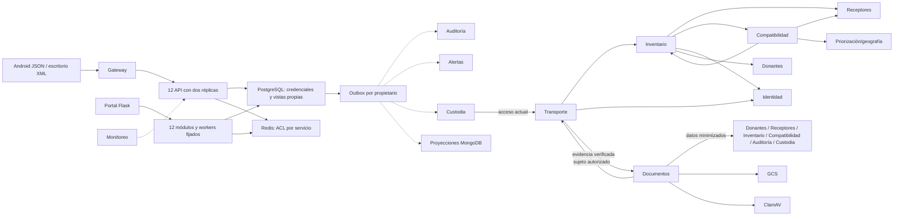

# Revisión de límites: versión correctiva 0.4.1, esquema 13

Fecha: 29/10/2026. Fuentes: AGENTS, PROJECT_STATUS, prompts 00/01/09 y corrección 01; expediente histórico F1–F11; retroalimentación original del profesor; código ejecutable y contratos. Esta revisión propia no sustituye una comprobación independiente. Los resultados reproducibles y su manifiesto se conservan en `documentation/evidencias/entrega-final/backend/correccion_comprobacion/20261029T125058Z/`.

## Diagnóstico y secuencia de trabajo

El punto de partida era el commit 8909baf8458dff797d40d15541c57c66c14ef964 con cambios locales extensos, once servicios, código 0.4.0 y esquema 11. El manifiesto inicial registra también archivos sin seguimiento. Se respaldaron esos cambios en un archivo privado temporal antes de editar. El código existente ya implementaba gran parte del catálogo docente; el expediente demostraba variantes ausentes, no ausencia total de producto.

Plan aplicado: (1) comprobar invariantes y consumidores; (2) corregir destinos, laboratorio y custodia; (3) unificar rastreo y recuperación; (4) cerrar permisos, consultas y auditoría; (5) comparar fronteras y extraer el propietario documental; (6) actualizar contratos, interfaz y despliegue; (7) pruebas aisladas, migración/restauración y navegador; (8) evaluar acceso productivo y documentar bloqueos. La ejecución productiva necesita autorización de despliegue y una VM disponible. No se interpreta una prueba local como prueba de la versión desplegada.

## Mapa de propiedad y consumidores

Doce servicios independientes, doce módulos de dominio reutilizables por el backend web y dos réplicas API por servicio en Compose. Una réplica adicional no representa otra responsabilidad. Cada imagen ejecuta su API y worker supervisados; ambos pertenecen al mismo propietario. El portal es un producto separado y puede ejecutar los doce módulos sin listeners API. El gateway es infraestructura, no un servicio de negocio. Hay 24 réplicas API, más web, gateway y tres almacenes (29 contenedores permanentes); bootstrap es un trabajo de instalación.

| Propietario / puerto | Responsabilidades docentes | Autoridad y módulos | Consumidores |
| --- | --- | --- | --- |
| Identidad / 5101 | BE-01, BE-02 | Cuentas, instituciones, permisos, sesiones, dispositivos, factores y acreditaciones; `routes`, `catalogue`, `strong_auth`, `devices`, `accreditations` | Todos validan JWT/Redis; clientes autorizados administran identidad |
| Donantes / 5102 | BE-03, BE-13 (colecta), BE-22 | Donante, consentimiento, donación, campañas y cupos; `agenda` | Web, Android donante, escritorio autorizado, Inventario |
| Receptores / 5103 | BE-04, BE-16 (necesidad/cupo) | Receptor, solicitud, retención, autorización externa | Web/escritorio, Compatibilidad, Inventario, Reportes |
| Inventario / 5104 | BE-05, BE-13 (fraccionamiento), BE-15, BE-16 (reserva), BE-17, BE-18, BE-21 (stock), BE-24 (mapeos) | Recurso, reserva/operación, controles, frío, linaje, destinos, identificadores externos; `quality`, `analytics`, `interoperability` | Web/escritorio y consultas móviles autorizadas; Compatibilidad, Transporte, Documentos |
| Compatibilidad / 5105 | BE-06, BE-14 | Evaluaciones/revisiones, perfiles, muestras, resultados y acciones de laboratorio; `laboratory` | Web/escritorio médico; Inventario; Documentos |
| Priorización/geografía / 5106 | BE-07 | Rutas versionadas, rankings, propuestas y ejecución algorítmica | Compatibilidad, Inventario, clientes autorizados |
| Transporte / 5107 | BE-08, BE-23, BE-21 (tiempos), TRACK-01–04/07–10 backend | Orden/transiciones, asignaciones, puntos, cursor, comandos; `tracking`, `tracking_socket`, `synchronization`, `analytics` | Web, Android transportista, escritorio; Custodia; Documentos |
| Custodia / 5108 | BE-09 | Cadena/eventos secuenciados y proyección Mongo | Transporte por outbox; clientes autorizados y Reportes |
| Alertas / 5109 | BE-10 | Inbox, políticas, suscripciones, entregas y acuses | Outbox de propietarios, clientes autorizados, adaptadores SMTP/push |
| Auditoría / 5110 | BE-11 | Registro central inmutable, consultas y hallazgos | Outbox de propietarios, auditor regional, Reportes |
| Monitoreo / 5111 | BE-12 | Sondeos, latidos/colas, tiempos/historial/percentiles | Observa servicios; clientes autorizados |
| **Documentos / 5112** | **BE-19, BE-20** | `stored_file`, `document_metadata`, `file_scans`, `export_jobs`; `files`, `documents`, `reports` | Web/Android JSON/escritorio XML; alias v1 de Transporte; propietarios de sujetos |

PostgreSQL contiene una sola copia de cada tabla. Las credenciales `rh_<propietario>` ven únicamente `access_<propietario>`; las colas técnicas están filtradas por servicio. Compartir servidor no concede lectura de tablas vecinas. Mongo almacena proyecciones de Transporte/Custodia/Auditoría/Monitoreo. Redis conserva seguridad y datos temporales. GCS conserva objetos; solo Documentos tiene SDK y permisos de objetos en las API. El backend web modular usa la misma lógica y credenciales por módulo, nunca las sesiones internas como credencial de otros clientes.

## Comparación de agrupaciones y decisiones

Las cargas y costes monetarios de producción no se han medido. La siguiente decisión usa invariantes comprobables y fallos de código, no promesas de capacidad.

| Agrupación | Conservar / reorganizar | Extraer | Decisión, beneficio y coste |
| --- | --- | --- | --- |
| Identidad / Instituciones | Alta institucional y primer administrador comparten transacción, ámbito y revocación; acreditaciones ya tienen módulo propio | Introduciría coordinación para desactivar institución, impedir login y provisionar administrador; requeriría caché invalidable o consulta síncrona adicional en cada login | Mantener módulos. `routes.institution_administrator`, `permissions` y autenticación consultan institución activa. Menor ventana de cuenta sin ámbito; coste: mantenimiento institucional puede afectar identidad. Documentos de acreditación se extraen, no sus permisos. |
| Laboratorio / Compatibilidad | Resultados y evaluaciones conservan versiones/fingerprint; autorización es médica y lectura institucional; `laboratory` separa DTO y reglas | Ventaja potencial de equipos/ingesta masiva independientes; hoy exigiría coordinación de revisión y completitud, trasladando el bloqueo a un contrato de validación/lease | Mantener módulos. F2 serializa autorización/corrección con reserva mediante bloqueo por recurso y compara fingerprint. No hay medición que justifique escala independiente. Coste: comparten despliegue y caída. HLA clínico no se inventa. |
| Priorización / Geografía | Ruta versionada es entrada del ranking y propuesta; mismos lectores/coordinadores, sin proveedor GIS externo | Útil si se añade un proveedor GIS/coste o cargas distintas; hoy añade salto de red y estado incierto sin eliminar un acoplamiento de negocio | Mantener módulos y contratos distintos. La invalidación de versión ya es verificable; documentar que tiempos son estimaciones capturadas. Coste: proveedor GIS futuro puede justificar revisión de esta decisión. |
| Transporte / Rastreo / Sync | Estado del traslado y asignación gobiernan cada posición, cursor y comando. Lock de orden serializa transición y publicación; sync reutiliza la única transición | Un servicio separado permitiría escalar ingestión, pero tendría que consultar permiso antes de cada frame o mantener una concesión revocable; una proyección tardía permitiría capturar después de terminar | Mantener un propietario y módulos; replicar procesos WSS. F4/F6/F10 prueban permisos, historial y continuidad. Coste: picos GPS comparten API y PostgreSQL; límites/conexiones acotan consumo, no certifican capacidad sostenida. |
| Transporte / Documentos / Reportes | El worker antiguo ejecutaba recuperación de traslados y luego render/SDK/escáner, antes de despachar su outbox. Salud GCS degradaba Transporte | Separa permisos de objetos, carga CPU/memoria PDF/XLSX, fallos GCS/ClamAV y trabajo asíncrono; no necesita autoridad sobre órdenes | **Extraer Documentos+Reportes.** `worker.step` ahora ejecuta exportaciones únicamente en Documentos. Coste: llamada autorizada para sujeto/evidencia y otra imagen/worker/credencial. Reportes y archivos permanecen juntos: generación, archivo verificado y estado COMPLETE se confirman en una transacción, con objeto externo recuperable. |
| Inventario / Frío / Caducidad | Lectura fuera de perfil, cuarentena, reserva y destino compiten por la misma unidad y deben confirmar juntos | Separar medición puede ayudar a sensores masivos, pero la decisión de calidad debe volver al dueño del recurso. Proyección asíncrona no basta para liberar/reservar | Mantener guardas y módulos; lectura manual/sensor tiene procedencia explícita. Coste: misma disponibilidad y escalado. Una futura pasarela de sensores sería consumidor, no otra autoridad de calidad. |
| Inventario / Trazabilidad / Analítica | Trazabilidad compone contratos y no duplica entidad; pronóstico consulta destinos definitivos y stock autorizado | Servicio analítico de lectura sería útil con volumen demostrado o calendario independiente; hoy añadiría proyección/retardo y gobernanza de datos clínicos | Mantener consultas separadas. Oráculo de historia sintética y ventana documenta límites; analítica no modifica reserva. Coste: carga de consulta compartida. No confundir ausencia de medición con capacidad infinita. |
| Donantes / Citas / Donación | Consentimiento/eligibilidad y cupo determinan admisión a colecta/cita; locks de donante/campaña y estados se confirman juntos | Servicio agenda genérico separaría disponibilidad, pero introduce coordinación para retiro, cambio de cita y capacidad; no hay otro dominio que consuma agenda independiente | Mantener `agenda` y ciclos de donación. Fraccionamiento reside en Inventario porque crea recursos/hijos bajo lock de unidad. Coste: dos propietarios para colecta y derivados, unido por referencia única; no se vende como transacción global. |

## Grafo y propagación de fallos

`dependencias.json` acompaña esta revisión: aristas estáticas con archivo/línea más las resoluciones dinámicas conocidas. Cada llamada implica contrato, firma de servicio y JWT delegado cuando corresponde.

Hay ciclos dirigidos reales Inventario↔Compatibilidad y Transporte↔Documentos; no se ocultan. Se cortan a nivel de operación: completitud de laboratorio nunca devuelve llamada a Inventario cuando este mantiene su lock; `file_transport_check` solo lee archivo/scan y nunca consulta Transporte. Preparar archivo consulta la orden bajo un lock asesor compartido; la consulta de orden no toma lock exclusivo. Una transición toma ese mismo lock antes de bloquear la fila, y solo después verifica evidencia. Así no se forman esperas circulares en esos recorridos.

Cadena crítica de reserva: cliente → Inventario → Compatibilidad/laboratorio, Receptores (retención) y rutas/identidad según operación. Timeout conserva operación pendiente, no libera por conjetura. Cadena de archivo: cliente → Documentos → propietario del sujeto; GCS/ClamAV son requisitos para verificar/descargar, no para un traslado sin archivo. La autenticación protegida falla cerrada sin Redis. PostgreSQL compartido sigue siendo dependencia común; detener Mongo no debe impedir un commit cuya proyección queda en outbox. Monitoreo no participa del commit. Los eventos fallidos se reintentan con backoff e inbox deduplica; no existe garantía de entrega externa exactamente una vez.

## Fronteras transaccionales

| Operación | Commit e invariante | Concurrencia / posterior recuperable |
| --- | --- | --- |
| Cambio de rol | Usuario + versión + revocaciones SQL + decisión + outbox + idempotencia | Lock por usuario y fila; Redis invalida permisos/sesiones antes de confirmar privilegio. Fallo SQL no permite conservar privilegios antiguos; nueva autenticación puede reparar publicación de permisos. Prueba de token antiguo, tenant y 412. |
| Resultado/autorización laboratorio | Versión nueva o transición CAPTURED→AUTHORIZED/REJECTED + acción/outbox | SQL prohíbe sobrescribir valor/método/muestra/autor. Lock asesor por recurso serializa con reserva; resultado anterior persiste. |
| Reserva | Operación durable propia; retención idempotente remota; bloqueo de recurso y reserva única | No es ACID global. Se registra incertidumbre ante respuesta perdida; recuperación consulta retención antes de completar/compensar. No se libera una unidad ya recogida. |
| Custodia logística | Orden/version/secuencia/transición, inventario_pending y outbox | Estado esperado y responsable actual; campos obligatorios en cada entrega. Inventario actualiza por secuencia idempotente; Custodia consume después con hash/inbox. Un fallo posterior no borra el hecho físico. |
| Posición | Punto inmutable, cursor y outbox en una transacción de Transporte | Evento/dispositivo/secuencia y hash deduplican; row lock de traslado ordena concurrentes. Redis y Mongo son derivados recuperables. Historia paginada fija `through` y WSS continúa desde último cursor. |
| Destino | Nueva versión con supersedes, autor/motivo y cambio de estado/outbox | Lock de recurso y versión. Corrección documental misma fecha/destino conserva hecho histórico; nuevo uso exige recepción, tipo y guardas actuales. |
| Archivo | Reserva de metadatos/idempotencia; GCS fuera de SQL; verificación de generación/hash y scan antes de VERIFIED | PUT de creación condicionada a generación cero. Evidencia nueva y fin de traslado usan lock asesor común. Un timeout de GCS no se presenta como verificación. |
| Exportación | Snapshot minimizado autorizado y job/outbox; luego archivo+scan+metadata+COMPLETE en una transacción | Worker SKIP LOCKED, UUID/ruta determinista y generación cero. Si objeto ya existe, hash debe coincidir. Retry no duplica job/archivo. `region_id` del job permite recuperar trabajos anteriores sin reinterpretar eventos históricos. |

Locks PostgreSQL son por transacción, no garantías del número de microservicios. Referencia técnica: [PostgreSQL, bloqueos explícitos](https://www.postgresql.org/docs/current/explicit-locking.html). Autorización WSS se revalida durante la entrega y se cierra al perder permiso; referencia: [OWASP WebSocket Security](https://cheatsheetseries.owasp.org/cheatsheets/WebSocket_Security_Cheat_Sheet.html).

## Migración, contratos y despliegue

012 protege los valores históricos de laboratorio. 013 crea `access_documentos`, conserva `stored_file` y sus UUID, transfiere el ámbito de las claves idempotentes documentales y revoca los permisos runtime de Transporte. Los eventos/outbox anteriores conservan su fuente Transporte y su worker los drena; no se reescribe historia. `export_jobs.region_id` se completa con el evento original. La migración es transaccional y repetible mediante el catálogo global.

`upgrade_documents.py` provisiona la nueva credencial SQL/Redis y clave de servicio en mantenimiento, conserva las anteriores y publica los mapas de URL/firmas. Reintenta desde un archivo privado preparado si falla. El proceso de migración exige respaldo previo; ningún handler HTTP migra datos. El rollback debe restaurar respaldo y versión anterior conjuntamente: volver solo a un binario con permisos de Transporte revocados no sirve.

`ms_documentos` tiene Dockerfile, worker, salud y contratos JSON/XML/XSD. Puerto nuevo 5112; 5101–5111 permanecen. Gateway y generación GCP incorporan la nueva pareja. La web usa Documentos directamente; `legacy_documents.py` mantiene rutas v1 y reenvía JWT/idempotencia una sola vez. No importa módulos de otro propietario ni accede a archivos por SQL.

Custodia ya no admite un paso de entrega sin controles. El ingreso HTTP histórico de telemetría exige el sobre normalizado de rastreo (contrato publicado); clientes antiguos reciben 422 y deben actualizarse antes del despliegue. Historia previa permanece consultable. No existe fallback que acepte tres coordenadas sin dispositivo, evento o asignación. El plan de despliegue debe actualizar consumidores antes de habilitar la política.

## Límites que no quedan certificados

La independencia de paquetes y configuración no demuestra una imagen Docker construida si no se ejecutó Docker. Las pruebas y sus omisiones se detallan en la matriz de cierre. El estado productivo conocido debe verificarse antes de publicar: una VM detenida no prueba disponibilidad. HLA clínico, GPS físico, proveedores reales de avisos, clientes completos y mapas del cliente conservan sus etapas/dependencias. Esta revisión no certifica reglas clínicas, firma legal, cumplimiento regulatorio ni capacidad sostenida.
