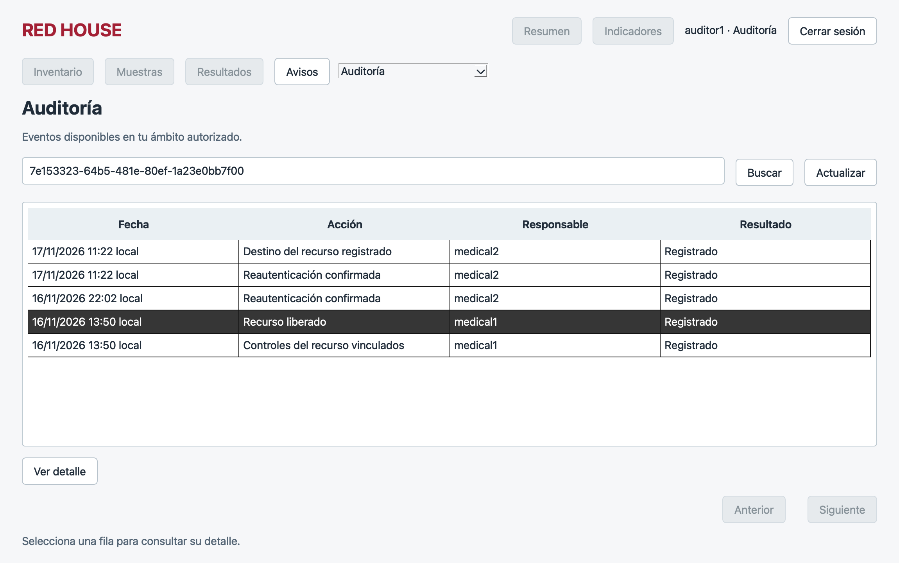
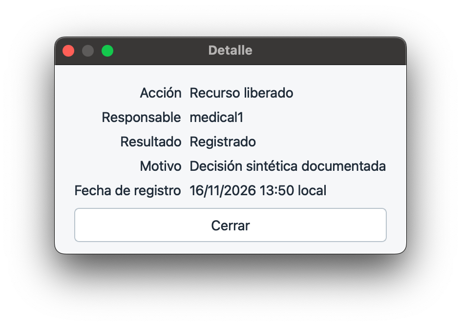

# Consulta GUI de Auditoría para E2E-C — 17/11/2026

Esta evidencia añade una consulta visual de solo lectura sobre un evento de la cadena E2E-C ya aceptada el 16/11. No repite sus operaciones ni recorre de nuevo todos sus eventos. La [aceptación E2E-C de escritorio/Qt y web](../e2ec-qt-20261116/RESULTADOS.md) conserva su propio alcance.

## Evidencia GUI y consulta

La cuenta regional `auditor1` abrió Auditoría en la consola Qt, filtró el recurso sintético liberado y consultó su detalle. La dirección inspeccionó ambas capturas. La tabla mostró el evento «Recurso liberado» y responsable `medical1`; el diálogo mostró acción, responsable, motivo y fecha completos y legibles.

El servicio recibió seis peticiones HTTP, todas con respuesta 200: login, perfil `me`, dos listados de Auditoría, detalle de evento y logout. El evento consultado corresponde al recurso liberado de la cadena E2E-C. Los requests de negocio fueron GET. No hubo nuevas escrituras de negocio.

## Resultado y límites

El runner conservó salida **1** y error principal `ValueError`: su timer no detectó el diálogo Qt y no escribió el identificador en su propio recibo. Dirección capturó e inspeccionó la ventana Qt del proceso mientras seguía abierta; el `GET` de detalle respondió 200 para el evento indicado en [resumen.json](resumen.json). La captura e inspección visual y el recibo HTTP/cierre son evidencias independientes; no se transforma la salida del runner en PASS.

El cierre posterior de la familia creada por la consulta quedó comprobado: fila SQL revocada, clave de sesión ausente en Redis y JTI revocado; `cleanup_errors` vacío. El primer intento (`run01`) se detuvo antes de GUI/autenticación por falta de `psycopg` en el entorno de escritorio. El segundo (`run02`) usó el `site-packages` de servicios y alcanzó tabla, detalle HTTP y cierre.

El alcance cubre una fila y su detalle visual; no evalúa toda la bitácora, el ciclo de todos los roles, accesibilidad, Windows ni cierre de etapas. No se modificaron registros de negocio ni se repitieron las pruebas integrales anteriores.
