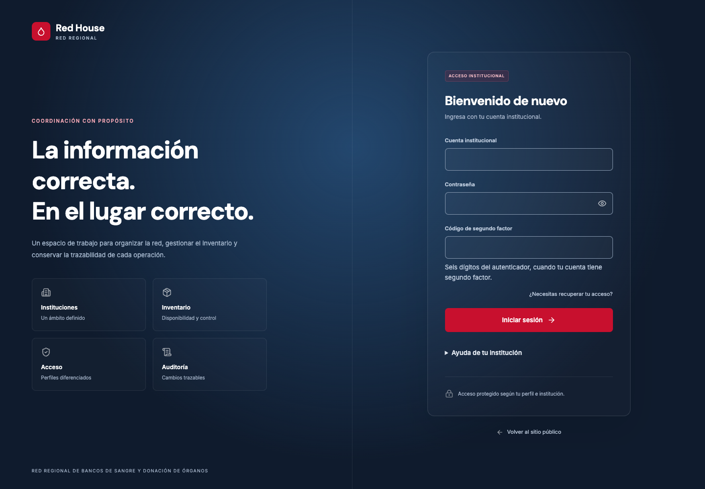

# Manual de usuario

Corte: 20/11/2026. Guía para las personas que usan Red House, la red regional de bancos de sangre y donación de órganos. Se organiza por perfil y, dentro de cada perfil, por las aplicaciones donde ese perfil entra: portal web, app móvil (Android/iOS) o consola de escritorio. Los textos entre comillas son los que aparecen en pantalla.

Las capturas enlazadas son reales y están versionadas en el repositorio; muestran datos ficticios de prueba. La fecha de cada captura se indica cuando la pantalla pudo cambiar después. Las capturas de iPhone se conservaron en un directorio privado y no se enlazan; la app iOS comparte las pantallas de Android.

> **Importante.** Red House organiza información y registra operaciones. No decide si una persona puede donar ni si un recurso es compatible con un paciente: esas decisiones son del personal médico autorizado. El sistema no interpreta la tipificación HLA; solo la registra y documenta.

## 1. Qué aplicación usa cada perfil

| Perfil | Portal web | App móvil | Consola de escritorio |
| --- | --- | --- | --- |
| Donante | No | Sí | No |
| Médico | Sí | No | Sí |
| Operador | Sí | No | Sí |
| Coordinador | Sí | No | Sí |
| Personal de traslado (transportista) | No | Sí | No |
| Auditor | Sí | No | No |
| Administrador | Sí | No | No |

Resumen: el portal web es para administrador, auditor, operador, médico y coordinador; la consola de escritorio, para operador, médico y coordinador; la app móvil, para donante y personal de traslado.

El sitio público y las campañas publicadas se consultan sin iniciar sesión. Si intentas entrar con tu cuenta en una aplicación que no es la de tu perfil, el sistema te lo dice y te indica cuál usar (por ejemplo, «Usa la aplicación móvil»). Cada apartado de las secciones 4 a 10 describe solo las aplicaciones donde el perfil entra. Detalle: [Matriz de acceso por aplicación](Matriz_acceso_por_aplicacion.md).

Cada persona ve únicamente las opciones de su perfil y de su institución. Si un botón aparece desactivado, la acción corresponde a otro perfil o a otro momento del proceso.

## 2. Entrar, salir y recuperar el acceso

**Portal web** (administrador, auditor, operador, médico y coordinador). Abre `https://34.18.186.116` en el navegador. La página pública muestra la plataforma y las campañas publicadas; pulsa «Acceso institucional».

1. Escribe tu «Cuenta institucional» y tu «Contraseña».
2. Pulsa «Iniciar sesión». El portal no pide código de segundo factor: basta la contraseña. Verás el «Panel principal» con las tareas de tu perfil.

Para salir, usa el icono de salida junto a tu nombre, abajo a la izquierda. Si olvidaste la contraseña, pulsa «¿Necesitas recuperar tu acceso?», escribe tu cuenta y revisa el correo verificado: el código llega por correo, vale 15 minutos y sirve una sola vez. Se escribe en el formulario de confirmación junto con la contraseña nueva. Al cambiarla se cierran tus sesiones anteriores. [Pantalla de recuperación](../evidencias/uiux/20261110/capturas/web-recuperacion.png).

**App móvil** (donante y personal de traslado). Abre Red House, escribe «Cuenta» y «Contraseña» y pulsa «Iniciar sesión». Si tu cuenta lo requiere, escribe el «Código de verificación» de seis dígitos ([captura](../evidencias/entrega-final/mobile/seguimiento-20261113/mfa-desafio-sintetico.png)). «Recuperar acceso» envía la solicitud al contacto verificado de tu cuenta. La app no pide la dirección del servidor. Para salir: pestaña «Cuenta» → «Cerrar sesión»; se borran los datos guardados en el teléfono.

**Consola de escritorio** (operador, médico y coordinador). Abre la aplicación «Red House | Consola institucional», escribe «Cuenta» y «Contraseña» y pulsa «Iniciar sesión». Si tu cuenta lo requiere, aparece «Código de verificación». Para salir pulsa «Cerrar sesión» o cierra la ventana. [Acceso](../evidencias/entrega-final/desktop/iteracion-sec/login.png) · [con verificación](../evidencias/entrega-final/desktop/iteracion-sec/login-verificacion.png).

Si entras con una cuenta en una aplicación que no es la de su perfil, el acceso se rechaza con un mensaje que indica cuál usar; no hay que hacer nada más que abrir esa aplicación.

**Acciones críticas.** Liberar una unidad, emitir un dictamen o autorizar una reserva pueden pedir que confirmes tu identidad: en el portal, «Confirma tu contraseña»; en escritorio, la ventana «Confirmar identidad».

## 3. Cómo se usa cada aplicación

### Portal web

- **Menú lateral** agrupado en General, Banco de sangre, Logística, Donación/trasplante de órganos, Seguimiento y Administración. En teléfono se abre con el botón de menú.
- **Horario.** Arriba a la derecha, «Horario» cambia la zona en que se muestran las fechas.
- **Listados.** Buscar, filtros, «Limpiar», 20 registros por página y «Exportar página CSV» (solo la página visible). Para el conjunto completo usa «Reportes privados».
- **Acciones por fila.** El ojo abre el detalle; el lápiz edita cuando tu perfil puede hacerlo; «…» muestra más acciones.
- **Notificaciones.** Avisos de tu perfil; puedes marcarlos como atendidos.
- **Documentos privados.** Carga JPEG, PNG o PDF de hasta 10 MiB. Un documento se usa solo después de analizarse y verificarse; si el antivirus no está disponible, se rechaza la verificación. [Ejemplo](../evidencias/entrega-final/portal-documentos-20261114/intento-02/primera-version.png).
- **Reportes privados.** «Solicitar reporte» con el mismo filtro del listado, en PDF, CSV o XLSX. El reporte se prepara aparte: consulta su estado y descárgalo cuando esté «Completado»; si queda «Pendiente de reintento», usa «Reintentar reporte». [Reporte completo](../evidencias/entrega-final/portal-reportes-20261116/intento-02/reporte-pdf-completo.png).

### App móvil

- **Barra inferior** según el perfil. Donante: «Inicio», «Citas», «Campañas», «Avisos», «Cuenta». Personal de traslado: «Inicio», «Traslados», «Avisos», «Cuenta». «Volver» regresa a la pantalla anterior.
- **Listas** con «Actualizar», «Más información», «Anterior» y «Siguiente».
- **Avisos.** Bandeja de notificaciones; «Ver detalle» y «Marcar leído». [Bandeja](../evidencias/entrega-final/mobile/android-c-ver-detalle-20261117/03-avisos.png) · [detalle](../evidencias/entrega-final/mobile/android-c-ver-detalle-20261117/04-ver-detalle.png).
- **Cuenta.** Opciones «Notificaciones» («Activar notificaciones»), «Privacidad y permisos» («Abrir permisos del sistema»), «Información de la cuenta» («Consultar perfil vigente»), «Operaciones pendientes» cuando las hay, y «Cerrar sesión». El donante ve además «Mi expediente». [Cuenta](../evidencias/uiux/20261110-calidad/donor1-account-360-130.png) · [privacidad](../evidencias/uiux/20261110-calidad/donor1-privacy-360-130.png).
- **Permisos.** La cámara se usa solo para escanear o fotografiar evidencia; la ubicación, solo durante una tarea autorizada y con la app visible. Puedes negarlos: las consultas siguen funcionando.
- **Operaciones pendientes.** Si una acción no recibió respuesta, aparece en «Cuenta» → «Operaciones pendientes» («Operaciones por confirmar»). Usa «Consultar y recuperar operación pendiente»; no repitas la acción desde cero.

### Consola de escritorio

- **Barra superior**: «Resumen», «Indicadores», tu cuenta y «Cerrar sesión». Debajo, una barra de áreas según tu perfil y el menú «Más ▾» con el resto de las áreas. Al entrar se abre el área inicial de tu perfil.

  | Perfil | Área inicial | Barra de áreas | Menú «Más» |
  | --- | --- | --- | --- |
  | Operador | Inventario | Inventario, Muestras, Resultados, Donaciones, Solicitudes, Reservas, Traslados, Avisos | Receptores, Equipos de conservación, Perfiles térmicos, Reportes, Operaciones pendientes |
  | Médico | Inventario | Inventario, Muestras, Resultados, Solicitudes, Evaluaciones, Reservas, Receptores, Avisos | Donaciones, Traslados, Cobertura, Equipos de conservación, Perfiles térmicos, Reportes, Operaciones pendientes |
  | Coordinador | Traslados | Traslados, Inventario, Reservas, Cobertura, Avisos, Reportes, Operaciones pendientes | Usuarios |

- **Tabla**: «Buscar», «Actualizar», selecciona una fila y pulsa «Ver detalle». «Anterior» y «Siguiente» cambian de página.
- **Acciones**: los botones bajo la tabla cambian según el área y el perfil. [Inventario de operador](../evidencias/entrega-final/desktop/iteracion-sec/inventario.png).
- **Indicadores**: gráficas por periodo ([captura](../evidencias/entrega-final/desktop/iteracion-analitica/real-02/02-superior.png)).
- **Reportes**: «Solicitar reporte», elegir formato y «Descargar reporte» cuando esté listo ([solicitud](../evidencias/entrega-final/desktop/reporte-qt-20261116/01-solicitud.png), [descarga](../evidencias/entrega-final/desktop/reporte-qt-20261116/04-descarga.png)).

## 4. Donante

Puedes consultar tu expediente, campañas y horarios, reservar y gestionar tus citas. La evaluación de aptitud y las correcciones de datos clínicos las realiza tu institución. Tu perfil entra solo en la **app móvil**; si intentas entrar al portal o a la consola, el sistema te indica «Usa la aplicación móvil».

### App móvil

Barra inferior: «Inicio», «Citas», «Campañas», «Avisos», «Cuenta».

1. **Inicio**: muestra tu **siguiente paso** (por ejemplo, registrarte, reservar un horario o asistir a tu cita) y «Campañas públicas». Desde una campaña, «Compartir campaña» envía solo su información pública ([inicio](../evidencias/entrega-final/mobile/seguimiento-20261113/donante-lote-final.png)).
2. **Registrarte**: si aún no tienes expediente, completa el registro preliminar, marca el consentimiento para registrar tus datos y pulsa «Registrar expediente preliminar». No sustituye el consentimiento documental ni la evaluación médica. Si no conoces tu grupo sanguíneo, no lo supongas: tu institución lo establece.
3. **Campañas**: jornadas publicadas con fechas y sede. «Buscar horarios disponibles»: filtra por «Campaña o sede», elige sede y periodo opcional y pulsa «Consultar horarios». Elige un horario y confirma. La disponibilidad se confirma al guardar; si otra persona ocupó el cupo, se te avisa sin duplicar la reserva ([formulario](../evidencias/uiux/20261110-calidad/donor1-booking-form-360-130.png)).
4. **Citas**: «Consultar cita», «Reprogramar», «Cancelar cita» o «Confirmar asistencia prevista» ([agenda](../evidencias/entrega-final/mobile/seguimiento-20261113/agenda-lote-final.png)). Las fechas usan la zona horaria del teléfono.
5. **Avisos**: confirmaciones y cambios de tus citas; «Ver detalle» y «Marcar leído».
6. **Cuenta** → **Mi expediente**: «Nombre mostrado» → «Guardar nombre»; «Consentimiento actual» e «Historial de consentimiento» ([nombre actualizado](../evidencias/entrega-final/mobile/seguimiento-20261113/nombre-actualizado.png)). Para aceptar, renovar o retirar un consentimiento debes acudir a tu institución; la app aún no lo permite.

Si aparece «Hay un intento anterior sin confirmar», usa la opción de recuperar antes de enviar otro.

## 5. Médico

Revisa expedientes, laboratorio y solicitudes; emite dictámenes y libera unidades. Ningún resultado de algoritmo sustituye tu decisión. Entras al **portal web** y a la **consola de escritorio**; la app móvil no es para tu perfil.

### Portal web

Panel: «Solicitudes abiertas», «Liberaciones pendientes» y «Donantes».

1. **Donantes**: consultar expedientes, registrar consentimiento («Registrar consentimiento»: versión de la política, referencia, fecha y si se otorgó) y emitir la evaluación. La papelera «Retirar donante» da de baja a un donante de tu institución; si tiene historia, queda inactivo y se cancelan sus citas pendientes.
2. **Laboratorio y Muestras**: recibir muestras, capturar resultados ABO/HLA, «Revisar resultado» y «Registrar corrección» con historial ([resultado ABO](../evidencias/entrega-final/web-laboratorio-get-20261117/resultado-abo.png)). La completitud documental no es un dictamen.
3. **Liberar una unidad**: Inventario → unidad en cuarentena → liberar, tras revisar perfil, controles y resultados. Pide confirmar identidad.
4. **Receptores y solicitudes**: registrar receptor y «Registrar solicitud»; en una solicitud de órgano, «Documentar constancia externa» (el registro no emite autorizaciones oficiales).
5. **Evaluar y reservar**: en la solicitud, «Evaluar candidatos» → «Compatibilidad y candidatos» → «Dictamen del candidato» → «Autorizar reserva». Si la reserva queda pendiente, usa «Reanudar operación» sobre la misma operación; no inicies otra reserva. HLA faltante no aprueba un candidato.
6. **Propuestas de cobertura**: «Proponer cobertura regional» sobre una evaluación propia revisada; no crea reservas.
7. **Destino final**: tras la recepción, «Registrar destino» (uso, devolución, descarte u otro permitido). Aceptar un traslado no equivale a transfundir ni trasplantar ([destino](../evidencias/entrega-final/desktop/e2eb-recepcion-destino-20261116/web/02-destino.png)).
8. **Conservación**: perfiles térmicos sintéticos, controles y revisión de incidencias; la revisión no libera.

### Consola de escritorio

1. **Muestras / Resultados**: «Registrar muestra», «Registrar recepción», «Capturar resultado», «Adjuntar documento», «Corregir resultado» y «Revisar resultado» ([recepción](../evidencias/entrega-final/desktop/iteracion-laboratorio/repeticion-final/recepcion-qt.png), [captura](../evidencias/entrega-final/desktop/iteracion-laboratorio/repeticion-final/captura-qt.png), [revisión](../evidencias/entrega-final/desktop/iteracion-laboratorio/repeticion-final/revision-qt.png), [documento HLA](../evidencias/entrega-final/desktop/iteracion-hla-documento-real/02-adjuntar.png)).
2. **Receptores**: «Registrar receptor» y «Corregir receptor». **Solicitudes**: «Registrar solicitud» (buscar y elegir receptor), «Editar solicitud», «Cancelar solicitud» ([receptor](../evidencias/entrega-final/desktop/iteracion-alta-muestra/ensayo-vertical/receptor-alta-qt.png)).
3. **Evaluar**: en Solicitudes, «Generar evaluación». En «Candidatos para revisión», elige unidad y pulsa «Dictamen favorable» o «Dictamen desfavorable»; después «Reservar unidad». La reserva exige un dictamen favorable previo ([candidatos](../evidencias/entrega-final/desktop/iteracion-evaluacion/ensayo-real/candidato-qt.png)).
4. **Reservas**: «Consultar operación» y, si quedó pendiente, «Reanudar reserva».
5. **Inventario**: «Trazabilidad», «Vincular perfil», «Liberar unidad», «Vincular conservación» y «Documentar destino» ([liberación](../evidencias/entrega-final/desktop/e2ec-qt-20261116/capturas/liberacion-qt.png), [destino](../evidencias/entrega-final/desktop/e2eb-recepcion-destino-20261116/destino-real.png)).
6. **Donaciones**: «Registrar colecta»: busca al donante con evaluación vigente, tipo, producto, fecha documentada, motivo y confirmaciones ([colecta](../evidencias/entrega-final/desktop/e2ec-qt-20261116/capturas/colecta-qt.png)).
7. **Cobertura** y **Perfiles térmicos**: consulta de propuestas y registro o corrección de perfiles.

## 6. Operador

Registra unidades, procesa donaciones, controla la conservación y prepara o recibe traslados. No libera unidades ni emite dictámenes. Entras al **portal web** y a la **consola de escritorio**; la app móvil no es para tu perfil. Las lecturas de temperatura se registran en «Conservación» del portal o en «Conservación» del inventario del escritorio.

### Portal web

Panel: «Registrar unidad», «Inventario en cuarentena» y «Traslados» ([inventario](../evidencias/gcp/uiux-quality-20261110/after-operator1-inventario-1440.png)).

1. **Registrar unidad**: «Inventario sanguíneo» → «Registrar unidad». Queda en «Cuarentena» hasta la liberación médica.
2. **Componentes, linaje y etiqueta**: en la unidad, «Componentes» crea derivados en cuarentena; la etiqueta Code128 identifica el recurso, no certifica aptitud ([linaje y etiquetas](../evidencias/entrega-final/e2ec-20261116/etiquetas-web/linaje-etiquetas-sinteticas.png)).
3. **Donaciones y procesamiento**: registrar el procesamiento de una donación evaluada y vincular la unidad.
4. **Campañas e inscripciones**: «Crear campaña», «Crear horario» por sede, publicación con confirmación; en inscripciones, confirmar, reprogramar y registrar asistencia.
5. **Conservación**: registrar equipos y lecturas ([captura](../evidencias/gcp/uiux-quality-20261110/after-operator1-conservacion-1440.png)).
6. **Laboratorio**: recibir muestras y capturar resultados dentro de tu institución.
7. **Traslados**: en origen, «Documentar: Preparado»; en destino, aceptar la recepción después de la entrega ([traslados](../evidencias/gcp/uiux-quality-20261110/after-operator1-traslados-1440.png)).

### Consola de escritorio

1. **Inventario**: «Registrar unidad» (con o sin donación de origen), «Registrar derivados», «Corregir unidad», «Conservación» y «Vista previa de etiqueta» → «Guardar PDF» o «Imprimir» ([derivados](../evidencias/entrega-final/desktop/e2ec-qt-20261116/capturas/derivados-primero-qt.png), [etiqueta](../evidencias/entrega-final/desktop/iteracion-sec/etiqueta-previa.png)).
2. **Donaciones**: «Documentar procesamiento» ([captura](../evidencias/entrega-final/desktop/e2ec-qt-20261116/capturas/procesamiento-qt.png)).
3. **Muestras / Resultados**: igual que el médico, salvo «Revisar resultado».
4. **Equipos de conservación**: «Registrar equipo» ([equipo](../evidencias/entrega-final/desktop/iteracion-catalogo-conservacion-real/equipo.png)).
5. **Traslados**: «Ver detalle» → «Documentar preparación» (origen, estado planificado) o «Documentar recepción» (destino, estado entregado) ([recepción](../evidencias/entrega-final/desktop/e2eb-recepcion-destino-20261116/recepcion-real.png)).

## 7. Coordinador

Consulta la disponibilidad regional, programa traslados sobre reservas autorizadas y atiende hallazgos asignados. No ve expedientes clínicos individuales. Entras al **portal web** y a la **consola de escritorio**; la app móvil no es para tu perfil.

### Portal web

Panel: «Hallazgos asignados», «Reservas y asignaciones», «Traslados» y «Disponibilidad regional».

1. **Disponibilidad regional** y **Reservas**: recursos de la red para planear ([disponibilidad, 0.3.0](../evidencias/segundo-parcial/browser/coordinator1-disponibilidad.png)).
2. **Rutas y estimaciones**: «Registrar ruta» y «Actualizar estimación» ([rutas, 0.3.0](../evidencias/segundo-parcial/browser/coordinator1-rutas.png)).
3. **Planear traslado**: «Traslados y custodia» → «Planear traslado» sobre una reserva, con origen, destino, responsable y horarios. Puedes «Asignar rastreo a la orden».
4. **Seguimiento**: en el traslado, el mapa «Seguimiento en Nuevo León» (ver sección 8).
5. **Hallazgos**: registra la atención y la evidencia de corrección; el cierre lo verifica el auditor.
6. **Apoyo a decisiones**: consulta; no puedes crear propuestas de cobertura ni dictámenes (esa sección del menú es del médico).

### Consola de escritorio

Al entrar, el escritorio abre «Traslados». **Traslados** → «Planificar traslado» ([planificación](../evidencias/entrega-final/desktop/iteracion-planificacion/ensayo-02/planificacion-qt.png)); en el detalle, «Ver seguimiento» y «Ver cadena de custodia» ([mapa](../evidencias/entrega-final/desktop/iteracion-wss/mapa-wss-sintetico.png)). **Cobertura**: propuestas regionales ([cobertura](../evidencias/entrega-final/desktop/iteracion-cobertura-doble/ensayo-xml-real/cobertura-coordinacion-qt.png)).

## 8. Personal de traslado (transportista)

Recoge, transporta y entrega las unidades de las órdenes asignadas, con escaneo, sello, contraparte y confirmación en cada paso. Tu perfil entra solo en la **app móvil**; el portal y la consola no están disponibles para él y el sistema te indica «Usa la aplicación móvil».

### App móvil

Barra inferior: «Inicio», «Traslados», «Avisos», «Cuenta» ([lista](../evidencias/uiux/20261110-calidad/transport1-work-360-130.png)).

1. **Inicio**: muestra tu **orden activa** con su estado, origen → destino y una **acción principal** (el siguiente paso que te toca). Si no tienes orden activa, te lo indica. Aquí también aparecen las observaciones y operaciones pendientes de sincronizar.
2. **Traslados**: lista de tus órdenes; elige una para abrir la tarea. Verás el mapa, el estado, origen → destino y el siguiente paso ([tarea](../evidencias/uiux/20261110-calidad/transport1-task-360-130.png)). «Abrir en mapas» abre la ruta en la aplicación de mapas de tu teléfono.
3. **Contactos y ruta**: «Consultar contactos y ruta de esta tarea». Solo aparecen contactos operativos autorizados; la ruta avisa si cambió la versión ([contactos](../evidencias/uiux/20261110-calidad/transport1-contacts-360-130.png)). Nunca envíes credenciales al contacto.
4. **Confirmar un paso** (recolección, inicio de tránsito, entrega), en tres pasos:
   - «Paso 1 de 3»: «Escanear unidad» con la cámara y escribir el «Sello verificado» → «Continuar» ([paso 1](../evidencias/entrega-final/mobile/seguimiento-20261113/custodia-paso1.png)).
   - «Paso 2 de 3»: elige la contraparte autorizada y escribe la observación o motivo (mínimo 6 caracteres) → «Revisar».
   - «Paso 3 de 3»: revisa los datos y confirma. La entrega física no equivale a aceptación clínica; la recepción la documenta el operador de destino ([entregado](../evidencias/entrega-final/mobile/e2eb-android-20261116/entregado.png)).
5. **Ubicación**: «Ubicación» → «Autorizar ubicación durante esta tarea». Puedes «Capturar y publicar ubicación» o activar «Enviar GPS cada 15 segundos mientras la tarea esté visible». La captura se detiene al salir de la tarea, al pasar a segundo plano o al cerrar sesión. Si una lectura queda sin confirmar, puedes reintentar o «Descartar lectura sin confirmar»; la custodia no cambia. El mapa muestra la última posición, su fuente y antigüedad; las posiciones simuladas se identifican como «Ubicación simulada» y la línea entre puntos no es una ruta vial.
6. **Evidencia**: «Capturar evidencia» → revisar la foto → «Cargar y verificar». Solo una evidencia verificada se puede usar.
7. **Incidencias y observaciones**: «Registrar incidencia» o «Añadir observación». Las observaciones no cambian el estado del traslado y se conservan hasta sincronizarse («Recuperar y sincronizar»). Se conservan 24 horas; tras cinco intentos automáticos se requiere recuperación manual.
8. **Avisos** y **Cuenta**: bandeja de avisos de tus órdenes, permisos del sistema y «Cerrar sesión».

## 9. Auditor

Consulta la bitácora de la región, investiga y verifica hallazgos. No tiene acceso al mapa ni a expedientes clínicos completos. Entras solo al **portal web**; la consola de escritorio y la app móvil no son para tu perfil.

### Portal web

1. **Bitácora de auditoría**: filtra por fecha, acción, actor o resultado; abre un evento para ver sus vínculos; exporta lo autorizado ([bitácora filtrada](../evidencias/gcp/auditoria-formularios/auditoria-filtrada.png)).
2. **Hallazgos**: «Registrar hallazgo», vincula eventos y asigna un coordinador responsable. Cuando el responsable lo envía a verificación, otro auditor lo verifica y cierra. El historial no se borra ([hallazgo cerrado](../evidencias/gcp/auditoria-formularios/hallazgo-cerrado.png)).
3. **Estado de la plataforma**: disponibilidad de servicios y dependencias.

## 10. Administrador

Gestiona usuarios, catálogos, configuración y dispositivos de su institución. Administrar no concede acceso a expedientes clínicos ni al mapa. Entras solo al **portal web**; la consola de escritorio y la app móvil no son para tu perfil.

### Portal web

Panel: «Usuarios», «Catálogos» y «Estado de la plataforma».

1. **Usuarios**: «Crear usuario», «Cambiar acceso» y «Cambiar perfil» ([usuarios, 0.3.0](../evidencias/segundo-parcial/browser/admin1-administracion-users.png)).
2. **Instituciones** y **Catálogos**: sedes, contactos, horarios, capacidades y ubicaciones ([sedes, 0.3.0](../evidencias/segundo-parcial/browser/admin1-catalogos-sites.png)).
3. **Configuración y seguridad**: presentación pública de la institución y política del portal; publicar exige confirmación.
4. **Dispositivos de traslado**: alta para un transportista de tu institución, credencial de un solo uso y revocación. No compartas ni captures la credencial.

## 11. Si algo no sale como esperabas

| Situación | Qué hacer |
| --- | --- |
| «Sin conexión validada» o la acción no respondió | No repitas la acción. Usa la recuperación de la operación pendiente; conserva la misma operación |
| Una reserva o traslado dice «pendiente» | Consulta su estado o «Reanudar operación»; no inicies otra reserva |
| «La sesión terminó» | Inicia sesión de nuevo con la misma cuenta; en móvil se conservan tus operaciones pendientes. Otra cuenta borra los datos del teléfono |
| Negaste cámara o ubicación | «Cuenta» → «Abrir permisos del sistema» y vuelve a la tarea |
| Un documento queda rechazado o sin analizar | Carga una nueva versión; no se puede usar hasta verificarse |
| Un botón aparece desactivado | La acción corresponde a otro perfil, institución o estado del registro |
| «Tu perfil no puede iniciar sesión en…» | Abre la aplicación que indica el mensaje (portal, consola o app móvil); no es un error de tu contraseña |
| Problemas con tu cuenta | Contacta al administrador de tu institución |

## 12. Límites conocidos

- **Decisiones clínicas.** El sistema no decide la elegibilidad de donantes ni la compatibilidad; preselecciona y explica, y siempre requiere dictamen médico. HLA solo se registra y documenta, sin interpretación inmunológica.
- **Notificaciones push.** La recepción física en el teléfono (FCM/APNs) está pendiente de configurar el proveedor externo; los avisos se consultan en la bandeja de la app y del portal.
- **Ubicación.** Las pruebas usaron posiciones simuladas; no hay estimación de llegada ni ruta vial calculada.
- **Plataformas.** Android se entrega como APK de desarrollo (sin firma de distribución). iOS se instala con perfiles de desarrollo vigentes hasta el 24/11/2026. La consola de escritorio solo está comprobada en macOS Intel; Windows 11 no está verificado.
- **Accesibilidad.** TalkBack, VoiceOver completo y lectores de pantalla en escritorio no tienen aceptación.
- **Textos pendientes.** Algunos avisos móviles muestran etiquetas sin traducir (por ejemplo, ELIGIBLE o INFO); en el portal, un documento rechazado puede mostrar «Análisis: Pendiente».
- **Datos.** Las cuentas y registros del entorno publicado son ficticios.

Detalle técnico y estado de cada límite: [Manual técnico](Manual_tecnico.md) y [registro de incidencias](../entrega-final/Registro_incidencias.md).
