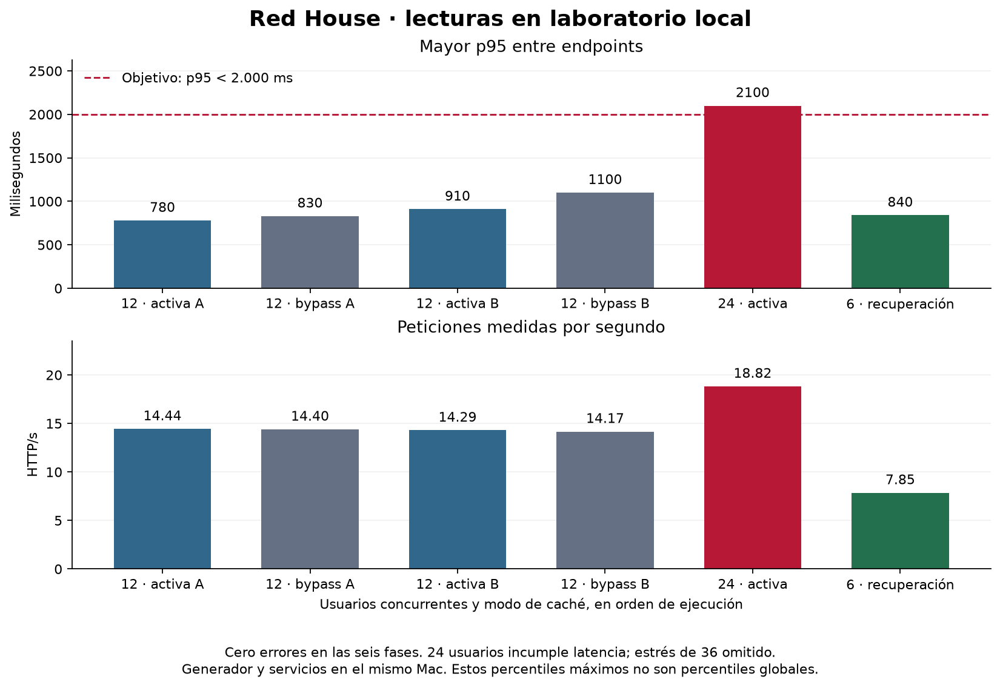

# Red House: documento técnico final

Proyecto 6: Red regional de bancos de sangre y donación de órganos. Equipo 01. Universidad de Monterrey, Integración de Aplicaciones Computacionales. **Corte documental: 18 de noviembre de 2026. Estado: consolidación parcial verificable; aceptación integral pendiente.** Las referencias a cortes anteriores conservan su fecha y alcance. Esta fecha identifica el corte documental, no una presentación efectuada ni una aprobación del producto.

Este informe reúne la implementación y evidencia disponibles. Conserva el [reporte del segundo parcial](Reporte_tecnico_segundo_parcial.md) como antecedente del 22 de octubre. Los resultados pertenecen a sus versiones y entornos; no se suman ejecuciones superpuestas ni se presenta una consolidación documental como prueba nueva. El [estado vigente](../../PROJECT_STATUS.md) y la [matriz única de continuidad](../entrega-final/continuidad/Matriz.md) registran cambios posteriores y disposición por criterio.

## 1. Resumen ejecutivo

Red House coordina instituciones que registran donaciones, recursos, necesidades, evaluaciones profesionales, reservas y traslados. Su propósito es reducir demoras por información dispersa y conservar una historia verificable de responsabilidades y estados. La plataforma muestra alternativas y restricciones; la autorización clínica sigue correspondiendo a profesionales e instituciones competentes.

La solución actual comprende un portal Flask/Jinja2 con backend autónomo, **doce servicios independientes**, una aplicación Kotlin Multiplatform/Compose Multiplatform para Android/iOS y una consola PySide6/Python. Móvil intercambia contratos JSON; escritorio utiliza XML/XSD. Ambos acceden mediante HTTPS/WSS y carecen de conexiones directas a PostgreSQL, MongoDB o Redis. El portal incorpora sus propios módulos y workers fijados; puede operar con las API detenidas si conserva sus dependencias de datos y seguridad.

PostgreSQL concentra compromisos transaccionales en una base compartida con permisos por propietario. MongoDB conserva eventos y proyecciones documentales; Redis mantiene sesiones, revocaciones, permisos y datos temporales. Los archivos operativos utilizan almacenamiento privado del servidor. GCS es opcional para el producto y conserva evidencia académica independiente. La VM GCE dispone de Docker, HTTPS, monitoreo y dos réplicas por API; los treinta contenedores sanos corresponden a comprobaciones puntuales publicadas, no a disponibilidad continua garantizada.

Hay evidencia de procesos sobre datos ficticios: cierres E2E-A y E2E-B en Android y iPhone con Qt/web, y E2E-C iOS→Qt/web; además, laboratorio XML, archivos intercliente, HLA con invalidación, rechazo de accesos y recuperación WSS. El [cierre E2E-A del 17/11](../evidencias/entrega-final/e2ea-cierre-20261117/RESULTADOS.md) aceptó 39 controles del caso sintético, sin transfusión ni autorización clínica real. La carga HTTP12 local anterior midió 1.472 respuestas sin fallos; la publicación GCP de etiquetas de seguimiento del 17/11 actualizó únicamente el JavaScript web y comprobó HTTPS/health, no GPS/WSS ni el flujo móvil. La [recuperación WSS móvil](../evidencias/entrega-final/mobile/tracking-recovery-20261117/RESULTADOS.md) aprobó casos comunes y un peer de loopback con autenticación/ACK controlados; no fue ensayo iOS ni persistencia SQL. La [construcción móvil final](../evidencias/entrega-final/mobile/final-build-20261117/RESULTADOS.md) compiló cuatro variantes; tras conservar el primer fallo de sesión Xcode, la [renovación posterior](../evidencias/entrega-final/mobile/profile-renewal-20261117/RESULTADOS.md) obtuvo perfiles hasta el 24/11 y actualizó Lab. Su aceptación física completa sigue pendiente; las comprobaciones parciales posteriores de Lab se delimitan en la sección 10. La serie previa incumplió el objetivo a 24 usuarios. La continuación del 17/11 aprobó tres fases de lectura con ritmo acotado, descritas en la sección 15. La [corrección N+1 de Inventario](../evidencias/entrega-final/inventario-consulta-20261117/RESULTADOS.md) conserva 4.502 filas idénticas y reduce el tiempo SQL local. La [ventana finita compuesta](../evidencias/entrega-final/carga-finita-20261117/RESULTADOS.md) midió seis casos y 49 HTTP sin fallos, pero el resultado original conserva `FAILED_CLEANUP`; su teardown corregido pasó después en solo lectura. La [publicación acotada de Inventario](../evidencias/entrega-final/gcp-inventario-20261117/RESULTADOS.md) aprobó en el segundo intento autorizado: dos contenedores actualizados, veintiocho intactos y doce controles protegidos JSON/XML. El acceso temporal y la única familia técnica quedaron cerrados; los fallos de preparación se conservan. Otro lote publicó las correcciones de custodia y presentación web. La renovación TLS cubre el 23/11 y el acceso temporal de esa publicación quedó retirado. [Publicación y TLS](../evidencias/entrega-final/gcp-custody-clock-lab-labels-20261117/RESULTADOS.md). Continuidad, capacidad, accesibilidad y plataformas pendientes conservan su alcance abierto. Nada de esto acredita aceptación académica total ni habilitación clínica.

## 2. Problema, objetivos, beneficios y alcance

Una solicitud urgente pierde tiempo cuando las instituciones desconocen existencias, responsables, vigencia de datos o condiciones de traslado. Las reservas simultáneas pueden comprometer el mismo recurso. Una recepción sin trazabilidad impide reconstruir procedencia, pruebas, autorizaciones y destino. El sistema organiza esa coordinación y hace visibles estados pendientes, conflictos y decisiones humanas.

El objetivo general es apoyar procesos regionales trazables con persistencia real, autorización institucional y recuperación explícita. Los objetivos específicos son registrar donantes/receptores; consultar disponibilidad; documentar pruebas y faltantes; comparar alternativas explicables; impedir duplicación de reservas; coordinar traslado/custodia; registrar uso o destino autorizado; y medir continuidad y rendimiento de los componentes.

Los beneficios esperados son menor búsqueda manual, mejor visibilidad de caducidades y reconstrucción de eventos. No se han medido reducción de mortalidad, tiempos clínicos o desperdicio real; el laboratorio no permite atribuir esos resultados sanitarios al software.

Se separan sangre y órganos por producto, estados, perfiles y procedimientos. El marco normativo de referencia es la NOM-253-SSA1-2012 para sangre (Secretaría de Salud, 2012) y el *Reglamento de la Ley General de Salud en Materia de Trasplantes* (2014) para órganos; el sistema no sustituye su aplicación clínica. Un filtro ABO no demuestra compatibilidad clínica. La plataforma no declara automáticamente aptitud, no autoriza transfusiones y no determina asignaciones oficiales de órganos. La validación profesional de reglas, competencias, conservación y privacidad permanece externa; esta condición no invalida los mecanismos académicos comprobados con datos sintéticos.

## 3. Actores, requisitos y trazabilidad

Los requisitos del semestre, casos e historias conservan sus documentos editables: [requisitos funcionales/no funcionales](Requerimientos_funcionales_y_no_funcionales.md), [historias](Historias_de_usuario.md), [casos de uso](Casos_de_uso.md), [reglas de negocio](Reglas_de_negocio.md) y [trazabilidad](Matriz_de_trazabilidad.md). Sus cortes de planificación no sustituyen la evidencia reciente.

El seguimiento actual utiliza las matrices existentes: [BE-01…BE-24 y TRACK](../entrega-final/backend/correccion/Matriz_cierre.md), [algoritmos y fuentes](../entrega-final/algoritmos/correccion/Matriz_fuentes_publicas.md), [portal](../entrega-final/portal/Matriz.md), [móvil](../entrega-final/mobile/Matriz.md), [escritorio](../evidencias/entrega-final/desktop/MATRIZ.md) y [CONT-01…CONT-10](../entrega-final/continuidad/Matriz.md). Estas fuentes contienen criterios, implementación, propietario, dependencias y evidencia; este informe no crea una matriz paralela de cumplimiento.

Los requisitos transversales incluyen autorización por recurso/institución, JWT y revocación Redis, contratos versionados, validación de archivos, auditoría, consistencia, recuperación, búsquedas/paginación, accesibilidad y medición de rendimiento. Una interfaz renderizada, un contrato generado o una compilación tienen alcances distintos; cada uno necesita su prueba aplicable antes de cerrar un criterio funcional.

| Perfil | Acción y recurso | Ámbito y límite |
| --- | --- | --- |
| Donante | Expediente personal permitido, consentimiento, campañas, citas y avisos | Solo información propia autorizada; no modifica evaluación clínica |
| Operador de banco | Inventario, muestras, captura de pruebas, preparación y recepción | Institución participante; captura no equivale a liberación médica |
| Médico | Solicitud, evaluación, dictamen y autorizaciones críticas habilitadas | Institución/recurso, versión vigente y reautenticación cuando corresponda |
| Coordinador regional | Disponibilidad agregada, rutas, programación y seguimiento | Región/asignación autorizadas; no obtiene expedientes clínicos generales |
| Transportista | Tarea asignada, QR, recolección, traslado, evidencia y entrega | Asignación y periodo vigentes; ubicación no confirma custodia |
| Administrador | Cuentas, instituciones, perfiles y configuración autorizada | Administración no concede acceso clínico indiscriminado |
| Auditor | Reconstrucción de eventos y revisión restringida | Consulta minimizada por ámbito; historia inmutable bajo credenciales runtime |

La [matriz de perfiles y permisos](Matriz_de_perfiles_y_permisos.md) y los contratos de cada propietario precisan acciones por producto. Los cinco perfiles de móvil conservan interfaces diferenciadas; administrador y auditor tienen otros canales autorizados. Los botones visibles no constituyen la autoridad: el servidor comprueba rol, acción, institución, región y relación con el recurso.

## 4. Arquitectura ejecutable y evolución

El navegador consume HTML/Jinja y formularios del portal. En modo `monolith`, `ApplicationKernel` ejecuta módulos de aplicación mediante WSGI sin listeners internos. Los mismos módulos versionados validan contratos, JWT/Redis, permisos y transacciones. El modo HTTP es una selección explícita; no existe cambio automático de backend después de una escritura incierta.

Las API no dependen de vistas, cookies o sesiones internas del portal. Cada propietario mantiene contratos, permisos, imagen y proceso/worker propios. Las copias compartidas de utilidades se fijan al empaquetar; actualizar un contenedor no modifica el código que otro proceso ya cargó. El acceso SQL del portal pertenece a su backend autorizado, nunca a la aplicación móvil o de escritorio.

El profesor recomendó una arquitectura objetivo de **24 responsabilidades**, sin exigir 24 procesos. El segundo parcial partió de once servicios; la extracción de Documentos/Reportes produjo doce. La [decisión de fronteras](../entrega-final/backend/correccion/Arquitectura_y_decisiones.md) conserva la correspondencia completa y sus alternativas. Una réplica o un módulo no se cuenta como otro microservicio.

| Propietario independiente / puerto interno | Responsabilidades BE agrupadas |
| --- | --- |
| Identidad y acceso / 5101 | 01 Identidad, 02 Instituciones |
| Donantes / 5102 | 03 Donantes, 13 Colecta, 22 Citas/campañas |
| Receptores / 5103 | 04 Receptores, 16 Necesidad/retención |
| Inventario / 5104 | 05 Inventario, 13 Fraccionamiento, 15 Frío, 16 Reserva, 17 Caducidad, 18 Trazabilidad, 21 Analítica de stock, 24 Mapeos |
| Compatibilidad / 5105 | 06 Evaluación, 14 Laboratorio |
| Priorización/Geografía / 5106 | 07 Propuestas y rutas |
| Transporte / 5107 | 08 Transporte, 21 Tiempos, 23 Sincronización operativa y rastreo |
| Custodia / 5108 | 09 Cadena de custodia |
| Alertas / 5109 | 10 Avisos y adaptadores |
| Auditoría / 5110 | 11 Auditoría y revisión de hallazgos |
| Monitoreo / 5111 | 12 Salud y disponibilidad |
| Documentos / 5112 | 19 Archivos/documentos, 20 Reportes |

Las responsabilidades compartidas tienen fronteras concretas: Donantes registra colecta e Inventario crea derivados; Receptores controla cupo e Inventario compromete la reserva; cada consulta analítica usa datos de su propietario. No hay una segunda autoridad sobre el mismo recurso.

Identidad agrupa instituciones porque activación institucional y acceso comparten invariantes. Laboratorio y Compatibilidad comparten versiones/completitud que deben revalidarse al reservar. Frío, caducidad y reserva pertenecen a Inventario porque compiten por la misma unidad. Transporte reúne asignación, posición y comandos recuperables para evitar una autorización GPS desactualizada. Documentos se extrajo para separar renderizado, permisos de objetos y fallos de almacenamiento/antivirus del worker de traslado. Cada agrupación tiene costes de despliegue/escala compartidos, documentados; no se afirma que esta distribución sea óptima para toda carga futura.

Los diagramas finales tienen [fuentes y procedimiento propios](../entrega-final/modelos/README.md), con doce propietarios y almacenamiento LOCAL principal. Se conservan además las decisiones de [fronteras/dependencias](../entrega-final/backend/correccion/Arquitectura_y_decisiones.md), [rastreo/secuencia](../entrega-final/backend/Rastreo.md), [almacenamiento autónomo](../entrega-final/continuidad/Rutas_almacenamiento_autonomas.md) y [despliegue](../../deployment/gcp/README.md). Las figuras del [segundo parcial](../segundo-parcial/README.md) son antecedentes fechados; sus once propietarios/GCS principal no describen el corte ampliado. El [registro editorial final](../evidencias/entrega-final/modelos-20261114/validacion-final.json) identifica artefactos y alcance de revisión, separado de aceptación funcional.

[Componentes actuales y separación entre productos: SVG ampliable](../entrega-final/modelos/diagramas/componentes.svg). El formato vectorial conserva la lectura de todos los nodos sin comprimirlos en una página carta.

## 5. Procesos de negocio e integración entre productos

Los siguientes tres procesos describen el comportamiento requerido y los mecanismos existentes. La secuencia narrativa no acredita una ejecución final integral. El [guion de demostración](../entrega-final/continuidad/Demostracion_final.md) ordena ensayos comprobados y conserva esa separación.



La [secuencia detallada ampliable](../entrega-final/modelos/diagramas/secuencia.svg) conserva mensajes y propietarios sin reducirlos a texto ilegible en la página.

### 5.1 Solicitud y suministro de sangre

1. Un médico registra receptor/solicitud institucional con componente y necesidad. Receptores valida y persiste versión/estado; emite eventos durables para auditoría y avisos.
2. Compatibilidad consulta inventario y laboratorio autorizados, registra faltantes, versiones, rutas y explicaciones. Un candidato técnico permanece pendiente de dictamen profesional.
3. El médico revisa y confirma el dictamen. Priorización ofrece comparación operativa; la propuesta no crea reservas.
4. Inventario registra operación idempotente, solicita retención a Receptores, bloquea recurso y revalida versiones/estado. Restricciones impiden doble reserva y sobrecobertura.
5. Coordinación programa el traslado sobre reserva confirmada. Origen prepara; transportista escanea y registra recolección, tránsito y entrega. Destino acepta con su perfil y comprobaciones.
6. Inventario/solicitud reciben eventos por secuencia. El uso o destino posterior requiere registro y autorización propios; la recepción no representa transfusión realizada. Auditoría, Custodia y Alertas conservan el contexto minimizado.

Ante timeout se conserva resultado incierto y se consulta la operación antes de repetir con la misma clave/cuerpo. Un conflicto local puede compensar una retención; una recolección física no se deshace mediante una liberación automática. Una corrección de laboratorio invalida la evaluación vigente sin reescribir la histórica.

Hay evidencia integrada para un caso académico: la unidad y traslado recorrieron Android, Qt/XML y web; Qt registró recepción y destino documental, y Chrome consultó el resultado final. El [recibo de cierre E2E-A](../evidencias/entrega-final/e2ea-cierre-20261117/RESULTADOS.md) conserva 39 controles, 18 eventos correlacionados y límites: sin transfusión, sin lectura térmica y mapa histórico sin nueva conexión WSS. No generaliza a iPhone ni cubre todos los casos de seguridad/carga. También se conservan [evaluación](../evidencias/entrega-final/desktop/iteracion-evaluacion/RESULTADOS.md), [reserva recuperable](../evidencias/entrega-final/desktop/iteracion-reserva/RESULTADOS.md) y [laboratorio](../evidencias/entrega-final/desktop/iteracion-laboratorio/RESULTADOS.md).

En el caso de iPhone, la entrega física conservada continuó con recepción ACCEPTED v6, descarte académico DISCARDED v1, unidad WITHDRAWN y solicitud CLOSED. Cuatro GET finales de Chrome devolvieron 200 y tres familias propias de Qt/web cerraron en SQL/Redis. La medición de latencia de mapas y la lectura web de la referencia histórica del destino conservan sus límites. [Cierre iOS A](../evidencias/entrega-final/e2ea-ios-cierre-20261117/RESULTADOS.md).

### 5.2 Coordinación de órgano

1. Personal institucional registra recurso y receptor/solicitud con la información autorizada. Se separan producto, órgano y procedimiento de sangre.
2. Laboratorio conserva muestras, resultados, HLA, fuentes/perfiles y estados de revisión. Faltantes o ambigüedad no se interpretan como resultados favorables.
3. El sistema conserva evaluación y explicaciones. La autoridad profesional y el procedimiento oficial determinan las autorizaciones; Red House registra el soporte y no asigna automáticamente un receptor.
4. Solo tras las autorizaciones aplicables se coordinan reserva y logística. Transporte/Custodia registran responsables, versiones, incidencias, tiempos y evidencias.
5. La institución receptora acepta y registra el cierre/destino permitido. La historia mantiene referencias y correcciones; una coordenada no confirma entrega ni trasplante.

La evidencia [HLA JSON/XML](../evidencias/entrega-final/cont01-hla-20261113/RESULTADOS.md) verifica faltantes, revisión, nueva evaluación e invalidación tras corrección. El [documento HLA con ClamD real](../evidencias/entrega-final/cont01-documentos-20261113/RESULTADOS.md) verifica asociación por muestra/resultado. Son ensayos separados. Para E2E-B, el [tramo móvil Android](../evidencias/entrega-final/mobile/e2eb-android-20261116/RESULTADOS.md) llegó a DELIVERED y la [recepción/destino Qt→web](../evidencias/entrega-final/desktop/e2eb-recepcion-destino-20261116/RESULTADOS.md) aceptó su continuación. El [cierre iPhone B posterior del 17/11](../evidencias/entrega-final/e2eb-ios-cierre-20261117/RESULTADOS.md) acepta el caso sintético de iPhone iOS→Qt/XML→web: 112 controles, auditoría SQL/Mongo 49/49 y 13 avisos, recepción ACCEPTED y descarte DISCARDED. Conserva dos brechas/revisiones, 18 lecturas sintéticas y el FAIL del soporte de 15 lecturas con cierre de dos familias conciliado. El alcance queda limitado al órgano sintético. Conservan sus criterios propios la medición térmica física, la referencia y el motivo históricos en el formulario de destino, las demás variantes y la habilitación clínica.

### 5.3 Donación voluntaria y procesamiento

1. Donante consulta feed público/campañas y agenda desde móvil. El servidor autoriza cuenta/cupo y confirma la cita persistida; el cliente no confirma localmente.
2. La institución verifica identidad, consentimiento y evaluación humana. El donante modifica únicamente campos personales habilitados.
3. Personal autorizado registra colecta y procedencia de la unidad. Operador documenta procesamiento, muestra y resultados; el médico realiza las acciones profesionales que procedan.
4. Inventario registra componentes/derivados y su linaje, cuarentena/liberación o destino. Cambios conservan versiones y auditoría.
5. Avisos y visualizaciones consultan el mismo resultado autorizado desde web, JSON móvil y XML escritorio. El cierre por uso/destino conserva su hecho propio.

El E2E-C académico está correlacionado en [iOS→Qt/XML→web](../evidencias/entrega-final/e2ec-20261116/RESULTADOS.md): la agenda nativa del donante dio paso a colecta/procesamiento escritorio y consulta web de los mismos registros. La [agenda iOS posterior](../evidencias/entrega-final/mobile/ios-resume-20261116/AGENDA.md) aporta competencia válida por último cupo y un recordatorio conciliado con la bandeja; su captura iOS no fue aceptada. Android conserva agenda y edición en [móvil](../evidencias/entrega-final/mobile/RESULTADOS.md), [próxima cita](../evidencias/entrega-final/mobile/next-appointment-20261113/RESULTADOS.md) y [edición personal](../evidencias/entrega-final/edicion-personal-20261113/RESULTADOS.md). El caso posterior iniciado con una reserva nativa Android completó su tramo Qt/web y conservó los mismos registros. Último cupo, recordatorio y capturas nativas de cita/perfil conservan evidencia pendiente. [Tramo Android C→Qt→web](../evidencias/entrega-final/e2ec-android-web-20261117/RESULTADOS.md). La [consulta Auditoría Qt del 17/11](../evidencias/entrega-final/desktop/auditoria-e2ec-20261117/RESULTADOS.md) añadió una fila y su detalle inspeccionados, seis HTTP 200 y cierre SQL/Redis/JTI. Su runner conserva exit 1 por captura del modal y el import fallido previo queda separado; captura alternativa y cierre sustentan aceptación compuesta de esa consulta, sin repetir negocio. Toda la bitácora y accesibilidad permanecen abiertas.

Una consulta posterior en Chrome verificó el mismo resultado ABO en el monolito LOCAL con el nuevo archivo común. El ensayo incluyó login con MFA, el GET de negocio y logout, sin escrituras de negocio. Mostró «Resultado informado: O» y «Reportado», devolvió GET 200 y cerró su única familia SQL/Redis. Resultado, muestra y fuentes permanecieron iguales. [GET de laboratorio](../evidencias/entrega-final/web-laboratorio-get-20261117/RESULTADOS.md).

## 6. Persistencia, modelos y archivos privados

### 6.1 PostgreSQL

Una base `red_house` conserva datos estructurados, relaciones y compromisos. Las vistas `access_<propietario>` y credenciales separadas limitan acceso; no contienen copias físicas de cada servicio. Las tablas técnicas delimitan colas/idempotencia por propietario. Historiales y acciones relevantes se agregan sin permitir sobrescritura por credenciales runtime.

La captura local de solo lectura del 17/11 confirmó **esquema 21, 117 tablas incluyendo `web_runtime`, 227 índices y doce servicios**. Registró el índice parcial `shared_outbox_dispatch_order` ya instalado. Solo inició y cerró PostgreSQL propio, sin migraciones ni consulta de filas de negocio. El corte anterior documentó 226 índices y conserva su alcance. Las cifras de 71 tablas y 72 con tabla técnica pertenecen al segundo parcial. [Captura vigente](../evidencias/entrega-final/modelos-20261117/RESULTADOS.md) · [Catálogo del 14/11](../evidencias/entrega-final/modelos-20261114/postgresql-physical.json).

El catálogo físico, la proyección relacional y las fichas se regeneraron con los metadatos vigentes. El diagrama físico quedó idéntico. [Catálogo físico](../entrega-final/modelos/Modelo_fisico.md) · [Modelo relacional](../entrega-final/modelos/Modelo_relacional.md) · [Fichas de servicio](../entrega-final/modelos/Fichas_microservicios.md) · [SVG ampliable](../entrega-final/modelos/diagramas/postgresql-completo.svg) · [Generación y límites](../entrega-final/modelos/README.md).

El [modelo conceptual](../entrega-final/modelos/Modelo_conceptual.md) y su [vista ampliable](../entrega-final/modelos/diagramas/datos.svg) expresan relaciones de negocio; no declaran cardinalidades SQL. El modelo relacional y el catálogo físico mantienen las restricciones comprobadas del esquema instalado.

Las API no migran al recibir peticiones. Las migraciones se aplican con respaldo, permisos de propietario y verificación en copia aislada. Una base compartida permite claves foráneas; no convierte la coordinación HTTP entre servicios en una transacción ACID global. La reserva mantiene estado durable, retención remota y compensación limitada.

### 6.2 MongoDB

Transporte, Custodia, Auditoría y Monitoreo tienen ámbitos documentales separados. UUID/identificador de evento deduplica entregas de outbox. Auditoría y custodia conservan eventos inmutables; las proyecciones autorizadas pueden actualizarse por secuencia.

`rh_transporte.shipment_tracking` conserva la versión/estado observado por traslado. Una secuencia anterior no degrada la proyección; misma identidad con otro contenido es conflicto. Índices regionales y de secuencia, pipelines y reconstrucción constan en [persistencia](Datos_y_persistencia.md) y pruebas del [segundo parcial](../evidencias/segundo-parcial/RESULTADOS.md). Esas comprobaciones conservan su corte histórico. MongoDB no sustituye al propietario SQL ni contiene los binarios del expediente.

Monitoreo intenta registrar sondeos primero en MongoDB y luego en SQL; puede consultar el historial documental durante una caída SQL si sigue autorizando Redis. Si ambos almacenes fallan, no se promete conservar cada sondeo.

### 6.3 Redis

Redis mantiene sesión/familia, renovación rotativa, revocación, versión de permisos, nonce de llamadas internas, contadores de consumo y caché autorizada. Los prefijos y ACL separan propietarios. El JWT firmado no permite omitir la consulta de estado actual. Redis inaccesible provoca rechazo seguro.

La caché incluye usuario/ámbito, filtros y revisión; no decide reservas. El portal guarda credenciales cifradas y una cookie opaca; cierres pendientes tienen registro SQL. Los TTL, ACL y claves se describen en [arquitectura](Arquitectura.md) y [reporte base](Reporte_tecnico_segundo_parcial.md); los valores efectivos de laboratorio se conservan en cada resultado, sin presentarlos como configuración productiva. Restaurar una copia antigua de Redis exige invalidar sesiones según el procedimiento, para impedir resucitar revocaciones posteriores.

### 6.4 Archivos del servidor y GCS

**LOCAL es el proveedor operativo predeterminado y publicado.** Documentos conserva metadatos, propietario/sujeto, tipo, tamaño, hash, generación, privacidad, estado y análisis. El binario se guarda en volumen privado del servidor; autorización y capacidades de transferencia no exponen credenciales de almacén al cliente. Las [rutas separadas API/portal](../entrega-final/continuidad/Rutas_almacenamiento_autonomas.md) conservan autonomía de productos.



La [secuencia de archivo ampliable](../entrega-final/modelos/diagramas/archivos.svg) detalla mensajes y capacidades de transferencia.

Preparar, cargar y verificar son acciones distintas. El backend comprueba tamaño/tipo/estructura/hash y exige análisis limpio vigente antes del uso permitido. Un objeto ausente, pendiente, rechazado, infectado o con análisis indisponible no adquiere estado limpio por reintentar. Android volvió a codificar el JPEG sin EXIF en su ensayo; iOS eliminó metadatos originales y conservó cinco etiquetas técnicas observadas, sin GPSIFD ni fechas observadas. No se atribuye ausencia total de EXIF a ambas plataformas. Idempotencia de carga y verificación permite recuperar incertidumbre sin crear otro objeto verificado.

[Almacenamiento local](../evidencias/entrega-final/almacenamiento-local-20261113/RESULTADOS.md), [vigencia del antivirus](../evidencias/entrega-final/antivirus-vigencia-20261113/RESULTADOS.md) y [foto Android consultada por XML](../evidencias/entrega-final/mobile/seguimiento-20261114/foto-intercliente/RESULTADOS.md) acreditan alcances específicos. Este último confirmó VERIFIED/CLEAN, hash/generación/bytes, ausencia de EXIF, eventos SQL/Mongo coincidentes y 403 al transportista no asignado. No ejecutó GUI de escritorio ni una captura nueva.

El [recorrido de documentos privados del portal del 14/11](../evidencias/entrega-final/portal-documentos-20261114/RESULTADOS.md) completó Chrome sobre el monolito autónomo, con las API detenidas: dos versiones de acreditación sintética, carga/análisis reales, descarga íntegra de ambas y conservación de la primera. Rechazó bifurcación obsoleta con 412, otra institución con 403 y nuevas solicitudes de descarga tras logout. Almacenamiento LOCAL y ClamD real; HTTPS de laboratorio con excepción de confianza únicamente en sus contextos temporales. No acredita TLS del sistema, GCP, GCS o revocación instantánea de capacidades ya emitidas.

La ejecución pytest **terminó fallida en su oráculo**, que esperaba `FILE_PREPARED` en lugar de `DOCUMENT_PREPARED`, después del recorrido Chrome y las comprobaciones de versiones. La [consulta correctiva SQL de solo lectura](../evidencias/entrega-final/portal-documentos-20261114/intento-02/oraculo-corregido.json) comprobó las dos versiones/archivos, análisis por generación/hash, bytes/tamaño/MIME y un evento de preparación/verificación por archivo. No repitió el navegador ni la carga; son resultados separados y no un pytest posteriormente aprobado. No consultó MongoDB. Las capturas originales y sus 1.305 fuentes estables se conservan.

La revisión visual identificó estados técnicos en inglés y recuperación insuficiente del 412. El ajuste de presentación `982d592` tradujo estados con el formateador compartido y orientó a la lista de versiones del mismo sujeto, ocultando el formulario obsoleto. Cinco comprobaciones de plantilla/macros con datos dobles y dos capturas ligeras pasaron por separado; no repitieron backend. El texto global `ERROR` se neutralizó después a «Error» y el enlace recibió estilo/subrayado visible. Al terminar la medición se repitieron únicamente [cinco comprobaciones de presentación con hashes actuales](../evidencias/entrega-final/portal-documentos-20261114/presentacion-final/checks.json) y se capturó [el enlace final subrayado](../evidencias/entrega-final/portal-documentos-20261114/presentacion-final/version-obsoleta.png), con base/datos dobles, sin motores ni repetición del flujo funcional. Los casos de laboratorio, traslado, conservación/hold y EICAR por formulario no se cierran con la acreditación probada.

La evidencia del 16/11 completa los otros tipos de I06-02: [RESULT y evidencia de traslado en GCS](../evidencias/entrega-final/portal-resultados-evidencias-gcs-20261116/RESULTADOS.md). Médico autorizado cargó PNG de un resultado propio y el transportista asignado cargó JPEG antes de cerrar su traslado; ClamD real, VERIFIED/CLEAN, generación/hash/tamaño, bytes y dos eventos por objeto en Auditoría SQL/Mongo quedaron correlacionados. Otra institución y responsable no asignado recibieron 403 en consulta y descarga, sin URL firmada. Familias propias cerradas en SQL/Redis y fuentes estables.

El primer intento RESULT permanece FAIL por un href con `return_to` que el arnés comparó literalmente después del único POST. La continuación aprobada hizo solo GET del mismo documento y descarga del PNG original. La fila HLA completa se comparó antes/después de esa continuación, sin inventar un snapshot anterior al POST que no se guardó. Los objetos web se conservan; no forman parte de la limpieza nativa iOS. Junto con la acreditación14/11, **I06-02 queda cubierto por evidencia compuesta para los tres tipos requeridos**. No se suma una suite nueva ni se cierran I06-01/03/08/09 o etapas 06/07 mediante ese recorrido. Las etiquetas y el reintento LOCAL se validaron y publicaron después en el [lote de cinco fuentes](../evidencias/entrega-final/gcp-documentos-referencia-20261116/RESULTADOS.md), con gate y alcance propios descritos en la sección 14; esta publicación sustituye su pendiente anterior, sin repetir el ciclo GCS.

GCS continúa **opcional para operar** y mantiene requisito académico separado. El [ensayo GCS real sintético JSON/XML](../evidencias/entrega-final/gcs-sintetico-20261113/RESULTADOS.md) y la [prueba anterior de bucket/URLs firmadas](../evidencias/segundo-parcial/gcs-real.json) conservan su evidencia. Google Cloud describe la firma temporal de objetos privados en su documentación de V4; la firma no sustituye la autorización de aplicación (Google Cloud, 2026).

Los 34 objetos GCS históricos pendientes de análisis no se presentan como descargables ni limpios. Las políticas clínicas de retención, clasificación, eliminación y conservación necesitan aprobación institucional; un hash/scan no acredita esa aprobación ni hace inviolable el archivo ante un administrador del host.

## 7. Contratos, autenticación y consistencia

Cada propietario publica OpenAPI y esquemas JSON/XML/XSD en [su directorio de servicios](../../apps/services/README.md). La API conserva `/api/v1`, entradas tipadas, envoltura de respuesta, códigos HTTP y errores seguros. Los contratos describen obligatoriedad, ejemplos, filtros y paginación. Un cambio incompatible necesita versión/convivencia explícita; cambiar un archivo cliente no acredita interoperabilidad hasta validar sus operaciones afectadas.

Móvil solicita JSON por HTTPS. Escritorio solicita XML y valida tanto la envoltura XSD como DTO/tipos de la operación y versión permitida; XML dentro de JSON o JSON dentro de XML no satisface esa separación. El parser rechaza DTD/entidades externas. Las transferencias binarias usan capacidades autorizadas; no transforman el cliente en consumidor directo de una base o bucket con credenciales.

Identidad firma JWT de acceso breve; renovación rota secreto y la reutilización revoca la familia. Cada operación protegida comprueba sesión/permisos/revocación en Redis y autorización actual del recurso. Las llamadas internas usan identidad de servicio firmada y delegación del actor cuando corresponde. Correlación relaciona petición, operación, evento y auditoría sin registrar tokens.

Las escrituras recuperables conservan `Idempotency-Key`, cuerpo, identidad y versión. Repetir con otro cuerpo se rechaza. Las reservas concurrentes del mismo recurso se serializan con bloqueos de fila `SELECT … FOR UPDATE` (PostgreSQL Global Development Group, s. f.). Un timeout posterior al envío puede haber confirmado el commit; el cliente consulta estado y recupera la misma operación. Outbox transaccional e inbox deduplicado permiten centralización eventual sin prometer entrega externa exactamente una vez.

Las colas locales solo admiten operaciones declaradas. Ningún modo offline confirma liberación, reserva, asignación clínica o cierre verificado de custodia. Toda sincronización reautoriza identidad, institución, versión y estado antes de confirmar en servidor. Los detalles están en [estados backend](../entrega-final/backend/Estados.md), [contratos/rastreo](../entrega-final/backend/Rastreo.md) y las guías de cada cliente.

## 8. Laboratorio, HLA y decisión profesional

El registro distingue resultado no realizado, pendiente, indeterminado, informado y corregido, así como captura y revisión/autorización. Un archivo adjunto no prueba un resultado ni una prueba faltante equivale a negativa. HLA conserva muestra, método/laboratorio, fecha, loci/alelos, resolución, ambigüedad, nomenclatura, catálogo y responsable declarados.

El catálogo IPD-IMGT/HLA **3.66.0** (IPD-IMGT/HLA, 2026) y su hash proceden del [expediente de adquisición](../evidencias/entrega-final/algoritmos/fuentes_publicas/20261102T143541Z/RESULTADOS.md). Comprueba pertenencia/nomenclatura a esa edición; no interpreta compatibilidad inmunológica. Baja resolución, grupo o entrada ausente no se convierten en alelo exacto. No se redistribuye el catálogo completo como una copia modificada; sus condiciones y atribución constan en el [registro de fuentes](Reglas_y_fuentes_clinicas.md).

Perfil, acciones y evaluación conservan versiones/huellas. La corrección añade historia e invalida el uso actual de evaluaciones obsoletas; reproducir una instantánea histórica mantiene sus entradas congeladas. Captura, completitud técnica, preselección, evaluación y dictamen son estados distintos. La gobernanza sintética prueba mecanismos, sin atribuir acreditación real a una cuenta ficticia.

El [registro clínico/normativo](Reglas_y_fuentes_clinicas.md) contiene fuentes primarias, jurisdicción, fechas, transición y limitaciones. Este informe las reutiliza documentalmente; no vuelve a certificar su vigencia ni interpreta sus disposiciones. La NOM de sangre no se extiende por analogía a órganos, y nomenclatura HLA no proporciona criterios de asignación. Activación clínica, protocolos por producto/órgano, competencia de aprobadores y retención requieren validación externa.

## 9. Algoritmos explicables

La especificación completa, pseudocódigo, límites, ejemplos, oráculos y métricas se mantiene en [Algoritmos](Algoritmos.md) y [operación/reproducción](../entrega-final/algoritmos/correccion/Operacion_y_reproduccion.md). Se conservan RBC-1.0, ORGAN-1.0 y LOGISTICS-1.0 históricos. LOGISTICS-1.0 ordena vencimiento/minutos/distancia/ID; no debe atribuirse el uso de urgencia/espera de versiones sintéticas posteriores.

| Algoritmo | Entradas y salida | Complejidad del núcleo y límite |
| --- | --- | --- |
| EXPLAIN-PROFILE-2.0 | Solicitud, perfil, laboratorio, recursos/rutas; motivos por candidato e instantánea | Recorrido O(U+R) más resultados examinados/consultas; no es complejidad de toda la infraestructura |
| LOGISTICS-OWNER-SIM-3.0 | Evaluaciones vigentes/política sintética; orden lexicográfico y factores | O(C log C), memoria O(C); no prioridad clínica oficial ni ranking de órganos |
| REGIONAL-DIJKSTRA-2.0 | Grafo dirigido versionado, costes no negativos/bloqueos; ruta y coste | O((V+E) log V) más ordenación determinista; memoria O(V+E) |
| COVERAGE-HK-1.0 | Grafo de cupos/candidatos revisados; matching máximo | Hopcroft–Karp O(E√V); cardinalidad, sin coste clínico ni reserva automática |
| DEMAND-OWNER-SES-2.0 | Destinos registrados, ventanas diarias, stock/lotes; pronóstico, MAE y sobrantes | O(H+B log B) del núcleo; extracción acotada separada |
| CONSISTENCY-OWNER-2.0 | Hechos de propietarios autorizados; anomalías potenciales y revisión | O(F+S) del detector; acceso SQL/Mongo/HTTP se mide aparte |

El matching usa BFS por capas y DFS de caminos aumentantes hasta no poder ampliar el conjunto. Si cupo A permite U1/U2 y B solo U1, puede producir dos parejas. No optimiza urgencia o coste. Su propuesta conserva `reservations_created=0`; Inventario revalida antes de comprometer recursos.

El ranking sintético excluye factores ausentes/restricciones incumplidas y ordena `(-urgencia,-espera,vencimiento,minutos,distancia,id)`. Guarda escala, política, fuente y corte. Son parámetros de simulación, sin pesos médicos inventados.

Dijkstra relaja mejoras estrictas con heap y reconstruye predecesores. Los oráculos enumeran caminos pequeños; pesos inválidos y ausencia de ruta producen rechazo o `UNREACHABLE`. La adquisición vial pública posterior conserva originales/hash y atribución, pero no demuestra actualidad vial, tráfico o ETA medida desde GPS. Se separan cartografía, ruta planificada, posición observada y ETA modelada.

SES divide cronológicamente entrenamiento/evaluación, selecciona alfa entre 0,2/0,5/0,8 solo en entrenamiento y compara MAE contra persistencia. Un día sin evento cuenta ausencia de registro, no ausencia física de demanda. Sin consumo registrado devuelve insuficiencia; no ejecuta transferencias ni prolonga caducidades. El detector de inconsistencias abre hallazgos potenciales deduplicados y requiere revisión; no corrige silenciosamente el pasado.

Los [benchmarks integrados](../evidencias/entrega-final/algoritmos/correccion_comprobacion/20261101T042648Z/benchmark-final.json) conservan tamaños, repeticiones, mediana/p95, asignaciones Python/RSS y alcance. No equivalen a latencia productiva, Locust sostenido o beneficio clínico. Las [fuentes públicas y resultados](../evidencias/entrega-final/algoritmos/fuentes_publicas/20261102T143541Z/RESULTADOS.md) registran fallos, correcciones y repeticiones sin borrar incidentes.

## 10. Aplicación Android/iOS

Kotlin Multiplatform comparte sesión, contratos JSON, estado y reglas de presentación; Compose Multiplatform aporta UI y puentes nativos para cámara, ubicación, mapas y almacenamiento. Los cinco perfiles son donante, operador, transportista, coordinador y médico. La app no replica la autoridad del backend ni usa sesiones web. Las versiones de Kotlin, Compose y Gradle se eligieron según la guía de compatibilidad de Kotlin Multiplatform (JetBrains, 2026).

El donante entra a feed/campañas y próxima cita; compartir publica únicamente texto público mediante selector nativo. Transportista prioriza mapa, tarea y siguiente acción, con QR previo a transferencias. Médico consulta datos autorizados; no se habilita un dictamen clínico móvil por la mera existencia del perfil. El resto de operaciones se filtra por servidor y ámbito.

Android protege sesión/diario con Keystore/AES-GCM; iOS utiliza Keychain (Apple, s. f.) con acceso ligado al dispositivo y cubierta al salir de primer plano. La contraseña no se persiste. Observaciones permitidas y comandos interactivos inciertos tienen tratamientos separados; un reintento de custodia conserva clave/cuerpo y nunca se transforma en confirmación offline. Logout detiene captura/trabajos y solicita revocación; si falta red, informa que el cierre remoto no está confirmado.

Android se verifica en emulador, sin exigir teléfono. Hay recorridos de donante/agenda, permisos, paginación, recreación, sincronización, QR óptico de escena virtual, custodia y fotografía con recuperación. [Resultados por intento](../evidencias/entrega-final/mobile/RESULTADOS.md) conservan versiones y omisiones. La cámara/posición emuladas no acreditan hardware Android físico.

La app normal iOS fue firmada, actualizada y abierta en **iPhone 16 Pro**, y se inspeccionó sesión donante/calendario en recorridos identificados. El [paquete normal del corte d735668](../evidencias/entrega-final/mobile/seguimiento-20261114/paquetes.md) acredita firma/instalación/arranque, sin nueva operación de negocio ni prueba de continuidad de sesión. Ese perfil histórico vencía el **17/11/2026 a las 22:39 UTC**. Fue sustituido por la renovación del 17 y la [actualización normal posterior](../evidencias/entrega-final/mobile/normal-update-20261117/RESULTADOS.md), con perfil hasta el 24/11; esa instalación no abrió la aplicación ni acredita restauración o recorrido. Compilar arm64, firmar, instalar, abrir y completar un recorrido son evidencias distintas.

El [laboratorio físico iOS del 14/11](../evidencias/entrega-final/mobile/ios-lab-20261114/RESULTADOS.md) ejecutó una variante separada `org.redhouse.mobile.lab`, con cuentas sintéticas introducidas manualmente. El oráculo confirmó dos escaneos del mismo recurso/traslado, fotografía CLEAN con tamaño/hash/generación coincidentes y dos posiciones iOS correlacionadas en SQL/MongoDB/Redis. El seguimiento terminó detenido; el traslado permaneció PREPARED y no se ejecutó custodia completa. El servidor no conservó indicador explícito `simulated=false`; el resultado no acredita esa propiedad ni una precisión determinada.

En ese corte del 14/11, el cierre de transporte revocó su familia SQL y eliminó su clave Redis, conservando otra familia del fixture. Donante modificó nombre propio a versión 2 con auditoría; la campaña 105 se encontró mediante búsqueda, **sin probar navegación hasta página 6**. HTTPS positivo pasó; los negativos de CA ajena, vencimiento, hostname/origen y validación WSS de esa variante todavía no se habían ejecutado. Las siete comprobaciones de identidad pasaron. El perfil Lab de ese corte vencía el 21/11 y fue sustituido por la renovación del 17 documentada más adelante. La nueva compilación normal conservó origen de producción y ausencia de CA de laboratorio, pero no se instaló. Este ensayo no se atribuye a la app normal ni cierra la etapa 04.

El 16/11, el usuario confirmó la navegación hasta la página 6 y las campañas 101–105; la captura y correlación final de esa rama permanecen pendientes. La agenda física comprobó reserva, cambio, cancelación, último cupo y recordatorio con correlación independiente. Dos certificados inválidos —CA ajena y SAN incorrecto— bloquearon acceso, sin nuevo HTTP; al restaurar la confianza, el usuario confirmó el regreso a la misma cuenta sin credenciales. Estos resultados corresponden al binario ensayado, anterior al arreglo de arranque y al lote siguiente. [Agenda/TLS y límites](../evidencias/entrega-final/mobile/ios-resume-20261116/LOTE-HORARIOS.md), [restauración posterior](../evidencias/entrega-final/mobile/startup-owner-20261116/RESULTADOS.md).

El corte inicial del [lote preliminar/GCS](../evidencias/entrega-final/mobile/preliminary-gcs-20261116/RESULTADOS.md) compiló cuatro variantes y ejecutó 25 pruebas JVM dirigidas; entonces no las instaló. El APK Lab se reutilizó después para el [tramo Android E2E-B](../evidencias/entrega-final/mobile/e2eb-android-20261116/RESULTADOS.md): cuatro transiciones únicas hasta DELIVERED, dos lecturas ópticas, seis eventos SQL/Mongo y tres familias técnicas cerradas. Dirección inspeccionó QR y Entregado; el mapa regional no acredita una posición GPS nueva. La recepción Qt/consulta web conservan sus recibos separados.

La [aceptación nativa GCS y permisos](../evidencias/entrega-final/mobile/native-gcs-20261116/RESULTADOS.md) atravesó MobileRepository y los motores reales OkHttp/Darwin: un JPEG sintético nuevo por plataforma VERIFIED/CLEAN, hash/generación, Auditoría SQL/Mongo y GET anónimo 403 sobre su misma generación. Se cerraron las familias exactas en SQL/Redis y se eliminaron únicamente las generaciones propias identificadas; sin IAM/históricos ni prueba de vencimiento físico de soft-delete. El entorno GCS fue una variante del fixture conservado; producción mantuvo LOCAL. El host iOS privado usó una lease técnica temporal sin abrir Keychain/diarios y después se restauró Lab distribuible como actualización, con cuenta donante confirmada por el usuario. No se distribuye el host ni sus secretos.

Los callbacks nativos denegados de cámara/ubicación aprobaron en ambas plataformas. iPhone canceló cámara al ir a Inicio sin foto y restauró permisos 3/4. Android restauró grants; dejó historial USER_SET documentado, sin reset global. BGAppRefresh pasó de cero a una solicitud pendiente, sin callback observado ni ejecución de cola: iOS decide la oportunidad. No se repitieron cámara/QR/GPS positivos anteriores.

El [alta preliminar Android](../evidencias/entrega-final/mobile/preliminary-android-native-20261116/RESULTADOS.md) creó por un único envío UI un expediente propio PRELIMINARY versión 1 de la cuenta sintética existente, sin usuarios nuevos. Checkbox explícito y grupo seleccionado; un evento correlacionado SQL/Mongo y dos familias técnicas cerradas. El booleano `donors.consent` no sustituyó consentimiento documental: referencia/fecha null y cero versiones formales; tampoco se creó elegibilidad clínica. El primer test falló por escribir en Nombre aún Disabled; después se observó habilitado y la continuación UI completó el caso. La captura tomó una ventana del terminal y quedó privada/descartada: **no hay inspección visual aceptada de ese formulario**.

Los perfiles iOS del corte previo vencían el 17/11 y 21/11 UTC; fueron sustituidos por la renovación del 17/11 documentada a continuación. Se conservan CA, Keychain y configuración push. **FCM/APNs permanece pendiente externo por decisión humana**; no se crearon cuentas/proyectos/certificados ni se atribuye recepción física. No se descargó Simulator. Las [dependencias](../entrega-final/mobile/Dependencias_externas.md), [matriz móvil](../entrega-final/mobile/Matriz.md) y [guía de compilación](../../apps/mobile/README.md) se interpretan por sus cortes, sin transformar build o prueba común en otro recorrido físico.

El lote [final del 17/11](../evidencias/entrega-final/mobile/final-build-20261117/RESULTADOS.md) compiló Android normal/Lab e iOS normal/Lab con salida 0; no instaló ni activó variantes. Verificó la separación normal/Lab, firma y entitlements iOS, pero los perfiles embebidos no cubren el umbral de entrega del 23. La renovación intentó usar la sesión existente de Xcode y falló por sesión caducada; los perfiles originales se restauraron byte a byte. No hubo perfil sustituto. El paquete conserva sus huellas; no se repitieron suites anteriores. La próxima aceptación iOS requiere firma vigente y prueba nativa del artefacto correspondiente. Posteriormente, el [segundo intento de renovación](../evidencias/entrega-final/mobile/profile-renewal-20261117/RESULTADOS.md) aprobó perfiles hasta el 24/11 y actualizó Lab en el iPhone, sin repetir APK ni suites. Después se [actualizó también la variante normal](../evidencias/entrega-final/mobile/normal-update-20261117/RESULTADOS.md), sin desinstalar ni abrir. El usuario confirmó Inicio en Lab tras login manual; no se acreditó restauración previa. Dos capturas XCTest fallaron por LocalAuthentication −4, por lo que revisión visual y recorridos restantes siguen pendientes.

Las [comprobaciones físicas de Lab renovada del 17/11](../evidencias/entrega-final/mobile/ios-current-20261117/RESULTADOS.md) acreditan, por confirmación del usuario, Inicio tras login manual, el anuncio «Avisos» y su apertura mediante doble toque con VoiceOver, el título «Recordatorio de tu cita» y el menú nativo Compartir campaña, cerrado sin envío externo. No se acreditó restauración previa ni orden de lectura completo; dos capturas XCTest fallaron con LocalAuthentication −4 y no se aceptaron como evidencia visual. La restauración de VoiceOver al estado anterior no quedó confirmada por separado. Los perfiles vigentes son normal 24/11 18:03:31 UTC y Lab 24/11 18:03:22 UTC: ambos cubren el 23. Las secciones 5.1 y 5.2 documentan los cierres iOS A y B por sus propios recorridos. La aceptación integral de la etapa 04 sigue pendiente.

## 11. Consola de escritorio

PySide6/Python (Qt Group, s. f.) atiende procesos internos con tablas, búsqueda/paginación, captura, evaluación, comparación, reserva, custodia, reportes y etiquetas. La consola utiliza HTTPS/XML, XSD y DTO por operación; copia contratos versionados y no necesita el código servidor para ejecutarse. La red se procesa fuera del hilo principal. Las escrituras requieren diario cifrado por cuenta y llavero disponible; no existe cola universal de negocio offline.

Los expedientes acreditan [captura/revisión de laboratorio](../evidencias/entrega-final/desktop/iteracion-laboratorio/RESULTADOS.md), [evaluación](../evidencias/entrega-final/desktop/iteracion-evaluacion/RESULTADOS.md), [reserva recuperable](../evidencias/entrega-final/desktop/iteracion-reserva/RESULTADOS.md), [cobertura](../evidencias/entrega-final/desktop/iteracion-cobertura-doble/RESULTADOS.md) y otros recorridos especificados en [DESK-01…14](../evidencias/entrega-final/desktop/MATRIZ.md). Las pruebas de cliente y una ventana Qt aislada no sustituyen todos los recorridos funcionales.

El incremento `82c554d` añadió captura de muestras y gestión de receptores/solicitudes. El **mismo ensayo conjunto** obtuvo **2/2 aprobados en 98,94 s**, sin contar esa cifra dos veces por aparecer en dos expedientes. [Muestra](../evidencias/entrega-final/desktop/iteracion-alta-muestra/RESULTADOS.md): selección de unidad/perfil por Qt/XML, alta REQUESTED comprobada en PostgreSQL, recepción hasta RECEIVED y eventos SQL. [Receptor/solicitud](../evidencias/entrega-final/desktop/iteracion-receptores/RESULTADOS.md): médico dio de alta/corrigió receptor y editó/canceló solicitud desde GUI; el cliente XML creó la solicitud. SQL confirmó CANCELLED, versión 3/cantidad 2 y eventos; operador obtuvo 403 al intentar registrar receptor.

Las capturas reales del ensayo se inspeccionaron y las huellas de fuentes permanecieron estables. El fixture utilizó datos sintéticos, proxy Flask/TLS, servicios TESTING, Qt offscreen y clave de diario doble. No acredita llavero/MFA de estas acciones, recuperación tras finalizar proceso, conflicto concurrente real, edición de órgano, creación de solicitud por su formulario ni flujo completo de colecta/derivados. Las comprobaciones UI/diario anteriores con dobles conservan su evidencia separada; el paquete Mac previo no incorpora automáticamente estos cambios.

El [recorrido de planificación DESK-09](../evidencias/entrega-final/desktop/iteracion-planificacion/RESULTADOS.md) pasó **1/1 en 47,50 s**: coordinación seleccionó reserva y cuenta de traslado del origen, confirmó horarios/motivo, creó PLANNED y lo consultó por XML. SQL correlacionó reserva/responsable; fuentes estables y fixture cerrado. Tres comprobaciones previas de diario/UI con dobles pasaron, mientras el caso real de ese intento no arrancó por socket denegado en sandbox. La repetición real autorizada conserva su propio fixture y evidencia. Dirección inspeccionó dos capturas reales y una captura posterior con doble del aviso corregido; el laboratorio no se repitió por ese texto. No se inyectó respuesta perdida ni `inventory_pending`, ni se verificaron MFA, reinicio, custodia completa, ventana de mapa/gateway o entrega física. **DESK-09 y etapa 05 permanecen parciales**; el paquete Mac previo aún no contiene este lote.

El [ensayo de caída/restauración](../evidencias/entrega-final/desktop/iteracion-recuperacion-servicio/RESULTADOS.md) pasó 1/1 en 42,087 s: consulta persistida, detención del listener de Priorización, error visible con limpieza de resultados, restauración y recuperación de una sola propuesta SQL. Qt se renderizó offscreen sobre fixture TESTING/WSGI; la clave del diario fue efímera. No acredita caída productiva ni todas las latencias. El mensaje posterior se revisó con un doble, separado del recorrido real.

Los incrementos del 16/11 amplían evidencia sin cerrar etapa05. La preparación de carga documental desde resultados aporta pruebas con dobles y diario cifrado; su límite queda separado del recorrido real. En fixture local con `TESTING=False`, Qt/XML registró resultado HLA PENDING, cargó un PNG sintético que ClamAV marcó CLEAN, guardó corrección HLA/documental y revisión MEDICAL; SQL correlacionó el antecedente y sus hashes. No es E2E-B completo ni autorización clínica. [Preparación de carga](../evidencias/entrega-final/desktop/iteracion-carga-documental/RESULTADOS.md) y [ensayo HLA real](../evidencias/entrega-final/desktop/iteracion-hla-documento-real/RESULTADOS.md).

DESK-10 añadió consulta paginada/detalle de equipos y perfiles térmicos: OPERATOR registra equipos y MEDICAL registra o corrige perfiles académicos. Diez pruebas del candidato pasaron con transporte simulado. Después, un recorrido Qt/XML real creó equipo y perfil y los vinculó a una unidad sintética independiente, conservando su perfil de laboratorio; SQL/eventos y cierre de cuatro familias propias se comprobaron. Dirección inspeccionó tres formularios. No acredita lecturas térmicas, política clínica ni paquete actualizado. [Preparación](../evidencias/entrega-final/desktop/iteracion-catalogo-conservacion/RESULTADOS.md), [ensayo real y límites](../evidencias/entrega-final/desktop/iteracion-catalogo-conservacion-real/RESULTADOS.md). DESK-11 añadió historia paginada y documentación/corrección de destino con referencia, fecha, motivo y confirmación humana; seis pruebas de formulario y ocho de comando aprobaron, también con transporte simulado. La inspección Cocoa fue sin envío. La aceptación posterior Qt/XML documentó DISCARDED sintético sobre el mismo órgano y dejó la unidad WITHDRAWN; [el oráculo y la consulta web](../evidencias/entrega-final/desktop/e2eb-recepcion-destino-20261116/RESULTADOS.md) correlacionaron esa unidad, reserva, traslado ACCEPTED y solicitud Cerrada/cobertura Recibido. La lectura Chrome no envió POST de negocio y cerró su familia propia. Ese corte todavía mostró el menú sanguíneo en un destino de órgano y códigos de evento sin traducir. Dos [relecturas Chrome posteriores](../evidencias/entrega-final/portal-referencia-etiquetas-20261116/RESULTADOS.md) comprobaron la sección Órganos y las etiquetas corregidas sobre los mismos registros, sin POST de negocio; sus cinco fuentes se publicaron después en el lote GCP descrito en la sección 14. [Destino documentado](../evidencias/entrega-final/desktop/iteracion-destino/RESULTADOS.md). Estos cambios no prueban reglas clínicas ni el flujo integral.

La [analítica nativa Qt/XML](../evidencias/entrega-final/desktop/iteracion-analitica/RESULTADOS.md), integrada en `e3ef9b8`, añadió selección temporal local con envío UTC, tablas y barras de inventario, solicitudes y caducidades, y media de recolección a aceptación con unidad, población y ámbito informados por los propietarios. Coordinación no consulta Receptores y los valores ausentes no se convierten en cero. Cuatro pruebas con dobles, una regresión de ventana/resumen y una regresión dirigida de campos opcionales aprobaron por separado; no se suman como una ejecución conjunta.

El primer recorrido real de analítica falló por asumir obligatorio `unit`, que el contrato permite omitir; se preservan el fallo, su captura y el cierre de su familia propia. Tras normalizar los valores predeterminados de `unit` y `values`, una repetición de solo lectura con `operator2` consultó Inventario, Receptores y Transporte por XML y comparó todas las tablas con los DTO, incluida la serie de caducidad vacía y la media de tiempos. Dirección inspeccionó las dos vistas reales del panel; ambas familias, una por intento, quedaron cerradas en SQL/Redis y las fuentes permanecieron estables por intento. Los demás roles y los estados vacío/degradado tienen comprobaciones con dobles; Tab y Page Down conservan ese alcance acotado. No acredita accesibilidad completa, Windows, paquete actualizado ni uso clínico.

El primer paquete [macOS Intel del 17/11](../evidencias/entrega-final/desktop/paquete-macos-20261117/RESULTADOS.md) incorporó las fuentes vigentes, incluidas analítica y mapas. Compilación/smoke terminaron 0; 160 fuentes y 58 contratos permanecieron estables/coincidentes, el ZIP pasó CRC y Dirección inspeccionó el login empaquetado. Esto acredita solo arranque/UI en macOS Intel, no nueva operación de negocio, firma/notarización ni otros destinos. **Windows 11, macOS Apple Silicon, Linux e impresión/lector físicos no se presentan como probados.** El paquete final 02 posterior incorporó los ajustes Qt finales. Build y smoke terminaron con código 0, con 163 fuentes estables, 59 contratos embebidos exactos y CRC correcto en 1.629 entradas. Se inspeccionó el login empaquetado sin autenticar. El primer control falló por la correspondencia ausente de `quality_review.xsd`. Se ajustó el mapa de sincronización y pasó la comprobación posterior. Instalación limpia y recorrido funcional empaquetado siguen pendientes. [Paquete macOS Intel final 02](../evidencias/entrega-final/desktop/paquete-macos-20261117-02/RESULTADOS.md).

La distribución conserva esos límites y los pendientes de accesibilidad en [matriz de escritorio](../evidencias/entrega-final/desktop/MATRIZ.md), [guía de distribución](../entrega-final/continuidad/Distribucion_escritorio.md) y [manual](../../apps/desktop/README.md).

La [consulta Auditoría Qt E2E-C del 17/11](../evidencias/entrega-final/desktop/auditoria-e2ec-20261117/RESULTADOS.md) reconstruyó visualmente una fila «Recurso liberado» y su detalle autorizado sobre el caso previo. Seis peticiones HTTP 200 y cierre SQL/Redis/JTI aprobaron; no hubo POST de negocio. El runner mantiene salida 1 por su timer de captura del modal; Dirección inspeccionó tabla y ventana real alternativa, y el import fallido anterior a GUI/autenticación se conserva. Esta evidencia compuesta no prueba toda Auditoría, accesibilidad ni Windows.

## 12. Rastreo WSS y cartografía

Transporte autoriza dispositivo/usuario, asignación, periodo y estado por cada publicación/entrega. El punto válido se compromete en SQL junto con cursor/outbox; solo entonces se responde `PERSISTED_SQL`. MongoDB proyecta después y Redis conserva datos temporales/avisos. UUID/secuencia/cuerpo permiten deduplicar; un dato atrasado puede conservarse sin hacer retroceder la última observación.

HTTP, mensajes WSS y esquemas están separados en [contratos de rastreo](../../apps/services/ms_transporte/contracts/websocket/). JSON usa `/ws/v1/tracking/json`; escritorio usa XML/XSD por `/ws/v1/tracking/xml`, con prefijo público del gateway. Primero se autentica; no se pasan credenciales en query string. Suscripción por cursor, heartbeat, ACK, estado y `resync.required` permiten recuperar huecos con límites de ventana/memoria. Una conexión existente no migra de réplica: el cliente reconecta y recupera cursor.

El [manual de receptor/simulador](../entrega-final/backend/Rastreo.md) reúne TRACK-01…TRACK-10, adaptador JSON/NMEA RMC, escenarios de duplicado/desorden/sin fijación/reconexión, parámetros y procedencia. El simulador entra por WSS real y no escribe directamente en bases. El hardware GPS externo es opcional; no se declara comprado, conectado ni aceptado.

Las vistas distinguen posición/fuente/hora/precisión, antigüedad y desconexión; el mapa no inventa observaciones ni entrega física. Web/Android utilizan cartografía con atribución OSM, conforme a la política de uso de teselas (OpenStreetMap Foundation, s. f.); iOS integra MapKit. La geometría del mapa de escritorio pasa por puente local autorizado, manteniendo XML en su cliente de negocio. La disponibilidad de mosaicos no prueba actualización del grafo vial ni tráfico. Una alternativa textual conserva estado cuando falla la cartografía, sin presentarse como mapa operativo.

El proxy WSS usa la actualización de conexión de Nginx (NGINX, s. f.) y su autenticación se contrastó con las recomendaciones de seguridad para WebSocket de OWASP Foundation (s. f.). I06-07 comprobó caída/recuperación con Nginx/Chrome WSS y eventos SQL/Mongo. I06-08 tiene A/C/D y B03 aprobados por separado. B03 verificó cierre durante caída, recuperación autorizada y ausencia de datos privados para sesión revocada. El fix WSS se [publicó con Nginx efectivo 1.28.3](../evidencias/gcp/proxy-wss-20261114/RESULTADOS.md). Los [intentos previos](../evidencias/entrega-final/portal-security-20261114/RESULTADOS.md) conservan B01/B02 fallidos; cambio de rol/asignación en las combinaciones exactas pendientes no se declara cubierto por logout. Falta correlacionar todos los mapas/clientes y medir latencia extremo a extremo/concurrencia sostenida; TRACK integral permanece abierto.

El [lote de recuperación móvil](../evidencias/entrega-final/mobile/tracking-recovery-20261117/RESULTADOS.md) aprobó 13 pruebas JVM dirigidas (11 nuevas de reconexión y dos regresiones existentes), y un ensayo separado de OkHttp WSS/TLS de loopback. La autenticación HTTP y el ACK fueron controlados por dobles; no hubo SQL/GCP/GPS, instalación ni aceptación nativa iOS. La [publicación GCP de etiquetas](../evidencias/entrega-final/gcp-tracking-labels-20261117/RESULTADOS.md) actualizó solamente `tracking.js`: dos rondas HTTPS confirmaron salud/login/JS y SHA aprobado, con 30 contenedores saludables. El expediente de etiquetas conserva su alcance sobre HTTPS y JavaScript. La renovación TLS posterior se describe en la sección 14. WSS, GPS e integración E2E conservan sus expedientes propios. La carga de seguimiento aún no tiene aceptación.

## 13. Seguridad, privacidad y auditoría

Las contraseñas se almacenan con hash; secretos, ADC, claves de firma, tokens y respaldos privados permanecen fuera de Git. El servidor conserva JWT/renovación/revocación, permisos actuales, rate limiting, registro de intentos y autorización institucional. La web añade CSRF y escape de presentación. SQL usa consultas parametrizadas; JSON/XML y archivos se validan según contrato. HTTPS/WSS conserva verificación TLS.

MFA y reautenticación protegen acciones críticas. El reto se liga a intención, clave idempotente, cuerpo y sesión; recuperar una misma operación no permite cambiar esos datos. La [integración de reautenticación](../evidencias/entrega-final/reauth-20261113/integracion/README.md) conserva el defecto base64url no canónico y sus pruebas dirigidas; no se presenta la pasada inicial con fallos como íntegramente aprobada.

Auditoría conserva accesos sensibles, rechazos, acciones, versiones y correlación minimizados. Custodia conserva transferencias y hashes encadenados. Append-only y hash detectan alteraciones dentro del modelo de confianza; no certifican verdad física, firma legal ni resistencia absoluta al superusuario. Una corrección agrega evento, sin borrar el anterior.

ClamD real analiza archivos con versión/fecha de firmas y límite de antigüedad. La [vigilancia operativa](../entrega-final/continuidad/CLAMD_VIGENCIA.md) y [publicación del esquema 20](../evidencias/gcp/scanner20-20261113/RESULTADOS.md) distinguen firmas cargadas de archivos descargados. Un escáner indisponible/antiguo falla seguro; no se marca CLEAN para continuar un traslado. El análisis malware no acredita política clínica de retención.

La ubicación se captura solo para tarea/periodo autorizado y se detiene al salir del alcance según plataforma. Las pruebas sintéticas no certifican políticas institucionales de privacidad. Capturas, logs y demostración deben ocultar tokens, expedientes y actividades ajenas del dispositivo.

## 14. Infraestructura, operación y recuperación

El entorno desplegado conocido es **sistemas-integracion-01 / red-house / me-central1-a**, origen HTTPS `https://34.18.186.116`. Las [comprobaciones publicadas](../evidencias/gcp/proxy-wss-20261114/RESULTADOS.md) identifican versión/configuración, treinta contenedores sanos y almacenamiento LOCAL. El esquema 20 y la alineación de escáner tienen [expediente propio](../evidencias/gcp/scanner20-20261113/RESULTADOS.md). No se atribuye a GCP una prueba local ni se asegura que todo cambio cliente/local esté desplegado.

[Distribución del despliegue: SVG ampliable](../entrega-final/modelos/diagramas/despliegue.svg). El host contiene treinta contenedores; los puntos comunes de fallo se describen a continuación.

Como antecedente, la publicación de las tres fuentes web documentales del 14/11 conservó treinta contenedores sanos, esquema 20 y LOCAL; su registro TLS y renovación pertenece a ese corte. El 16/11 se publicó otro lote de tres fuentes XML, sin migración: se conservaron esquema 21, backend monolítico y almacenamiento LOCAL; trece imágenes actualizaron 25 aplicaciones y quedaron 30 contenedores saludables. Cuarenta controles JSON/XML protegidos y ocho solicitudes XML inválidas aprobaron. El primer `finish` público devolvió 503 de causa no establecida; la verificación externa TLS y una repetición exclusiva de `finish` aprobaron. El certificado observado en ese corte vencía el 21/11/2026 a las 15:14 UTC. El rollback preparado no se ejecutó. [Publicación GCP XML y límites](../evidencias/entrega-final/gcp-xmlschema-20261116/RESULTADOS.md).

La [publicación posterior de Documentos y referencia](../evidencias/entrega-final/gcp-documentos-referencia-20261116/RESULTADOS.md), documentada en `4e80a26`, validó cinco fuentes: reintento LOCAL del mismo documento MISSING conservando autorización/inmutabilidad, referencias de negocio en HTML/CSV y etiquetas/sección de destino del portal. Dos imágenes derivadas actualizaron solo Documentos A/B y web: tres contenedores cambiaron, veintisiete se conservaron y treinta quedaron saludables en la VM exacta. LOCAL, monolito y esquema 21 permanecieron, sin migración, cambios IAM/Nginx ni infraestructura nueva. El gate enlaza cuatro casos dirigidos LOCAL/I06-08 y dos relecturas Chrome con esas cinco huellas; el lote no representa todo el HEAD ni una nueva prueba de archivos en producción.

Doce controles protegidos JSON/XML aprobaron después del release: diez respuestas 200 y dos 401 esperados tras revocar la única familia propia, confirmada cerrada en SQL/Redis. Dos rondas públicas HTTPS verificaron salud/login 200. El primer probe falló por credencial obsoleta, sin crear otra familia; una selección local posterior falló antes de enviar. La conciliación conservó los recibos y repitió solo el probe con la contraseña ya rotada, sin restablecer credenciales. El primer cierre falló por ausencia de `requests` en Python del host, antes de HTTP; el cierre corregido utilizó `urllib` estándar sin instalar dependencias, reconstruir imágenes o alterar el producto. Los intentos fallidos conservan sus resultados. Se retiró la clave temporal propia, se conservaron dos previas y se eliminó la privada local. El certificado de ese corte vencía el **21/11/2026 a las 15:14:23 UTC** y el temporizador estaba activo. Rollback preparado sin ejecución, ajuste menor del aviso de mosaicos y etapas 06/07 permanecen pendientes.

El 17/11, la [publicación acotada de Inventario N+1](../evidencias/entrega-final/gcp-inventario-20261117/RESULTADOS.md) actualizó Inventario A/B y comprobó doce controles protegidos JSON/XML, la única familia cerrada SQL/Redis y dos rondas públicas; los intentos rechazado y fallido anteriores mantienen sus recibos. Después, la [propagación a web monolítica](../evidencias/entrega-final/gcp-web-inventario-20261117/RESULTADOS.md) derivó imagen `sha256:671ccee75e3033f079dfacd70ac7cb071f2cb5bf7e676dd50895099793daeab8` con la misma fuente candidata. Recreó solo web, conservó 29 contenedores —incluido Inventario recién publicado—, 30 saludables, host ya actualizado, JS y LOCAL/monolith/esquema 21. Config/USER y capas padre se comprobaron; rollback quedó preparado sin ejecutarse.

Su gate local Chrome aceptó listado y detalle de la misma unidad sintética Reservado, ambos HTTP 200, logout 302 y única familia cerrada SQL/Redis, con recurso/reservas/fuentes estables. El wrapper conserva FAIL: el observador de página principal omitió el logout de otra página, confirmado por navegador y cierre independiente. Los scripts ejecutados y el listener futuro corregido tienen hashes separados; no se repitió login. En GCP se hicieron solo GET públicos: dos rondas salud/login/JS 200, sin nueva sesión protegida ni negocio, migraciones, IAM o buckets. Acceso propio retirado, dos claves previas conservadas y privada eliminada. Ese lote observó el certificado anterior, con vencimiento el 21/11 a las 15:14:23 UTC. Ninguna publicación cierra etapas 06/07 ni la carga de capacidad.

El lote posterior publicó cinco fuentes de custodia, laboratorio y conservación en dos imágenes. Actualizó Transporte A/B y web, conservó los otros 27 contenedores y verificó 30 saludables con LOCAL, monolito y esquema 21. Diez GET públicos devolvieron 200. [Publicación de custodia y presentación](../evidencias/entrega-final/gcp-custody-clock-lab-labels-20261117/RESULTADOS.md).

Certbot emitió una vez y terminó con código 0. El ejecutor original conserva FAIL porque Certbot cambió el modo del archivo de renovación de `0644` a `0600`, con contenido y opciones iguales. La conciliación de solo lectura aprobó con tres huellas coincidentes y vencimiento el 24/11 a las 14:08:33 UTC, que cubre el día local del 23. Conservó 30 contenedores y 184 hashes ajenos a TLS. Pasaron `nginx -t` y cuatro GET públicos, y la retirada de la clave SSH temporal terminó con código 0. [Renovación y acceso](../evidencias/entrega-final/gcp-custody-clock-lab-labels-20261117/RESULTADOS.md#renovación-tls-y-cierre-de-acceso).

Compose separa, en redes internas propias (Docker, 2026), web, gateway, veinticuatro réplicas API/worker, PostgreSQL, MongoDB, Redis y antivirus. El bootstrap es un trabajo de instalación. Credenciales/puertos/firewall limitan acceso a almacenes; el gateway termina HTTPS y enruta HTTP/WSS. Los puertos internos no constituyen exposición pública autorizada.

Salud distingue proceso, readiness, PostgreSQL, Redis, MongoDB y archivos; Monitoreo conserva versión, última verificación, errores, tiempos y dependencia. La salud consultada es un instante. Un worker/cola atrasado y una dependencia inaccesible deben mostrarse degradados, sin convertir un `/health/live` exitoso en salud de toda la plataforma.

Dos réplicas en un host toleran ciertas caídas de proceso; gateway, almacenes y host siguen siendo puntos comunes. No existe evidencia de alta disponibilidad multizona o tolerancia total a pérdida del host. Redis caído deniega acceso protegido; SQL caído impide nuevos compromisos; MongoDB caído deja centralización pendiente en outbox; archivos indisponibles bloquean su ciclo y no todos los procesos sin archivo. Al recuperar se consulta estado antes de repetir escrituras.

El [ensayo coordinado aislado](../evidencias/entrega-final/recuperacion-20261113/RESULTADOS.md) restauró SQL, MongoDB, Redis y volumen privado con datos sintéticos. Observó **RTO 21,733 s** hasta descarga autorizada y **RPO 23,787 s** del documento conservado. Cerró escritores/listeners para el corte e invalidó explícitamente sesiones restauradas. No probó detección, host perdido, transferencia externa, claves perdidas, proxy/TLS, escrituras concurrentes ni GCS. Estos valores son observaciones, **no objetivos aprobados ni SLA**. El [procedimiento y límites](../entrega-final/continuidad/Plan_recuperacion_coordinada.md) conserva requisitos de una recuperación real. El 18/11 se repitió el ensayo [tres veces](../evidencias/entrega-final/recuperacion-20261118/RESULTADOS.md) (3/3 aprobadas): RTO técnico de 3.9 a 4.3 s y RPO de 6.6 a 7.0 s. El plan define ahora [objetivos propuestos](../entrega-final/continuidad/Plan_recuperacion_coordinada.md#objetivos-propuestos-rto-y-rpo): RPO ≤ 24 h y RTO ≤ 60 min para las bases y archivos, y RTO ≤ 5 min para Redis. El ensayo cumple esos objetivos solo en su parte técnica. El RPO real depende de programar el respaldo diario, que todavía se ejecuta a mano.

Instalación/arranque y diagnóstico se mantienen en [operación local](Instalacion_y_operacion.md), [Docker](../../deployment/README.md) y [GCE](../../deployment/gcp/README.md). No se debe ejecutar un procedimiento remoto histórico genéricamente: depende de respaldo, configuración y versión exactos. CI tiene configuración reproducible; los pases locales no acreditan ejecución remota del workflow.

## 15. Pruebas y resultados de rendimiento

Cada expediente conserva fecha, versión/manifiesto, entorno, comando, esperado/obtenido, incidencias y límites. La consolidación del informe **no ejecuta motores, regresiones funcionales ni carga**; reúne resultados existentes. El 16/11, HTTP12 ejecutó una corrida local sobre fixture esquema 21 con doce identidades: 1.472 respuestas medidas, cero fallos, p95 máximo de lectura 480 ms y p95 de recorrido máximo 2.000 ms. No es GCP ni comparación A/B causal. [Resultados HTTP12](../evidencias/entrega-final/carga-20261114/xml-lock-http12-20261116/RESULTADOS.md). Su [verificación editorial inicial de fuente/generador](../evidencias/entrega-final/documentacion-20261114/validacion-fuente.json) incluyó exportación Word temporal y conservación del modo histórico; el hash identifica la fuente de aquel corte. Las incorporaciones documentales posteriores aún requieren comprobación editorial final y no actualizan retroactivamente ese resultado. Se retiene cobertura aplicable cuando un cambio posterior no la invalida.

La evidencia anterior de [segundo parcial](../evidencias/segundo-parcial/RESULTADOS.md) incluye regresión, contratos, navegador, Docker, clon limpio y restauración. Su clon limpio no certifica instalación nueva del paquete final ampliado. Las ejecuciones recientes por componente se enlazan en las secciones anteriores y en [pruebas/validación](Pruebas_y_validacion.md); una cantidad agregada de tests no sustituye tres procesos E2E aceptados.

El 18/11 se [instaló desde un clon nuevo](../evidencias/entrega-final/clon-limpio-20261118/RESULTADOS.md) de `entrega-final`. Con los pasos documentados no arrancaba: Documentos quedaba sin la dependencia `google-api-core` y sin almacenamiento configurado, y su `/health/ready` respondía 503. Ambos defectos se corrigieron en el instalador. Tras la corrección, `install.sh` y `start.sh` dejaron 12/12 servicios listos sin intervención manual, con el portal en 200. La ruta Compose funcionó con una réplica por API. El stack completo de 30 contenedores no cabe en los 3.8 GB de Docker Desktop del equipo de prueba.

Las [pruebas de fallas](../evidencias/entrega-final/fallos-consigna-20261118/RESULTADOS.md) corrieron en un laboratorio nuevo: **43 aprobadas y 1 omitida** (requiere GCS real). Cubren resiliencia, salud, continuidad, frescura del antivirus, flujos y una prueba nueva de tiempo agotado y respuestas inválidas entre servicios: todas terminan en un 503 `dependency_unavailable` controlado, y la lectura se corta a los 3 s. En la demostración en vivo se detuvieron servicios con `components.sh`:

- **Alertas caído:** Donantes siguió agendando citas, y el aviso pendiente llegó 3.4 s después de reiniciar Alertas.
- **Identidad caído:** los tokens vigentes siguieron sirviendo y la validación que depende de Identidad respondió 503 en 9 ms, sin quedarse colgada.

La [línea base sostenida del 14/11](../evidencias/entrega-final/carga-20261114/baseline-6/RESULTADOS.md) utilizó seis perfiles, 30 s de calentamiento y 120,005 s medidos; **1.029 lecturas, cero errores y 8,575 peticiones/s**. El mayor p95 por endpoint fue **430 ms**; el p99 de Auditoría fue **680 ms**, mayor entre las operaciones informadas. La mediana del corte exacto no se conservó. No se sustituye el corte por CSV de drenado ni se suman calentamiento y medición como otra corrida.

Se usaron 2.000 donantes, 10.000 recursos y 100.000 eventos **SQL**, no ese volumen MongoDB. Mac Intel de 16 GiB, generador/servidores en el mismo host, una instancia por servicio en loopback, sin Nginx ni réplicas. Procesos reales con cuotas/MFA de producto; operador XML/XSD y restantes perfiles JSON. Se verificó revocación de seis familias en SQL/Redis. El entorno conservó guardas de disco y cerró sus motores propios.

| Operación de muestra | Peticiones | Media ms | p95 ms | p99 ms |
| --- | ---: | ---: | ---: | ---: |
| Auditoría / Bitácora | 92 | 273,7 | 430 | 680 |
| Inventario propio | 81 | 254,4 | 430 | 540 |
| Transporte / Traslados | 72 | 239,0 | 420 | 580 |
| Disponibilidad regional | 85 | 232,8 | 400 | 470 |
| Feed público | 73 | 116,8 | 180 | 210 |

La tabla resume operaciones del mismo corte, no escenarios independientes. [Measurement](../evidencias/entrega-final/carga-20261114/baseline-6/measurement.json), [topología](../evidencias/entrega-final/carga-20261114/baseline-6/topology.json) y CSV conservan el detalle. Preparación/datos incluye guardas y no mide inserción SQL pura. RSS/CPU sumados tienen límites de doble conteo y muestreo descritos en el resultado.

La [serie posterior de doce/veinticuatro usuarios](../evidencias/entrega-final/carga-20261114/serie-12-24/RESULTADOS.md) obtuvo seis fases válidas, **cinco conformes con el objetivo previo**. Todas tuvieron cero errores. El objetivo exigía p95 por endpoint estrictamente inferior a 2.000 ms; Traslados llegó a **2.100 ms** y Tareas propias a **2.000 ms** con veinticuatro usuarios. Esa fase **no fue aceptada por rendimiento**. El estrés de treinta y seis se omitió conforme al plan, sin modificar el umbral después de medir.

| Fase medida | Usuarios | Lecturas | HTTP/s | Media ponderada ms | Mayor p95 por endpoint ms | Mayor p99 por endpoint ms | Objetivo |
| --- | ---: | ---: | ---: | ---: | ---: | ---: | --- |
| Caché activa A | 12 | 1.734 | 14,441 | 336,6 | 780 | 850 | Cumple |
| Bypass A | 12 | 1.728 | 14,399 | 345,4 | 830 | 1.100 | Cumple |
| Caché activa B | 12 | 1.716 | 14,295 | 358,1 | 910 | 1.300 | Cumple |
| Bypass B | 12 | 1.700 | 14,166 | 352,8 | 1.100 | 1.200 | Cumple |
| Caché activa | 24 | 2.260 | 18,821 | 746,1 | 2.100 | 3.100 | No cumple |
| Recuperación con caché | 6 | 471 | 7,849 | 278,4 | 840 | 970 | Cumple |

Cada fase calentó treinta segundos; las cinco primeras midieron aproximadamente ciento veinte segundos y recuperación sesenta. Los máximos de percentiles por endpoint no se presentan como percentiles globales ni se promedian medianas. Cada `measurement.json` conserva mediana por operación y los cortes precisos. Las 78 familias nuevas quedaron revocadas en PostgreSQL y ausentes en Redis. Se conservaron 945 fuentes de preparación y veinte huellas de runtime/configuración iguales antes/después, con motores/PID propios cerrados. El código de salida cero acredita ejecución completa de la serie, sin convertir la fase de veinticuatro en aceptada.



Se utilizaron seis identidades/perfiles con familias independientes, dos por identidad para doce usuarios y cuatro para veinticuatro; no son veinticuatro personas distintas. El entorno local/volumen/protocolos conservaron el alcance anterior, sin Nginx, réplicas o GCP. El bypass afectó caché de lecturas; **Redis siguió autorizando**. HIT/MISS y BYPASS se comprobaron por fase, pero dos repeticiones por modo con medias próximas no sostienen una mejora porcentual general de caché. Volver al objetivo con seis usuarios demuestra recuperación al reducir concurrencia, no recuperación de una dependencia caída ni retorno exacto a la línea base.

Quedan mediciones transaccionales, GPS bajo carga, saturación/estrés adicional y restantes ensayos integrales. No se atribuye un cuello de botella exacto al p95 ni se afirma capacidad productiva/GCP. Los [intentos fallidos del 13/11](../evidencias/entrega-final/carga-20261113/RESULTADOS.md) conservan su expediente; no se borran por resultados posteriores. La [comparación numérica reproducible](../evidencias/entrega-final/carga-20261114/serie-12-24/comparacion.json) y el [plan previo](../evidencias/entrega-final/carga-20261114/serie-plan.md) completan la interpretación.

La [continuación finita del 17/11](../evidencias/entrega-final/carga-finita-20261117/RESULTADOS.md) compone nueve casos, seis medidos, 49 peticiones HTTP sin fallos y 27 intenciones conciliadas. El arnés pasó 67 pruebas puras tras quitar hooks privados. El raw de negocio conserva `FAILED_CLEANUP`; siete familias de intentos anteriores se conciliaron y un teardown posterior de solo lectura pasó, sin escrituras de negocio. El [resumen](../evidencias/entrega-final/carga-finita-20261117/resumen.json) conserva límites y métricas. Esto no estima capacidad ni cierra fases de carga. La publicación posterior de Inventario quedó aceptada en su [recibo independiente](../evidencias/entrega-final/gcp-inventario-20261117/RESULTADOS.md), conservando el rechazo automático inicial y el fallo stdin del probe anterior al login. No acredita carga de producción.

La continuación de lecturas del 17/11 aprobó **24, 36 y seis sesiones** sobre las mismas seis identidades con 4–6 s de espera por ciclo. Midió 1.334, 981 y 173 GET con cero errores y máximos p95 por endpoint de 890, 1.000 y 620 ms. Se cerraron 66 familias en SQL/Redis y se conservaron los 10.676 recursos, las cuotas y la configuración. El ensayo previo con 0,5–1,5 s de espera conserva FAIL por 244 respuestas 429 de Transporte. El intento previo y la continuación usaron esperas distintas; las tres fases aceptadas mantuvieron 4–6 s por ciclo. La reducción a seis sesiones midió menor demanda. Recuperación de dependencias, estrés adicional y GPS/WSS bajo carga conservan sus criterios propios. [Lecturas con ritmo acotado](../evidencias/entrega-final/carga-lecturas-paced-20261117/RESULTADOS.md).

## 16. Manuales, artefactos y reproducción

Los siguientes comandos orientan la reproducción desde la raíz; requieren los prerrequisitos y permisos de cada guía. Este informe no los ejecutó ni autoriza intervenir una instalación ajena.

```sh
# Servidor local; revisar antes requisitos/variables privadas de la guía vigente.
bash install.sh
bash start.sh
bash components.sh estado
bash stop.sh

# Docker de desarrollo separado; no reutilizar volúmenes privados habituales.
python3 deployment/start.py

# Android: compilar pruebas JVM y APK de desarrollo.
./apps/mobile/gradlew -p apps/mobile :composeApp:testDebugUnitTest :composeApp:assembleDebug

# Escritorio: contratos de la copia del cliente, sin iniciar motores.
apps/desktop/.venv/bin/python apps/desktop/sync_contracts.py --check
```

El [manual móvil](../../apps/mobile/README.md) registra JDK/SDK/Gradle y Xcode/firmas. El [manual escritorio](../../apps/desktop/README.md) registra Python 3.12.6/macOS x86_64 y dependencias fijadas para ese entorno. Las guías no deben interpretarse como comprobaciones de otras plataformas. Los artefactos recientes se identifican en el [lote móvil final](../evidencias/entrega-final/mobile/final-build-20261117/RESULTADOS.md), la [renovación de perfiles iOS](../evidencias/entrega-final/mobile/profile-renewal-20261117/RESULTADOS.md), la [actualización iOS normal](../evidencias/entrega-final/mobile/normal-update-20261117/RESULTADOS.md) y el [paquete macOS Intel final 02](../evidencias/entrega-final/desktop/paquete-macos-20261117-02/RESULTADOS.md). La reconstrucción con los ajustes Qt finales aprobó build/smoke, 163 fuentes estables, 59 contratos idénticos y ZIP íntegro; dirección inspeccionó el login sin iniciar sesión. Su hash y límites figuran en ese expediente, separado del paquete anterior. Los archivos privados no se publican mediante este documento.

El paquete final todavía requiere manifiesto liberable consolidado e instrucciones/artefactos por plataforma realmente verificada. La instalación local desde clon limpio quedó comprobada el 18/11 (sección 15); la ruta Compose completa sigue limitada por la memoria del equipo de prueba. Android debug no es firma de distribución. Los perfiles iOS renovados vencen el 24/11/2026: normal a las 18:03:31 UTC y Lab a las 18:03:22 UTC; ambos cubren el día 23, sin acreditar por esa vigencia los recorridos pendientes de cada variante. Mac no acredita Windows ni notarización. Licencias, atribuciones de mapas y condiciones HLA deben conservarse al distribuir, sin incluir secretos, `.env` real, ADC, claves privadas, dumps ni datos clínicos.

### Generación del documento Word/PDF

Se reutiliza `scripts/export_partial_report.py`, que conserva diseño institucional, carta, estilos, tablas, pie e índice enlazado del reporte anterior. La opción `--final` selecciona este archivo y una portada con corte propio; no importa capítulos, fecha ni declaración de autoría de la entrega histórica. Los anexos actuales se consultan por enlaces en el cuerpo. El modo anterior sigue disponible para regenerar el segundo parcial.

Dependencias del entorno editorial: `python-docx`, `Markdown`, `lxml`, `Pillow`; para PDF, `PyMuPDF` y `soffice`/LibreOffice en PATH. El [archivo de dependencias fijadas](../../scripts/requirements-docs.txt) registra el entorno preparado con Python 3.12.6/macOS x86_64; no acredita compatibilidad de otras plataformas. Desde la raíz:

```sh
# Preparación editorial aislada; --only-binary evita compilaciones de dependencias.
python3 -m venv .local/venv-docs
.local/venv-docs/bin/python -m pip install --only-binary=:all: -r scripts/requirements-docs.txt

# Word de trabajo; índice sin páginas definitivas.
.local/venv-docs/bin/python scripts/export_partial_report.py --final

# Word y PDF; conversión LibreOffice hasta estabilizar índice y páginas.
.local/venv-docs/bin/python scripts/export_partial_report.py --final --pdf
```

Destinos: `documentation/docx/Reporte_tecnico_final.docx` y `documentation/pdf/Reporte_tecnico_final.pdf`; catálogo separado con nombre `Modelo_fisico_PostgreSQL_final`. El [registro editorial del 14/11](../evidencias/entrega-final/modelos-20261114/validacion-final.json) identifica generación, integridad, enlaces, paginación y revisión de ese corte. La revisión de las exportaciones del informe actualizado sigue pendiente. La inspección comprueba figuras, tablas y texto dentro de página; un archivo generado no basta para dar por terminada su calidad editorial. Estos controles documentales no constituyen una regresión funcional nueva ni cierran requisitos de producto pendientes.

## 17. Incidencias, participación y entrega académica

Los incidentes se conservan en su expediente original con intentos y resultados; la [matriz de continuidad](../entrega-final/continuidad/Matriz.md) relaciona pendientes y evidencia. Los fallos B01/B02 del portal, las firmas antiguas del escáner, incidencias de compilación/arnés y preparaciones fallidas de carga tienen resoluciones o límites distintos. No se reescriben como pruebas nuevas ni se atribuyen defectos de producto a un fallo del arnés sin diagnóstico.

Se reutiliza el [guion de demostración](../entrega-final/continuidad/Demostracion_final.md). La versión final debe mostrar problema/arquitectura, web, Android/iOS, escritorio, contratos reales, Swagger, monitoreo/GCP, algoritmo, carga y procesos con rechazo/recuperación. Los ensayos parciales actuales sirven de soporte fechado; no sustituyen una grabación final completa.

El registro nominal de responsabilidades/contribuciones y las reflexiones necesitan aportes y confirmación de cada integrante. Este informe no infiere dominio técnico por cantidad de commits ni redacta experiencias personales en nombre del equipo. La defensa requiere explicar decisiones, localizar contratos/migraciones/pruebas y resolver un cambio pequeño en entorno de prueba.

El requisito textual «Sistema desplegado en la nube y en ubiquitous» se interpreta según la aclaración vigente: **Ubiquitous es la plataforma humana de entrega**, no otro despliegue técnico. Quedan pendientes confirmación de subida, video final, presentación efectuada y entregas/reflexiones individuales. La presentación/video del segundo parcial confirmados por el equipo son antecedentes, no evidencia de esos eventos finales. No se incorpora enlace de video inventado ni declaración de envío sin comprobante humano.

## 18. Limitaciones, riesgos y trabajo pendiente

La disposición por requisito permanece en la [matriz única](../entrega-final/continuidad/Matriz.md). El corte conserva estos límites principales:

- **Integración:** E2E-A Android→Qt→web, E2E-B Android→Qt→web y E2E-C iOS→Qt→web tienen recibos compuestos con límites en secciones 5.1–5.3. Los cierres E2E-A/B desde iPhone también tienen recibos propios. Android C completó el tramo Qt/web y conserva pendientes último cupo, recordatorio y capturas nativas. Quedan criterios de continuidad y experiencia. La consulta Auditoría Qt de una fila ya tiene aceptación compuesta; el resto de la bitácora permanece con su alcance pendiente. No se suman tramos como pruebas nuevas ni se declara cierre integral de etapa07.
- **Continuidad:** I06 y combinaciones pendientes de rol/asignación necesitan su evidencia; dos réplicas en un host no toleran pérdida total de infraestructura. Las caídas de servicio y la recuperación aislada tienen evidencia del 18/11, y ya hay objetivos RTO/RPO propuestos, pero el respaldo diario que exige el RPO todavía no está programado.
- **Rendimiento:** la serie histórica incumplió p95 con 24 usuarios y omitió el estrés de 36. La [repetición del 18/11 en Mac M1](../evidencias/entrega-final/carga-serie-20261118/RESULTADOS.md) bajó el mayor p95 a 90 ms con 24 usuarios, pero esa fase no se aceptó por 10.9 % de respuestas 429 de la cuota por cuenta (24 sesiones sobre seis identidades, sin espera). El equipo es distinto, así que INC-290 sigue abierta. La serie posterior aprobó 24, 36 y seis sesiones de lectura con esperas de 4–6 s por ciclo. La comparación de caché no demuestra mejora general. La corrida HTTP12 posterior verificó 873 escrituras y 291 recorridos totales, de los cuales 228 fueron medidos, además de doce replays conciliados. GPS bajo carga y los demás escenarios identificados siguen pendientes.
- **Plataformas:** Windows 11 nativo no probado; Linux adicional, Mac Apple Silicon e impresión/lector físicos sin aceptación. El paquete macOS Intel actualizado tiene smoke y revisión visual de login, no recorrido funcional de negocio ni notarización. Android usa emulador; iOS conserva recorridos físicos con artefactos separados. TalkBack, recorrido VoiceOver completo y accesibilidad de escritorio siguen pendientes; el control Avisos de iOS sí tiene comprobación física acotada. La lógica común no sustituye recorridos nativos cuando el criterio exige la plataforma.
- **Firma/distribución:** el lote móvil final compiló cuatro variantes. Tras conservar el primer fallo de sesión Xcode, el segundo intento renovó ambos perfiles hasta el 24/11 y actualizó Lab en el iPhone. Normal también fue actualizada, sin abrir; sesión/recorrido de normal siguen pendientes. Lab tiene comprobaciones físicas parciales de Inicio/Avisos/recordatorio/Compartir, sin aceptación nativa completa. El APK sigue siendo debug y el paquete Mac no está firmado/notarizado para distribución externa.
- **Avisos:** recepción física FCM/APNs pendiente externa por decisión humana, sin inventar cuentas/configuración. Bandeja/adaptadores no acreditan entrega de proveedor.
- **Clínica y privacidad:** protocolos, aprobación profesional, criterios oficiales de asignación y políticas de retención siguen externos. Los perfiles sintéticos verifican mecanismos, sin habilitar práctica clínica.
- **Archivos:** GCS opcional y prueba académica separada; objetos históricos sin análisis no adquieren CLEAN. El volumen local y sus secretos necesitan recuperación/operación con política institucional aprobada.
- **Expediente:** los modelos/diagramas y conversiones finales tienen registro editorial propio; faltan paquete final reproducible y aportes humanos de video, exposición, participación/reflexiones/Ubiquitous. La revisión documental no completa los criterios funcionales abiertos.

Las prioridades técnicas son completar los recorridos nativos pendientes, cerrar continuidad/medición y completar la aceptación de los artefactos renovados. Las decisiones externas conservan responsable humano o institucional; enumerarlas no las aprueba. Las funcionalidades no afectadas mantienen su cobertura histórica aplicable, evitando repetir auditorías completas por un ajuste documental. La corrección N+1 tiene aceptación SQL local; la ventana finita compuesta conserva `FAILED_CLEANUP`, el teardown posterior solo lectura pasó, y la carga de capacidad/estrés sigue pendiente. Las publicaciones acotadas y el cierre TLS/SSH tienen los recibos de la sección 14.

## 19. Conclusiones técnicas sustentadas

La evidencia disponible demuestra coordinación persistente, contratos JSON/XML, controles institucionales, procesos de cliente reales y recuperación en escenarios definidos. La separación entre propuesta algorítmica, compromiso transaccional y decisión humana está expresada en estados y pruebas. La consulta XML de una fotografía producida desde Android comprueba una capacidad intercliente concreta.

El alcance probado continúa siendo académico, con datos ficticios y entornos identificados. Los resultados no justifican aceptación integral, rendimiento productivo, alta disponibilidad multizona ni certificación clínica. El cierre exige completar los criterios técnicos pendientes y las acciones humanas del expediente. Esta conclusión es una síntesis del material verificable, no una reflexión individual atribuida a integrantes.

## 20. Referencias y procedencia

Las fuentes técnicas/normativas se reutilizan de los registros existentes. El 17/11/2026 se comprobó que cada URL responde y se tomaron título, fecha visible y versión documental; **esa comprobación no certifica vigencia legal ni compatibilidad actual de dependencias**. Las versiones documentales siguen las fijadas en el repositorio: PostgreSQL 14 y Nginx 1.28 (`compose.yaml`), PySide6 6.10.1 (`apps/desktop/requirements.txt`), Kotlin 2.1.21 y Compose Multiplatform 1.8.2 (`apps/mobile/build.gradle.kts`). Fechas/versiones de adquisición y sus hashes permanecen en el [registro clínico](Reglas_y_fuentes_clinicas.md), [fuentes públicas](../evidencias/entrega-final/algoritmos/fuentes_publicas/20261102T143541Z/RESULTADOS.md), [dependencias móviles](../entrega-final/mobile/Dependencias_externas.md) y expedientes enlazados. Las fuentes previas en [APA del segundo parcial](../segundo-parcial/Referencias.md) conservan su corte.

El catálogo IPD-IMGT/HLA se usa bajo su [licencia y atribución](https://www.ebi.ac.uk/ipd/imgt/hla/licence/); adquisición del 02/11/2026, edición y hash constan en el expediente de fuentes públicas. La NOM-253-SSA1-2012 tiene sucesora publicada el 12/10/2026, con entrada prevista el 10/04/2027; su aplicabilidad y transición requieren revisión competente y no se deriva aquí una regla clínica. El proyecto no sustituye los procedimientos del reglamento de trasplantes por un ranking local.

**Referencias**

Apple. (s. f.). *Keychain services*. Apple Developer Documentation. Recuperado el 17 de noviembre de 2026 de <https://developer.apple.com/documentation/security/keychain-services>

Docker. (2026, 16 de agosto). *Networking in Compose*. Docker Docs. <https://docs.docker.com/compose/how-tos/networking/>

Google Cloud. (2026, 21 de octubre). *V4 signing process with Cloud Storage tools*. Google Cloud Documentation. <https://docs.cloud.google.com/storage/docs/access-control/signing-urls-with-helpers>

IPD-IMGT/HLA. (2026, 14 de octubre). *IPD-IMGT/HLA Database* (versión 3.66.0) [Conjunto de datos]. European Bioinformatics Institute. <https://www.ebi.ac.uk/ipd/imgt/hla/>

JetBrains. (2026, 8 de octubre). *Compatibility guide for Kotlin Multiplatform*. Kotlin Multiplatform Documentation. <https://kotlinlang.org/docs/multiplatform/multiplatform-compatibility-guide.html>

NGINX. (s. f.). *WebSocket proxying*. nginx documentation. Recuperado el 17 de noviembre de 2026 de <https://nginx.org/en/docs/http/websocket.html>

OpenStreetMap Foundation. (s. f.). *Tile usage policy*. Recuperado el 17 de noviembre de 2026 de <https://operations.osmfoundation.org/policies/tiles/>

OWASP Foundation. (s. f.). *WebSocket security cheat sheet*. OWASP Cheat Sheet Series. Recuperado el 17 de noviembre de 2026 de <https://cheatsheetseries.owasp.org/cheatsheets/WebSocket_Security_Cheat_Sheet.html>

PostgreSQL Global Development Group. (s. f.). *Explicit locking* (versión 14). PostgreSQL Documentation. Recuperado el 17 de noviembre de 2026 de <https://www.postgresql.org/docs/14/explicit-locking.html>

Qt Group. (s. f.). *Getting started* (versión 6.10). Qt for Python Documentation. Recuperado el 17 de noviembre de 2026 de <https://doc.qt.io/qtforpython-6.10/gettingstarted.html>

*Reglamento de la Ley General de Salud en Materia de Trasplantes*. (2014, 26 de marzo). Diario Oficial de la Federación. Texto vigente compilado por la Cámara de Diputados. Recuperado el 17 de noviembre de 2026 de <https://www.diputados.gob.mx/LeyesBiblio/regley/Reg_LGS_MT.pdf>

Secretaría de Salud. (2012, 26 de octubre). *Norma Oficial Mexicana NOM-253-SSA1-2012, para la disposición de sangre humana y sus componentes con fines terapéuticos*. Diario Oficial de la Federación. <https://dof.gob.mx/normasOficiales/4917/salud3a/salud3a.html>

La consigna de entrega final y la retroalimentación docente están disponibles en `../stuff/` respecto de la raíz del repositorio del entorno original. Sus requisitos se conservan en los [prompts de entrega final](../../stuff/prompts/entrega-final/README.md), en especial [documentación/entrega](../../stuff/prompts/entrega-final/08_documentacion_y_entrega.md) y [rastreo](../../stuff/prompts/entrega-final/09_rastreo_gps_websockets.md), para que el expediente no dependa de distribuir archivos externos.
