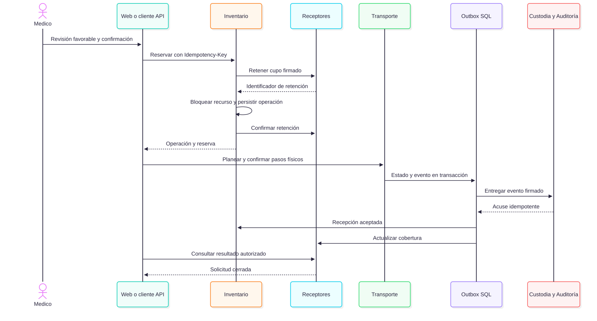
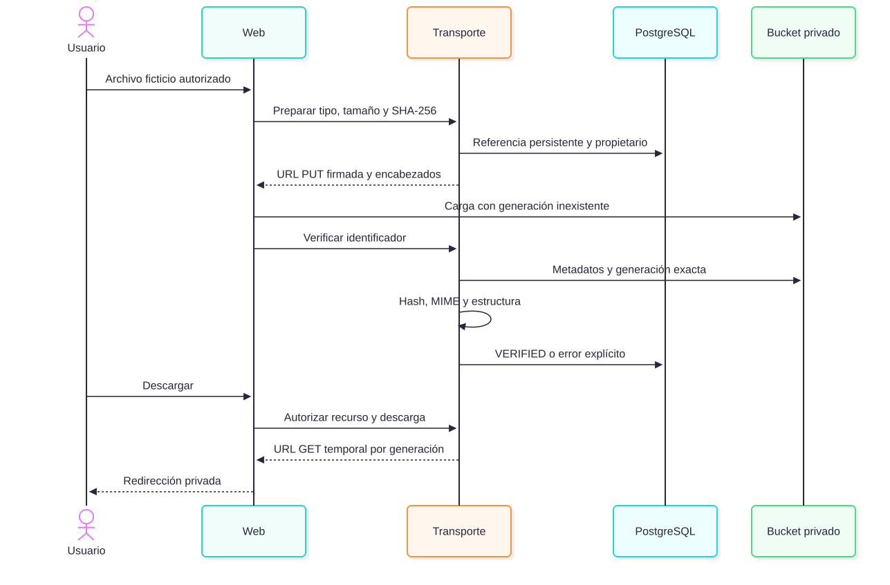

# Red House: documento técnico del segundo parcial

Proyecto 6, equipo 01. Entrega prevista: 22 de octubre de 2026. Edición de implementación 0.3.0. Las referencias a evidencia apuntan a archivos ejecutados y conservados; los ejemplos de contratos se identifican por separado.

Actualización del 20 de octubre: las sesiones técnicas del portal usan Redis y las revocaciones pendientes PostgreSQL. Las mediciones integrales del 19 de octubre se conservan como antecedentes; la nueva [validación de sesiones](../evidencias/sesiones-redis/RESULTADOS.md) documenta esta sustitución, su migración y sus pruebas.

## 1. Resumen ejecutivo y problema

Red House coordina una red regional de bancos de sangre e instituciones participantes. Una institución registra recursos disponibles y otra solicita su traslado; el sistema conserva quién registró, evaluó, autorizó, reservó, transportó y recibió cada recurso. El problema operativo es la dispersión de información, las reservas concurrentes, la pérdida de trazabilidad y la dificultad para distinguir disponibilidad real de información desactualizada.

La entrega integra un portal Flask/Jinja2, diez servicios de dominio y un servicio de Monitoreo. PostgreSQL conserva la información transaccional en una base compartida con permisos separados. Redis participa en cada petición protegida. MongoDB conserva eventos, telemetría y proyecciones documentales. Google Cloud Storage almacena evidencias privadas. Docker proporciona un entorno separado del entorno habitual, con dos instancias por API y un gateway.

El portal incorpora su propio backend modular. Ejecuta los mismos módulos versionados de aplicación que se empaquetan en los servicios, con las mismas validaciones, autorización y persistencia. Por ello puede ejecutar operaciones cuando las API están detenidas. Los futuros clientes Android y escritorio utilizarán exclusivamente las API con JSON y XML, respectivamente; su implementación está fuera de este parcial.

Este es un sistema académico de coordinación y apoyo. La elegibilidad, compatibilidad clínica, conservación, asignación y trasplante requieren valoración y autorización profesional. Un resultado del algoritmo no constituye autorización clínica. Los datos de las pruebas son ficticios.

## 2. Objetivos, alcance y actores

El objetivo general es ejecutar y demostrar procesos regionales trazables, con seguridad común, persistencia real y continuidad ante la caída de una instancia de aplicación.

Los objetivos específicos son conservar registros de donantes y receptores; controlar inventario y solicitudes; obtener candidatos explicables; registrar revisión humana; impedir reservas duplicadas; coordinar traslado y recepción; conservar custodia, notificaciones y auditoría; demostrar contratos JSON/XML; y reproducir el despliegue con contenedores y secretos externos.

| Actor | Responsabilidad implementada | Restricción principal |
| --- | --- | --- |
| Administrador | Usuarios, instituciones y catálogos autorizados | Administrar cuentas no concede acceso clínico general |
| Médico | Receptores, solicitudes, dictámenes, liberación y reserva | Ámbito institucional, versión de registro y confirmación humana |
| Operador de banco | Registro de recursos, donaciones, preparación y recepción | Institución participante en el recurso o traslado |
| Coordinador regional | Rutas, planeación, seguimiento y panel regional | Región asignada; no sustituye dictamen médico |
| Transportista | Recolección, traslado, entrega y ubicación | Solo traslados asignados y estados autorizados |
| Auditor | Historial minimizado y monitoreo | Región y perfil; no modifica eventos |
| Donante | Registro preliminar, campañas, citas y avisos propios | Acceso a su cuenta y expediente autorizado |

La implementación distingue sangre y órganos mediante tipos, componentes, estados y reglas de evaluación. No interpreta HLA ni decide aptitud clínica. No implementa Android ni escritorio. La recuperación automatizada de contraseña, email/push, agenda detallada por sede/hora y reportes regulatorios certificados continúan pendientes. La ayuda de acceso y la exportación CSV de una página no se presentan como esas funciones.

## 3. Correcciones y trazabilidad

Las correcciones siguientes se comprueban en código y pruebas. No se atribuyen al docente observaciones que el equipo no proporcionó.

| Situación anterior | Cambio del segundo parcial | Criterio verificable |
| --- | --- | --- |
| Portal dependiente de HTTP para todo el negocio | Backend modular propio seleccionado al configurar el portal | Sangre y órganos con todas las API detenidas |
| Una instancia por API | Dos instancias de cada propietario, incluida Identidad, con workers | JSON/XML y flujo completo con las instancias A detenidas |
| Persistencia separada por servicio en antecedentes | Base `red_house`, 71 tablas y vistas `access_*` | Esquema físico, permisos y pruebas de la base compartida |
| Infraestructura sin Compose | Dockerfiles propios, redes, volúmenes, secretos e inicializador | Construcción, arranque, reinicio y recreación de instancias |
| MongoDB con eventos inmutables | Proyección mutable de seguimiento, versionada y reconstruible | Actualización, duplicados, desorden, reconstrucción e índice |
| Adaptador de archivos sin flujo web completo | Selección, carga, verificación, estados y descarga privada | Prueba con bucket real, archivo inválido y URL expirada |
| Ejemplos estáticos de API | Captura optativa de solicitudes ejecutadas y verificación de persistencia | Inventario y expediente HTTP con fecha, versión y correlación |

| ID | Requisito comprometido | Implementación / evidencia |
| --- | --- | --- |
| RF-01 | Identidad, sesión y administración | `ms_identidad_acceso`; pruebas de seguridad y administración web |
| RF-02 | Donantes, campañas, citas y procesamiento | `ms_donantes`; flujo de donación/procesamiento |
| RF-03 | Receptores y solicitudes | `ms_receptores`; retenciones y cierre por recepción |
| RF-04 | Inventario, disponibilidad y reservas | `ms_inventario`; concurrencia, idempotencia y recuperación |
| RF-05 | Evaluación y dictamen humano | `ms_compatibilidad`; entradas y versiones conservadas |
| RF-06 | Rutas, ranking y propuesta | `ms_priorizacion_geografia`; pruebas de matching y límites |
| RF-07 | Traslado, ubicación y recepción | `ms_transporte`; flujo integrado y autorización por responsable |
| RF-08 | Cadena de custodia | `ms_custodia`; orden, deduplicación y verificación de hashes |
| RF-09 | Avisos y auditoría | `ms_alertas`, `ms_auditoria`; outbox, inbox y consulta autorizada |
| RF-10 | Monitoreo y degradación | `servicio_monitoreo`; sondeos y pipelines documentales |
| RF-11 | Archivos privados | Transporte, formulario web y GCS; pruebas de archivos reales |
| RNF-01 | Autorización uniforme | RS256, Redis, permisos por rol/institución/recurso |
| RNF-02 | Continuidad | Backend propio web, dos instancias por API, workers idempotentes |
| RNF-03 | Contratos interoperables | OpenAPI, DTO JSON, XML/XSD, errores uniformes |
| RNF-04 | Reproducibilidad | `deployment/README.md`, Compose y secretos generados |
| RNF-05 | Recuperación y trazabilidad | Operaciones persistentes, correlación, auditoría y pruebas de fallos |

La [matriz de cierre](Cierre_segundo_parcial.md) determina qué criterios tienen evidencia final y cuáles conservan limitaciones. Las cifras históricas no se suman a las pruebas nuevas.

## 4. Arquitectura y continuidad

El navegador consume HTML y formularios del portal. El módulo de integración traduce cada operación a un contrato de aplicación. En modo `monolith`, `ApplicationKernel` ejecuta los módulos Flask mediante WSGI dentro del proceso, sin abrir listeners internos. El mismo controlador valida entradas, JWT, permisos Redis, reglas y transacciones. Las llamadas internas conservan firma de servicio y delegación del usuario. El modo HTTP se conserva como configuración explícita para pruebas y entornos anteriores; no es un fallback automático.

Cada módulo accede a PostgreSQL con su propia credencial limitada. El portal es una aplicación backend autorizada, no un cliente móvil con acceso directo a bases. Los microservicios no dependen de las vistas, plantillas ni sesiones privadas del portal. Las imágenes de dominio contienen únicamente su módulo y la biblioteca común; cada imagen puede actualizarse de forma individual.

La reutilización se fija mediante versión 0.3.0 y hashes de fuente en la evidencia. Una actualización de una API no modifica el código ya cargado en el portal. La compatibilidad de contratos y migraciones se debe conservar durante el despliegue gradual.

Nginx descubre dos destinos por servicio mediante DNS Docker. Hay redundancia para Identidad y los otros diez propietarios. Cada instancia supervisa su API y su worker. La web ejecuta sus propios workers de todos los dominios. Los workers comparten colas SQL con bloqueo `FOR UPDATE SKIP LOCKED`; los consumidores deduplican eventos. La proyección MongoDB también admite duplicados y orden de entrega diferente.

El gateway reintenta conexiones fallidas sin habilitar `non_idempotent`. Una respuesta perdida después de enviar una escritura tiene resultado incierto. El cliente conserva `Idempotency-Key`, consulta la operación y repite con la misma clave solo según su contrato. No cambia a otro backend después de escribir. Reservas y retenciones tienen identidad persistente y recuperación explícita.

| Fallo | Portal modular | Clientes API | Recuperación |
| --- | --- | --- | --- |
| Una API o su worker | Opera con backend y workers propios | Instancia restante atiende el flujo | Reinicio supervisado y DNS |
| Todas las API de un servicio | Opera si sus dependencias de datos siguen disponibles | Fallan operaciones que requieren ese propietario | Restablecer instancia; consultar estado antes de repetir |
| Redis | Rechazo de operaciones protegidas | Igual | Restablecer Redis y verificar sesión; no omitir seguridad |
| PostgreSQL | Operaciones transaccionales indisponibles | Igual | Restablecer base y recuperar coordinaciones pendientes |
| MongoDB | Outbox SQL conserva eventos; consulta documental degradada | Igual | Reintento idempotente y reconstrucción de proyección |
| GCS | Funciones sin archivo disponibles; evidencia pendiente/error | Igual | Consultar estado y verificar objeto existente |
| Gateway | Portal modular continúa | API externa indisponible | Restaurar gateway; no hay réplica de gateway en este alcance |
| Host Docker | Entorno indisponible | Entorno indisponible | Restaurar host, volúmenes y secretos |

Dos contenedores en un host no equivalen a alta disponibilidad multizona. PostgreSQL, Redis, MongoDB, gateway y el host siguen siendo puntos únicos de infraestructura. Los resultados de disponibilidad se limitan al fallo de instancia comprobado.

## 5. Procesos integrados

### Sangre y órganos

El origen registra un recurso y un médico lo libera con confirmación y motivo. El destino registra receptor y solicitud. Compatibilidad conserva la evaluación, candidatos, exclusiones, ruta y versiones de reglas. El médico dicta favorable o desfavorable para cada candidato. Priorización presenta un orden operativo explicable; la propuesta no reserva automáticamente.

Inventario crea una operación, solicita retención de capacidad a Receptores y bloquea el recurso. Las claves e índices impiden reservar dos veces el mismo recurso o cubrir en exceso una solicitud. Una confirmación pendiente se recupera; no se interpreta un timeout como ausencia de efecto.

Coordinación planea el traslado con ruta y responsable. Origen prepara, transportista recoge, transporta y entrega, y destino acepta. Cada paso exige estado y versión compatibles, perfil autorizado y confirmación humana. La recepción actualiza inventario y cobertura de solicitud mediante eventos durables. Custodia conserva secuencia y hashes; Alertas y Auditoría reciben el mismo contexto de correlación minimizado.

Para sangre RBC se conserva la regla documentada `RBC-1.0`. Para órganos, `ORGAN-1.0` es una preselección académica por tipo y ABO idéntico, sin interpretación HLA. Los tres tipos de órgano existentes conservan pruebas separadas. No se infieren equivalencias entre sus ciclos clínicos.

### Donación y procesamiento

Se registra el donante con consentimiento. Un médico documenta elegibilidad humana. La campaña define capacidad; la cita se registra transaccionalmente y no puede excederla. La donación conserva tipo, componente, fecha y confirmación. El operador registra procesamiento. Un recurso de inventario puede vincular su origen a esa donación, conservando trazabilidad; la aceptación de un formulario no certifica aptitud clínica.

### Archivos de un traslado

El usuario autorizado selecciona PNG, JPEG o PDF de hasta 10 MiB. El portal calcula hash y prepara el registro en Transporte. El backend autoriza la asociación con el traslado, persiste la referencia y firma una carga de creación exclusiva. El encabezado firmado `x-goog-if-generation-match: 0` evita sobrescribir un objeto existente.

Después de cargar, el servicio consulta metadatos y descarga la generación exacta para comprobar tamaño, SHA-256, tipo y estructura. Se limitan dimensiones de imágenes y páginas de PDF; se rechazan PDFs cifrados y mecanismos activos detectados. Esta validación estructural no sustituye un antivirus ni una política clínica de retención.

Los estados distinguen registro preparado, verificado, rechazado, ausente y error. Una descarga requiere autorización por recurso y estado verificado; se entrega una URL firmada temporal ligada a la generación. El bucket bloquea acceso público y no almacena datos reales de pacientes en estas pruebas.

## 6. Persistencia y modelo físico

### PostgreSQL

La base `red_house` conserva 71 tablas físicas en el esquema del dominio y una tabla técnica del portal en `web_runtime`, 72 en total. Deriva del esquema fijado de main y las ampliaciones descritas en [Esquema compartido](Esquema_compartido.md). Las vistas `access_<servicio>` adaptan los nombres del contrato sin duplicar registros. Cada credencial de ejecución dispone de permisos únicamente sobre su ámbito. El propietario estructural no inicia sesión. Los usuarios de aplicación no reciben acceso administrativo a las tablas físicas.

El [catálogo físico completo](../segundo-parcial/Modelo_fisico.md) se genera desde `pg_catalog` e `information_schema`: columnas, tipos, obligatoriedad, valores predeterminados, claves, restricciones e índices. Incluye tablas conservadas como antecedente que las API no escriben; su existencia no se confunde con una función terminada. El archivo JSON de metadatos permite contrastar el catálogo con la base instalada.

Las tablas `service_*` incluyen propietario en su clave. Las vistas de outbox, inbox, decisiones, idempotencia, actividad y latido filtran ese propietario. Las funciones privilegiadas usan objetos calificados y `search_path` restringido. Los historiales mantienen prohibición de actualización/eliminación para las credenciales de ejecución.

El SQL de instalación se aplica explícitamente a una base vacía. Arrancar una API no destruye ni reconstruye tablas. Las migraciones de entornos anteriores, sus respaldos y la comparación histórica de filas permanecen documentados; el entorno habitual no se usa para fallos destructivos de esta entrega.

### MongoDB

Transporte, Custodia, Auditoría y Monitoreo tienen bases documentales y credenciales propias. Los eventos se insertan por identificador estable. La entrega mediante outbox admite reintentos; una repetición con contenido distinto se rechaza. Los eventos de auditoría y custodia permanecen inmutables.

`rh_transporte.shipment_tracking` es una proyección mutable propiedad de Transporte. Su `_id` es el identificador del traslado PostgreSQL. Conserva `schema_version`, versión de secuencia, región, instituciones, transportista, reserva, último estado observado e identificador/fecha del evento. El evento de mayor secuencia reemplaza la proyección; uno anterior no la degrada. Una colisión de igual versión con distinto evento es conflicto. El campo `last_state` describe el último evento y no pretende sustituir la autoridad transaccional.

La migración documental crea índices `regional_state` y `shipment_sequence`. Las credenciales pueden actualizar la proyección, pero no los eventos. La reconstrucción recorre los eventos existentes sin editarlos. Las pruebas verifican inserción, consulta, actualización, filtro, pipeline, repetición, desorden, reconstrucción, permisos y un plan `explain` que utiliza el índice regional.

Monitoreo conserva sondeos con fuente, fecha, estado, tiempo, versión, dependencia y error. Sus pipelines calculan estado e historial. Primero intenta conservar cada sondeo en MongoDB y después en SQL; el endpoint puede consultar MongoDB si PostgreSQL falla, siempre que Redis permita autorizar al usuario. No promete conservación íntegra si ambos almacenes están caídos.

### Redis

Redis mantiene sesiones activas, renovaciones, revocaciones, permisos versionados, contadores de consumo y datos temporales. Las ACL y prefijos delimitan acceso por servicio. JWT contiene identidad y ámbito, pero cada petición protegida comprueba el estado de sesión y autorización en Redis.

Los tokens de acceso duran 900 segundos; renovación, 86400 segundos en la configuración base. La renovación rota su secreto; reutilizar una renovación revoca la familia. Logout elimina credenciales del navegador y revoca la sesión. La web conserva tokens cifrados en Redis con TTL máximo de 86400 segundos y una ACL propia; la cookie contiene un identificador opaco. Las concesiones de renovación duran 60 segundos y se liberan solo por su propietario. PostgreSQL conserva cierres y revocaciones pendientes en `web_runtime.session_revocations`: una tabla técnica adicional a las 71 del dominio, 72 entre ambos esquemas. El cierre se registra antes de eliminar credenciales Redis; ante una caída de Redis, el worker completa la revocación después de recuperarse. Las marcas de cierre se conservan hasta 24 horas e impiden reutilizar una cookie antigua. Si PostgreSQL falla, la web deniega acceso protegido y logout elimina la cookie pero informa 503 al no poder confirmar el cierre global.

La caché de consultas autorizadas tiene TTL breve, incluye ámbito y revisión de datos. No se utiliza para decidir una reserva. Los bloqueos SQL y las restricciones únicas protegen el compromiso final. Rate limiting es compartido entre réplicas mediante Redis; detener una réplica no reinicia los contadores.

En la tabla siguiente, `P` representa el prefijo configurado mediante `REDIS_PREFIX`; los identificadores son variables del contrato, no credenciales publicadas.

| Clave después de `P` | Contenido y finalidad | Expiración vigente |
| --- | --- | --- |
| `session:<sid>` | Usuario y vencimiento de la familia activa | 86400 s desde login; se elimina al revocar |
| `refresh:<sha256>` | Identificador de sesión asociado al secreto de renovación | Tiempo restante de la familia; rota sin extender su duración |
| `used_refresh:<sha256>` | Detecta reutilización y permite revocar la familia | Tiempo restante al rotar; la revocación explícita conserva marcador 86400 s |
| `permissions:<user>` | Perfil, ámbito, estado y versión autorizados | 86400 s; se vuelve a publicar al autenticar/renovar |
| `permission_version:<user>` | Revisión vigente que invalida permisos anteriores | Sin TTL; cambia al modificar la cuenta |
| `web:session:<sha256-cookie>` | Credenciales cifradas del portal; ACL exclusiva | Hasta 86400 s |
| `web:renewal:<sha256-cookie>` | Concesión de renovación concurrente, dueño verificado | 60 s |
| `revoked:<jti>` | Revocación del JWT presentado al cerrar sesión | Segundos restantes del token, mínimo 1 s |
| `login_fail:<sha256>` | Contador de accesos fallidos; bloquea desde cinco intentos | 300 s desde el último intento contabilizado |
| `limit:<service>:<category>:<scope>:<minute>` | Contador atómico compartido de consumo | 61 s |
| `nonce:<receiver>:<caller>:<nonce>` | Rechaza repetición de una firma interna | 65 s; firma admite desfase máximo de 30 s |
| `cache:<service>:read:<sha256>` | Respuesta ligada a usuario, ámbito, filtros y revisión SQL | Inventario 10/15 s; catálogos 30 s |

Las evidencias de login, renovación y revocación conservan comprobaciones SQL y de existencia/TTL Redis. Las pruebas adicionales verifican caché, límites, nonce repetido y denegación durante caída de Redis.

### Google Cloud Storage

El proyecto autorizado es `sistemas-integracion-01`. El bucket `red-house-evidencias-sistemas-integracion-01` usa Standard, `us-central1`, acceso uniforme y prevención de acceso público. La cuenta `red-house-archivos` recibió permisos de objetos limitados a ese bucket; la firma del usuario se limita a esa cuenta. Se utilizan credenciales impersonadas, sin descargar claves privadas de servicio.

PostgreSQL conserva identificador, traslado, propietario, ruta, MIME, tamaño, hash, generación y estado. Los archivos no se insertan en las bases. La prueba elimina únicamente sus objetos ficticios identificados; no vacía el bucket. Retención clínica, borrado de expedientes reales, antimalware y operación productiva requieren decisiones posteriores.

## 7. Servicios, contratos y comunicación

Las [fichas individuales](../segundo-parcial/Fichas_microservicios.md) detallan propósito, dependencias, persistencia, endpoints, puertos, permisos, pruebas y artefactos de cada propietario. El [expediente HTTP](../evidencias/segundo-parcial/http/index.html) es navegable y distingue peticiones reales HTTP de invocaciones WSGI del monolito.

Todos los servicios usan Python/Flask, contratos `/api/v1` y endpoints internos `/internal/v1`. Las respuestas externas ofrecen JSON o XML mediante `Accept`; el formato de entrada se determina con `Content-Type`. Los esquemas XSD validan estructura, cardinalidad y tipos, con entidades externas y DTD deshabilitados. El XML de respuesta utiliza el contrato tipado versionado; no se concatena XML con entradas sin escape.

El sobre satisfactorio contiene `data` y `meta`; el error contiene `error.code`, `error.message`, detalles permitidos y correlación. Las entradas se validan con modelos explícitos. Paginación y filtros rechazan campos o valores fuera de contrato. Los DTO de salida minimizan datos y excluyen credenciales. Los códigos distinguen validación, ausencia, autenticación, autorización, conflicto, límite y dependencia inaccesible.

Las llamadas internas exigen firma Ed25519 del servicio, marca temporal y nonce. Las llamadas con delegación conservan JWT del usuario. La autorización interna limita qué propietario puede invocar cada operación. Ni una ruta interna ni una dirección de red sustituyen esa autenticación.

Swagger se sirve en `/docs/`, con OpenAPI y ejemplos de entrada/salida, incluidos errores. Los ejemplos generados ayudan a construir solicitudes; únicamente el expediente de ejecución demuestra que se realizaron. Las capturas muestran resultados ejecutados y redactados, con acceso al JSON completo y persistencia asociada.

## 8. Seguridad y consistencia

Las contraseñas usan scrypt; no se conservan en texto plano. JWT acepta RS256, emisor y audiencia definidos, expiración y claims requeridos. Redis permite invalidar una sesión aunque el JWT todavía esté firmado y vigente. La autorización combina perfil, región, institución y relación con el recurso.

Los formularios web aplican CSRF, cookies de sesión y validación en servidor. Los archivos se validan antes de publicarse como verificados. SQL usa parámetros/ORM del controlador; las firmas internas y XML tienen defensas específicas contra repetición y XXE. Los errores no revelan DSN, SQL, claves o trazas al usuario.

Cada cambio conserva motivo, actor, correlación y evento local cuando corresponde. El evento se escribe junto con la transacción de negocio. Outbox desacopla su entrega a auditoría, alertas y proyecciones. Inbox deduplica por identificador y huella del contenido. Una caída posterior al commit no elimina el hecho persistido.

La evidencia HTTP es optativa y solo se habilita sobre datos ficticios. Redacta contraseñas, tokens, cookies, firmas y URLs privadas. Nunca se habilita por defecto en una instalación operativa. Los archivos `.local`, ADC y secretos quedan fuera de Git y del contexto Docker.

El Compose publica puertos solo en loopback para demostración local. No representa un despliegue público cifrado ni la certificación normativa de una plataforma clínica. Un despliegue externo requiere TLS, políticas de acceso/red, gestión de secretos y revisión regulatoria.

## 9. Algoritmos

La evaluación conserva reglas, versiones y exclusiones. El ranking operativo explica sus factores y no presenta ponderaciones médicas inventadas. La propuesta de balance utiliza matching bipartito Hopcroft–Karp: solicitudes/cupos en un lado, recursos candidatos en el otro; BFS identifica capas y DFS recorre caminos aumentantes. Su complejidad teórica es O(E√V) para el grafo representado.

El matching puede encontrar una cobertura mayor que una elección voraz cuando una solicitud admite varios recursos y otra solo uno. La salida es una propuesta; no modifica inventario ni reemplaza autorizaciones. Las pruebas comparan casos restrictivos, propuestas y ausencia de reservas automáticas. Problema, pseudocódigo, casos y límites adicionales están en [Algoritmos](Algoritmos.md).

Las mediciones anteriores de volumen y Locust se conservan como antecedentes identificados por fecha. No se atribuyen al código 0.3.0 sin repetición. La prueba de continuidad con carga moderada no equivale a carga sostenida, estrés o capacidad productiva certificada.

## 10. Instalación, operación y recuperación

El procedimiento ejecutable está en [deployment/README.md](../../deployment/README.md). Requiere Docker Compose v2 y Python para preparar secretos. El instalador genera contraseñas, claves de firma y configuraciones privadas; crea la base compartida, ACL, usuarios documentales y 14 cuentas ficticias. Una repetición verifica versión y aplica únicamente la migración documental aditiva.

El ensayo desde una instantánea Git local clonada aprobó ocho etapas: preparación, construcción del instalador, arranque de almacenes, bootstrap, construcción de aplicaciones, arranque de 27 contenedores saludables, flujo de sangre con consultas JSON/XML de los once propietarios y repetición del bootstrap. Empleó secretos y volúmenes nuevos. El primer intento tuvo un fallo DNS del registro de imágenes; se conserva junto a la repetición aprobada. La [evidencia del clon](../evidencias/segundo-parcial/clean-clone.json) identifica la instantánea y los resultados.

El portal local Docker está en `http://127.0.0.1:6050`; gateway API en 6101–6111. PostgreSQL, Redis y MongoDB no publican puertos. La red `data` es interna. El acceso externo se limita a componentes que requieren GCS y al gateway/portal. Las aplicaciones se ejecutan sin privilegios, con sistema de archivos de solo lectura y áreas temporales explícitas.

Liveness comprueba el proceso. Readiness verifica dependencias aplicables y versión de esquema. El health check de cada contenedor verifica además el latido de su propio worker para que el latido de otra réplica no oculte su fallo. Los logs incluyen servicio, ruta, estado, tiempo y correlación, sin cuerpo ni credenciales.

El arranque se realiza por pares de réplicas, empezando por los consumidores de eventos, para permitir el drenaje de colas conservadas. El sondeo Docker usa un proceso Python mínimo, sin cargar paquetes de la aplicación. Las conexiones PostgreSQL se reutilizan en pools acotados por aplicación, credencial y esquema; un fallo no provoca la repetición automática de una escritura.

Una actualización compatible reemplaza primero A, espera salud y ejecuta una operación, después B. No se aplican cambios destructivos de esquema en el arranque. Cambiar contratos o persistencia requiere una migración planificada con compatibilidad temporal y respaldo. Recrear la misma versión prueba el mecanismo; no demuestra compatibilidad con una migración futura desconocida.

El ensayo final reemplazó ambas imágenes de Inventario por un ID distinto. Las 100 consultas continuas respondieron 200 y se verificó un alta SQL después de cada sustitución. La versión contractual permaneció en 0.3.0; esa prueba acredita la actualización compatible de este incremento.

El respaldo debe conservar PostgreSQL, documentos MongoDB, persistencia/ACL Redis, configuración privada, claves y sesiones web, además de los objetos GCS según su política. Restaurar solo tablas sin las claves o las colas puede dejar referencias y sesiones incoherentes. El procedimiento de respaldo y restauración aislada se detalla en la guía; los archivos con datos y secretos no forman parte del expediente público.

La restauración comprobada conserva 15 122 filas de 71 tablas, 7 632 documentos, cinco usuarios y cuatro roles MongoDB mediante conteos y hashes idénticos. Redis recuperó la clave de prueba con TTL de 3575 s. Se restauró en motores nuevos sin puertos publicados. Las generaciones GCS no se copian en ese respaldo local y deben conservarse en el bucket.

## 11. Pruebas, evidencia y criterios de aceptación

La suite usa PostgreSQL, MongoDB y Redis temporales, separados del entorno habitual. Los tests de contratos ejercitan JSON/XML/XSD, autenticación, autorización, expiración, renovación, revocación, errores, concurrencia, idempotencia, recuperación y permisos de almacenamiento. Los tests de continuidad detienen listeners HTTP y ejecutan sangre, órganos y procesamiento mediante el backend web autónomo.

Las pruebas Docker ejecutan operaciones de negocio a través del gateway; detienen las instancias A de los once propietarios, comprueban lectura JSON/XML y flujo de órganos, detienen todas las API para ejecutar flujos web, recrean réplicas secuencialmente y reinician las bases para comparar registros. Una página pública o un health check por sí solos no satisfacen esos criterios.

La prueba GCS usa el bucket autorizado, carga y descarga un PNG ficticio, comprueba metadatos SQL, rechazo de acceso público, autorización por traslado, objeto ausente, MIME/contenido inválido, prohibición de sobreescritura, firma expirada y degradación/recuperación. No utiliza URLs fabricadas.

Los resultados finales y sus tiempos se incorporan en [Resultados de validación](../evidencias/segundo-parcial/RESULTADOS.md). Ese registro conserva esperado, obtenido y diagnóstico. Los límites de espera no se aumentan para ocultar un fallo. Una repetición posterior se identifica y no borra el resultado fallido previo.

La regresión final aprobó 182 pruebas, sin fallos ni omisiones, en 2005.90 s. Una prueba complementaria posterior aprobó en 36.08 s los errores de negociación y las conexiones fallidas/recuperadas de salud para los once propietarios. Docker aprobó nueve comprobaciones operativas. Chrome verificó 20 páginas de siete perfiles, las series Highcharts frente a sus datos del servidor, ancho 390 sin desbordamiento, una carga privada verificada y una consulta Swagger real.

El inventario final contiene 284 métodos/rutas con éxito HTTP y captura. Hay errores ejecutados para 240; las 44 rutas restantes sirven documentación fija y tienen una justificación explícita de no aplicabilidad de error de dominio. Todas las escrituras capturadas incluyen comprobación de persistencia. Estos números se obtienen del manifiesto de cobertura y no se fijan como contrato de futuras versiones.

La captura automática inventaría los métodos y rutas reales de cada aplicación. Cada registro incluye objetivo, URL, parámetros, headers redactados, petición, respuesta, código, fecha, versión, correlación, transporte y hash de implementación. Las escrituras idempotentes se vinculan a una consulta del resultado comprometido en PostgreSQL. Las operaciones sin ese registro requieren la evidencia de flujo o de su almacén específico; el informe de cobertura señala las brechas en lugar de fabricar ejemplos.

## 12. Presentación y trabajo pendiente

El [guion de demostración](../../stuff/presentacion/Guion_segundo_parcial.md) organiza responsabilidades y pasos reproducibles. No asigna nombres ni inventa participación. Incluye explicación del problema, arquitectura, flujo completo, JSON/XML, Swagger, Redis, MongoDB, archivos, Docker y fallos. El equipo completará reparto de participación, ensayo, grabación y publicación de YouTube.

La entrega académica completa requiere presentación presencial de todos los integrantes y un video accesible. Preparar el guion y los artefactos no acredita esos requisitos externos. Tampoco acredita validación clínica, operación productiva, pruebas de infraestructura multizona o certificación normativa.

## 13. Fuentes técnicas

- [Reintentos y upstream de Nginx](https://nginx.org/en/docs/http/ngx_http_proxy_module.html#proxy_next_upstream): distingue reintento de conexión y operaciones no idempotentes.
- [Redes y DNS de Docker Compose](https://docs.docker.com/compose/how-tos/networking/): descubrimiento de servicios y recreación de contenedores.
- [Roles IAM de Cloud Storage](https://docs.cloud.google.com/storage/docs/access-control/iam-roles): alcance de permisos sobre objetos.
- [Firmas de URLs de Cloud Storage](https://docs.cloud.google.com/storage/docs/access-control/signing-urls-with-helpers): acceso temporal a objetos privados.
- [Enunciado y matriz de ejecución](Cierre_segundo_parcial.md), [reglas del proyecto](Reglas_de_negocio.md) y [modelo compartido](Esquema_compartido.md): fuentes internas de alcance y trazabilidad.
